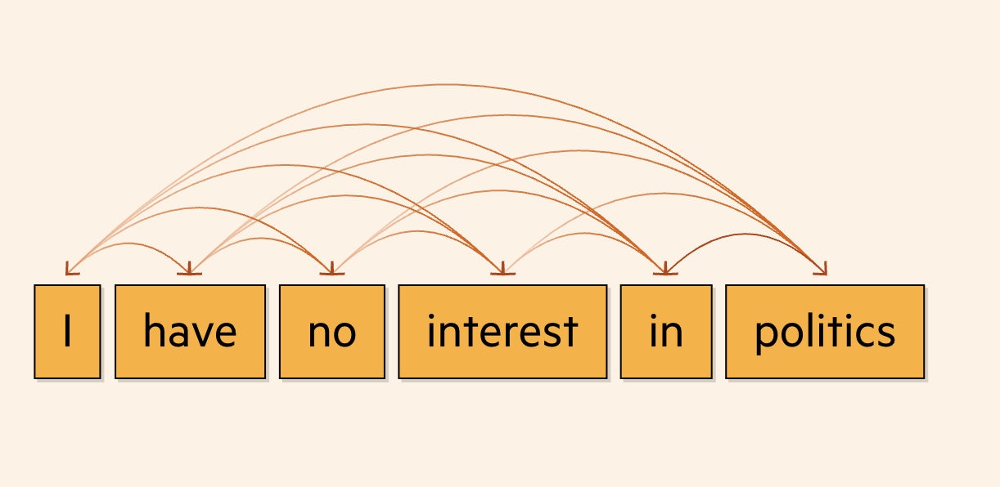
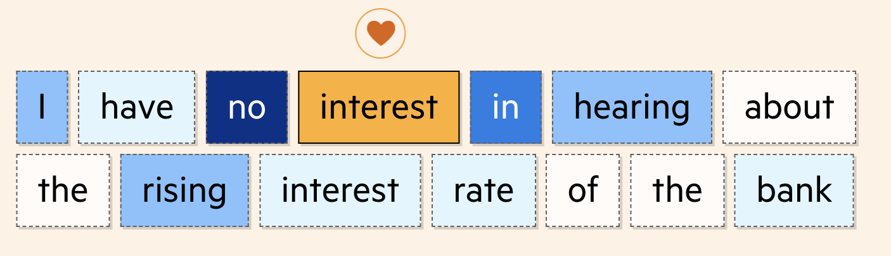
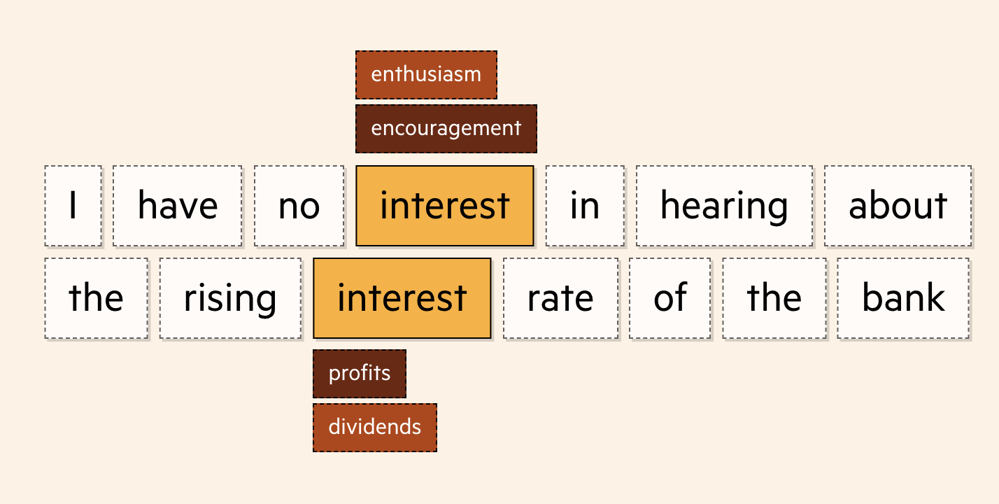
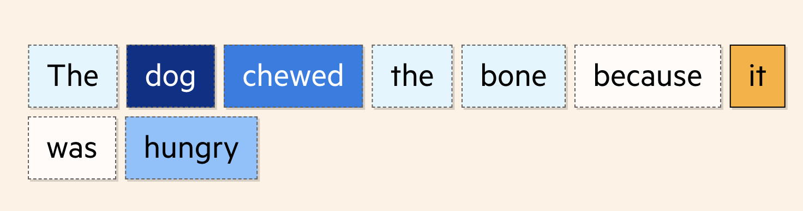
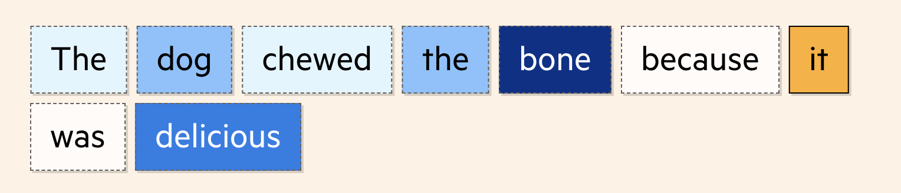
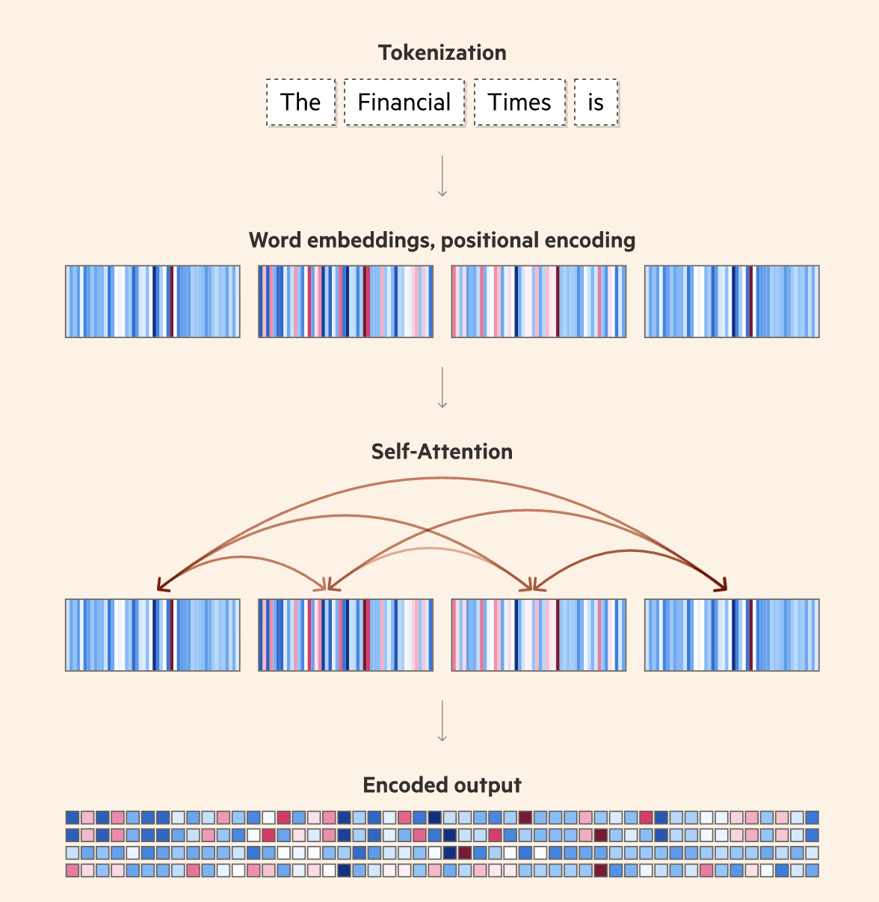
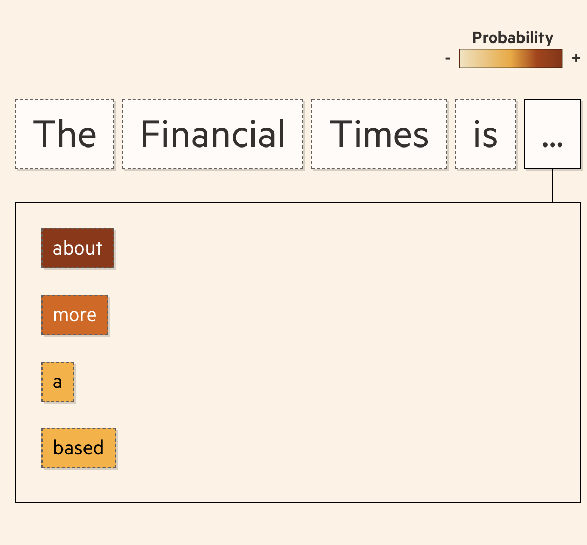
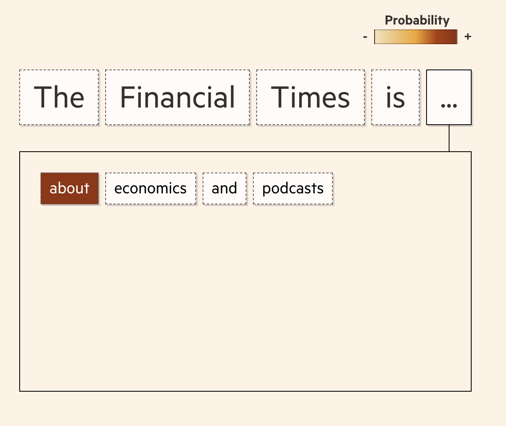
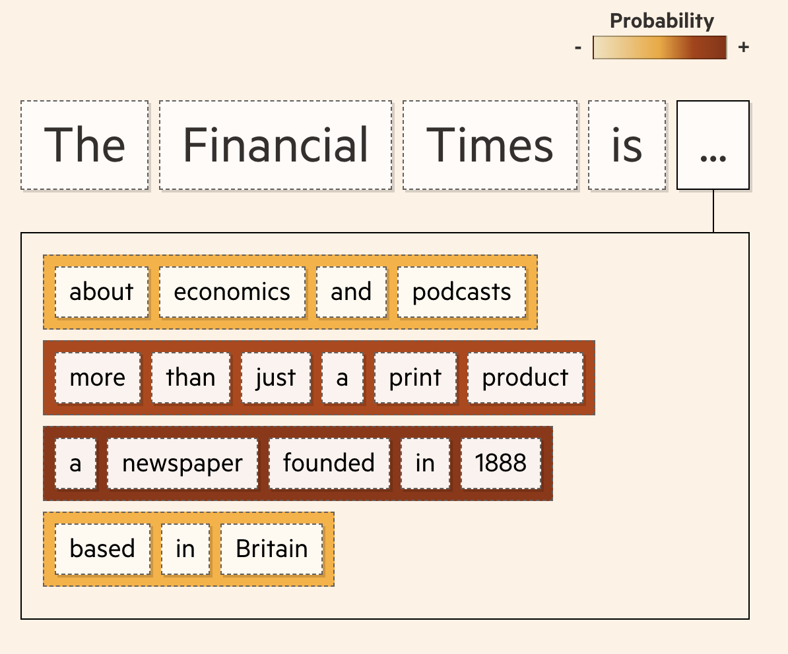

# Article: Generative AI exists because of the transformer

To write text, LLMs must first translate words into a language they understand.

First a block of words is broken into tokens — basic units that can be encoded. Tokens often represent fractions of words, but we’ll turn each full word into a token.

In order to grasp a word’s meaning, "work" in our example, LLMs first observe it in context using enormous sets of training data, taking note of nearby words. These datasets are based on collating text published on the internet, with new LLMs trained using billions of words.

Eventually, we end up with a huge set of the words found alongside work in the training data, as well as those that weren’t found near it.

As the model processes this set of words, it produces a vector — or list of values — and adjusts it based on each word’s proximity to work in the training data. This vector is known as a word embedding.

A word embedding can have hundreds of values, each representing a different aspect of a word’s meaning. Just as you might describe a house by its characteristics — type, location, bedrooms, bathrooms, storeys — the values in an embedding quantify a word’s linguistic features.

The way these characteristics are derived means we don’t know exactly what each value represents, but words we expect to be used in comparable ways often have similar-looking embeddings.

--> note: This called static word embedding model (like Word2Vec or GloVe) and it's old. In modern LLMs, a word does not have a single fixed vector. Instead, it has multiple contextual vectors. Modern models generate a unique vector for a word every time it appears in a sentence, based on the words around it.

We might spot clusters of pronouns, or modes of transportation, and being able to quantify words in this way is the first step in a model generating text.

But this alone is not what makes LLMs so clever. What unlocked their abilities to parse and write as fluently as they do today is a tool called the transformer, which radically sped up and augmented how computers understood language.

Transformers process an entire sequence at once — be that a sentence, paragraph or an entire article — analysing all its parts and not just individual words.

This allows the software to capture context and patterns better, and to translate — or generate — text more accurately. This simultaneous processing also makes LLMs much faster to train, in turn improving their efficiency and ability to scale.

Research outlining the transformer model was first [published](https://ai.googleblog.com/2017/08/transformer-novel-neural-network.html) by a group of [eight AI researchers at Google in June 2017](https://www.ft.com/content/37bb01af-ee46-4483-982f-ef3921436a50). Their 11-page research paper marked the start of the generative AI era.

A key concept of the transformer architecture is self-attention. This is what allows LLMs to understand relationships between words.

Self-attention looks at each token in a body of text and decides which others are most important to understanding its meaning.

Before transformers, the state of the art AI translation methods were recurrent neural networks (RNNs), which scanned each word in a sentence and processed it sequentially.

With self-attention, the transformer computes all the words in a sentence at the same time. Capturing this context gives LLMs far more sophisticated capabilities to parse language.  

In this example, assessing the whole sentence at once means the transformer is able to understand that interest is being used as a noun to explain an individual’s take on politics.

If we tweak the sentence . . . The bank’s interest rate rises  
. . . the model understands interest is now being used in a financial sense.

And when we combine the sentences, the model is still able to recognise the correct meaning of each word thanks to the attention it gives the accompanying text.  
  
For the first use of interest, it is no and in that are most attended. For the second, it is rate and bank.

  
This functionality is crucial for advanced text generation. Without it, words that can be interchangeable in some contexts but not others can be used incorrectly.

In the following sentence, self-attention is able to calculate that it is most likely to be referring to dog.  

And if we alter the sentence, swapping hungry for delicious, the model is able to recalculate, with it now most likely to refer to bone.  

The benefits of self-attention for language processing increase the more you scale things up. It allows LLMs to take context from beyond sentence boundaries, giving the model a greater understanding of how and when a word is used.  

From this enormous corpus of words and images, the models learn how to recognise patterns and eventually predict the next best word.

After tokenising and encoding a prompt, we’re left with a block of data representing our input as the machine understands it, including meanings, positions and relationships between words.  

At its simplest, the model’s aim is now to predict the next word in a sequence and do this repeatedly until the output is complete.

To do this, the model gives a probability score to each token, which represents the likelihood of it being the next word in the sequence.

And it continues to do this until it is happy with the text it has produced.  

But this method of predicting the following word in isolation — known as “greedy search” — can introduce problems. Sometimes, while each individual token might be the next best fit, the full phrase can be less relevant.

Not necessarily always wrong, but perhaps not what you’d expect either.

Transformers use a number of approaches to address this problem and enhance the quality of their output. One example is called beam search.  
Rather than focusing only on the next word in a sequence, it looks at the probability of a larger set of tokens as a whole.  

With beam search, the model is able to consider multiple routes and find the best option.

This produces better results, ultimately leading to more coherent, human-like text.

But things don’t always go to plan. While the text may seem plausible and coherent, it isn’t always factually correct. LLMs are not search engines looking up facts; they are pattern-spotting engines that guess the next best option in a sequence.

Because of this inherent predictive nature, LLMs can also fabricate information in a process that researchers call “hallucination”. They can generate made-up numbers, names, dates, quotes — even web links or entire articles.

Although researchers say hallucinations will never be completely erased, Google, OpenAI and others are working on limiting them through a process known as “grounding”. This involves cross-checking an LLM’s outputs against web search results and providing citations to users so they can verify.

Humans are also used to provide feedback and fill gaps in information — a process known as reinforcement learning by human feedback (RLHF) — which further improves the quality of the output. But it is still a big research challenge to understand which queries might trigger these hallucinations, as well as how they can be predicted and reduced.

Its real power, however, lies beyond language. Its inventors discovered that transformer models could recognise and predict any repeating motifs or patterns. From pixels in an image, using tools such as Dall-E, Midjourney and Stable Diffusion, to computer code using generators like GitHub CoPilot. It could even predict notes in music and DNA in proteins to [help design](https://www.ft.com/content/dd557790-a39b-4fd1-8f18-c73532a61b3e) drug molecules.

--> notes:  
Hallucinations are widely held to be unfixable in principle — partly because the training and evaluation setup rewards guessing over admitting ignorance. The main mitigation is **RAG**: retrieve real documents, put them in the prompt, ask the model to answer from them and cite. It helps substantially but doesn't solve it, since models still contradict or embellish what they're given, and can fabricate citations. **RLHF** shapes behavior via human preference rankings; it improves helpfulness and tone but doesn't add knowledge, and may worsen overconfidence. Active research directions: claim-level verification against sources, teaching models to abstain, and better calibration. Detection itself remains unreliable.

Source:  
[https://ig.ft.com/generative-ai/](https://ig.ft.com/generative-ai/)
