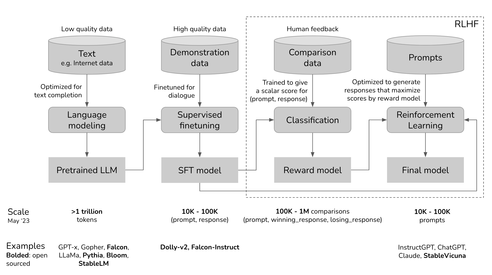
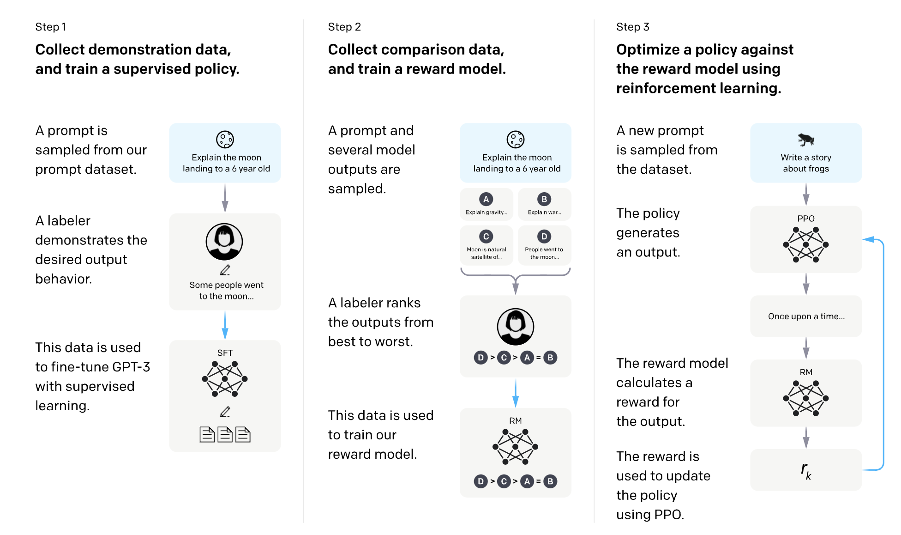

# Article: RLHF: Reinforcement Learning from Human Feedback

One narrative that is often glossed over is the incredible technical creativity that went into making models like ChatGPT work. One such cool idea is RLHF (Reinforcement Learning from Human Feedback): incorporating reinforcement learning and human feedback into NLP.

RL has been notoriously difficult to work with, and therefore, mostly confined to gaming and simulated environments like Atari or MuJoCo. Just five years ago, both RL and NLP were progressing pretty much orthogonally – different stacks, different techniques, and different experimentation setups.

RLHF overview  
Let’s visualize the development process for ChatGPT to see where RLHF fits in.  

1. The pretrained model is an untamed monster because it was trained on indiscriminate data scraped from the Internet: think clickbait, misinformation, propaganda, conspiracy theories, or attacks against certain demographics.
2. This monster was then finetuned on higher quality data – think StackOverflow, Quora, or human annotations – which makes it somewhat socially acceptable.
3. Then the finetuned model was further polished using RLHF to make it customer-appropriate, e.g. giving it a smiley face.

An SFT model is a language model that has undergone Supervised Fine-Tuning (SFT). In the LLM training pipeline, it is typically the checkpoint produced after taking a pretrained base model and training it further on a curated dataset of instruction–response pairs or demonstration examples.

You can skip any of the three phases. For example, you can do RLHF directly on top of the pretrained model, without going through the SFT phase. However, empirically, combining all these three steps gives the best performance.

Pretraining is the most resource-intensive phase. For the InstructGPT model, pretraining takes up [98% of the overall compute and data resources](https://openai.com/research/instruction-following). You can think of SFT and RLHF as unlocking the capabilities that the pretrained model already has but are hard for users to access via prompting alone.

Teaching machines to learn from human preferences is not new. It’s been around for [over a decade](https://arxiv.org/abs/1208.0984). OpenAI started exploring [learning from human preference](https://openai.com/research/learning-from-human-preferences) back when their main bet was robotics. The then narrative was that human preference was crucial for AI safety. However, as it turned out, human preference can also make for better products, which attracted a much larger audience.

Phase 1. Pretraining for completion  
The result of the pretraining phase is a large language model (LLM), often known as the pretrained model. Examples include GPT-x (OpenAI), Gopher (DeepMind), LLaMa (Meta), StableLM (Stability AI).  
A language model encodes statistical information about language. For simplicity, statistical information tells us how likely something (e.g. a word, a character) is to appear in a given context. The term **token** can refer to a word, a character, or a part of a word (like -tion), depending on the language model. You can think of tokens as the **vocabulary** that a language model uses.  
Fluent speakers of a language subconsciously have statistical knowledge of that language. For example, given the context My favorite color is \_\_, if you speak English, you know that the word in the blank is much more likely to be green than car.  
Similarly, language models should also be able to fill in that blank. You can think of a language model as a “*completion machine*”: given a text (prompt), it can generate a response to complete that text.  
As simple as it sounds, completion turned out to be incredibly powerful, as many tasks can be framed as completion tasks: translation, summarization, writing code, doing math, etc. For example, give the prompt: How are you in French is ..., a language model might be able to complete it with: Comment ça va, effectively translating from one language to another.

To train a language model for completion, you feed it a lot of text so that it can distill statistical information from it. The text given to the model to learn from is called training data.

Since language models mimic its training data, language models are only as good as their training data, hence the phrase “Garbage in, garbage out”. If you train a language model on Reddit comments, you might not want to take it home to show to your parents.

Mathematical formulation

- ML task: language modeling
- Training data: low-quality data
- Data scale: usually in the order of trillions of tokens as of May 2023.
    - [GPT-3’s dataset](https://arxiv.org/abs/2005.14165) (OpenAI): 0.5 trillion tokens. I can’t find any public info for GPT-4, but I’d estimate it to use an order of magnitude more data than GPT-3.
    - [Gopher’s dataset](https://www.deepmind.com/publications/scaling-language-models-methods-analysis-insights-from-training-gopher) (DeepMind): 1 trillion tokens
    - [RedPajama](https://github.com/togethercomputer/RedPajama-Data) (Together): 1.2 trillion tokens
    - [LLaMa’s dataset](https://arxiv.org/abs/2302.13971) (Meta): 1.4 trillion tokens
- Model resulting from this process: LLM

The rate of training dataset size growth is much faster than the rate of new data being generated ([Villalobos et al, 2022](https://arxiv.org/abs/2211.04325)). **If you’ve ever put anything on the Internet, you should assume that it is already or will be included in the training data for some language models**, whether you consent or not. This is similar to how, if you post something on the Internet, you should expect it to be indexed by Google.

On top of that, the Internet is being rapidly populated with data generated by large language models like ChatGPT. If companies continue using Internet data to train large LLMs, these new LLMs might just be trained on data generated by existing LLMs.

Once the publicly available data is exhausted, the most feasible path for more training data is with proprietary data. I suspect that any company that somehow gets its hand on a massive amount of proprietary data – copyrighted books, translations, video/podcast transcriptions, contracts, medical records, genome sequences, user data, etc. – will have a competitive advantage. It’s not surprising that in light of ChatGPT, many companies have changed their data terms to prevent other companies from scraping their data for LLMs – see [Reddit](https://www.redditinc.com/policies/data-api-terms), [StackOverflow](https://policies.stackoverflow.co/teams/enterprise-cloud-business/).

Phase 2. Supervised finetuning (SFT) for dialogue  
Why SFT  
Pretraining optimizes for completion. The goal of SFT is to optimize the pretrained model to generate the responses that users are looking for.  
How to do that? We know that a model mimics its training data. During SFT, we show our language model examples of how to appropriately respond to prompts of different use cases (e.g. question answering, summarization, translation). The examples follow the format (prompt, response) and are called demonstration data. OpenAI calls supervised finetuning *behavior cloning*: you demonstrate how the model should behave, and the model clones this behavior.  
To train a model to mimic the demonstration data, you can either start with the pretrained model and finetune it, or train from scratch. However, the finetuned approach produces much superior results.  
Demonstration data can be generated by humans, like what OpenAI did with InstructGPT and ChatGPT. Unlike traditional data labeling, demonstration data is generated by highly educated labelers who pass a screen test. Among those who labeled demonstration data for InstructGPT, [~90% have at least a college degree](https://arxiv.org/pdf/2203.02155.pdf) and more than one-third have a master’s degree.  
OpenAI’s approach yields high-quality demonstration data but is expensive and time-consuming. Instead, DeepMind used heuristics to filter for dialogues from Internet data for their model Gopher ([Rae et al., 2021](https://arxiv.org/abs/2112.11446)).

Phase 3. RLHF  
Empirically, RLHF improves performance significantly compared to SFT alone.

Dialogues are flexible. Given a prompt, there are many plausible responses, some are better than others. Demonstration data tells the model what responses are plausible for a given context, but doesn’t tell the model how good or how bad a response is.

The idea: what if we have a scoring function that, if given a prompt and a response, outputs a score for how good that response is? Then we use this scoring function to further train our LLMs towards giving responses with high scores. That’s exactly what RLHF does. RLHF consists of two parts:

1. Train a reward model to act as a scoring function.
2. Optimize LLM to generate responses for which the reward model will give high scores.

**The negative feedback hypothesis***: demonstration only gives the model positive signals (e.g. only showing the model good responses), not negative signals (e.g. showing models what bad responses look like). RL allows us to show models negative signals.*

3.1. Reward model (RM)  
The RM’s job is to output a score for a pair of (prompt, response). Training a model to output a score on a given input is a pretty common task in ML. You can simply frame it as a classification or a regression task. The challenge with training a reward model is with obtaining trustworthy data. Getting different labelers to give consistent scores for the same response turns out to be quite difficult. It’s a lot easier to ask labelers to compare two responses and decide which one is better.  
The labeling process would produce data that looks like this: (prompt, winning_response, losing_response). This is called comparison data.

For InstructGPT, the objective is to maximize the difference in score between the winning response and the losing response.

People have experimented with different ways to initialize an RM: e.g. training an RM from scratch or starting with the SFT model as the seed. Starting from the SFT model seems to give the best performance. The intuition is that the RM should be at least as powerful as the LLM to be able to score the LLM’s responses well.

3.2. Finetuning using the reward model  
In this phase, we will further train the SFT model to generate output responses that will maximize the scores by the RM. Today, most people use [Proximal Policy Optimization](https://openai.com/research/openai-baselines-ppo) (PPO), a reinforcement learning algorithm released by OpenAI in 2017.  
During this process, prompts are randomly selected from a distribution – e.g. we might randomly select among customer prompts. Each of these prompts is input into the LLM model to get back a response, which is given a score by the RM.

OpenAI also found that it’s necessary to add a constraint: the model resulting from this phase should not stray too far from the model resulting from the SFT phase (mathematically represented as the KL divergence term in the objective function below) and the original pretraining model. The intuition is that there are many possible responses for any given prompt, the vast majority of them the RM has never seen before. For many of those unknown (prompt, response) pairs, the RM might give an extremely high or low score by mistake. Without this constraint, we might bias toward those responses with extremely high scores, even though they might not be good responses.

OpenAI has this great diagram that explains the [SFT and RLHF](https://openai.com/research/instruction-following) for InstructGPT.  

RLHF and hallucination  
Hallucination happens when an AI model makes stuff up. It’s a big reason why many companies are hesitant to incorporate LLMs into their workflows.  
There are two hypotheses that I found that explain why LLMs hallucinate.  
The first hypothesis, first expressed by Pedro A. Ortega et al. at DeepMind in Oct 2021, is that LLMs hallucinate because they “[lack the understanding of the cause and effect of their actions](https://arxiv.org/abs/2110.10819#deepmind)” (back then, DeepMind used the term “delusion” for “hallucination”). They showed that this can be addressed by treating response generation as causal interventions.

The second hypothesis is that hallucination is caused by the mismatch between the LLM’s internal knowledge and the labeler’s internal knowledge. In his [UC Berkeley talk](https://www.youtube.com/watch?v=hhiLw5Q_UFg) (April 2023), John Schulman, OpenAI co-founder and PPO author, suggested that behavior cloning causes hallucination. During SFT, LLMs are trained to mimic responses written by humans. If we give a response using the knowledge that we have but the LLM doesn’t have, we’re teaching the LLM to hallucinate.

Schulman believed that [LLMs know if they know something](https://www.youtube.com/live/hhiLw5Q_UFg?feature=share&t=1019) (which is a big claim, IMO), this means that hallucination can be fixed if we find a way to force LLMs to only give answers that contain information they know. He then proposed a couple of solutions.

1. Verification: asking the LLM to explain (retrieve) the sources where it gets the answer from.
2. RL. Remember that the reward model in phase 3.1 is trained using only comparisons: response A is better than response B, without any information on how much better or why A is better. Schulman argued that we can solve hallucination by having a better reward function, e.g. punishing a model more for making things up.

From Schulman’s talk, I got the impression that RLHF is supposed to help with hallucination. However, the InstructGPT paper shows that RLHF actually made hallucination worse. Even though RLHF caused worse hallucination, it improved other aspects, and overall, human labelers prefer RLHF model over SFT alone model.

Based on the assumption that LLMs know what they know, some people try to reduce hallucination with prompts, e.g. adding Answer as truthfully as possible, and if you're unsure of the answer, say "Sorry, I don't know". Making LLMs respond concisely also seems to help with hallucination – the fewer tokens LLMs have to generate, the less chance they have to make things up.

Summary:  
1.Reinforcement Learning from Human Feedback): incorporating reinforcement learning and human feedback into NLP.  
2. Models have different phases: we have huge amount of text which we build the large language from, then we have pretrained LLM then Supervised fine tuning then RLHF after.  
3. Pretraining take almost 98% of the overal compute and data resources.  
4. A language model encodes statistical information about language  
5. You can think of a language model as a “*completion machine*”. The text given to the model to learn from is called training data.  
6. The rate of training dataset size growth is much faster than the rate of new data being generated. Once the publicly available data is exhausted, the most feasible path for more training data is with proprietary data.  
7. The goal of SFT is to optimize the pretrained model to generate the responses that users are looking for. During SFT, we show our language model examples of how to appropriately respond to prompts of different use cases (Demonstration data )  
8. Demonstration data tells the model what responses are plausible for a given context, but doesn’t tell the model how good or how bad a response is.  
9. The reward model (RM) takes a prompt and a response as input, and outputs a score for that pair. We then use the reward model to fine-tune the SFT model, so that the responses it generates receive the highest possible scores from the RM.

Source:  
[https://huyenchip.com/2023/05/02/rlhf.html](https://huyenchip.com/2023/05/02/rlhf.html)
