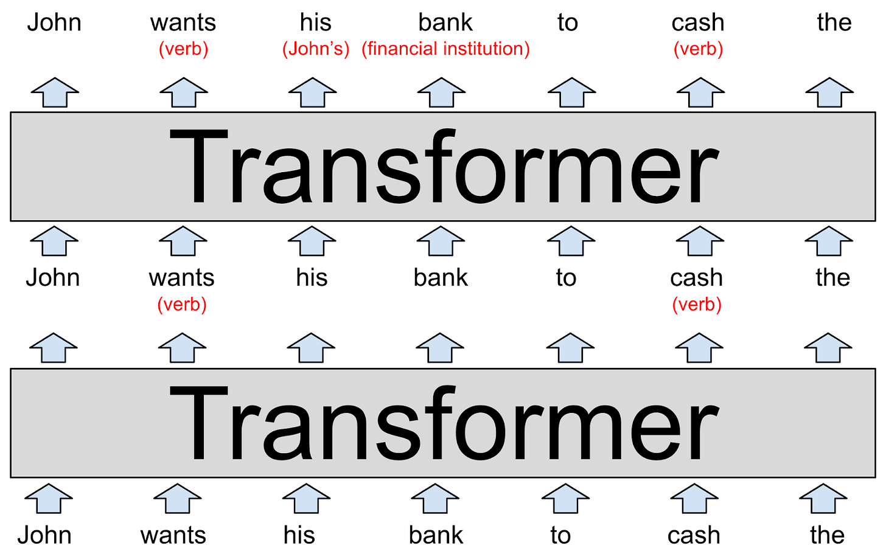
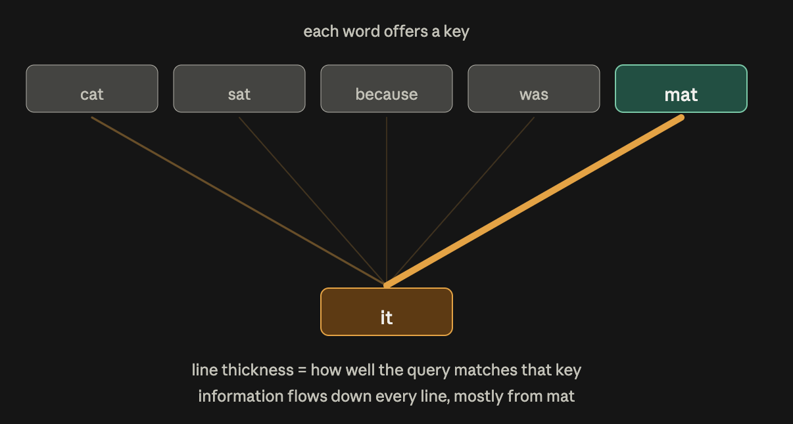
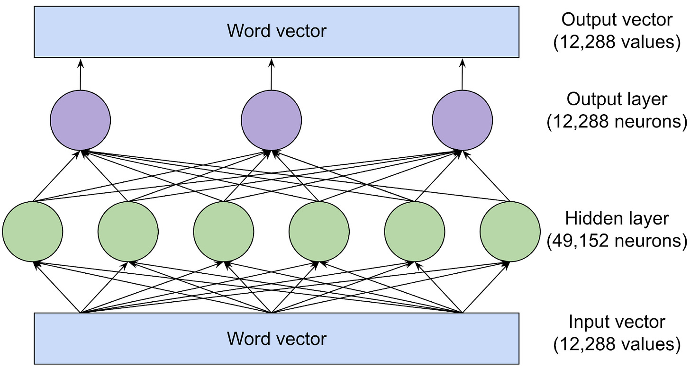

# Article: Understanding AI

We will belabor these vector representations because it’s fundamental to understanding how language models work.

To understand how language models work, you first need to understand how they represent words. Human beings represent English words with a sequence of letters, like C-A-T for **cat**. Language models use a long list of numbers called a word vector. For example, [here’s one way](http://vectors.nlpl.eu/explore/embeddings/en/MOD_enwiki_upos_skipgram_300_2_2021/cat_NOUN/) to represent **cat** as a vector:

\[0.0074, 0.0030, -0.0105, 0.0742, 0.0765, -0.0011, 0.0265, 0.0106, 0.0191, 0.0038, -0.0468, -0.0212, 0.0091, 0.0030, -0.0563, -0.0396, -0.0998, -0.0796, …, 0.0002\]

This is useful for reasoning about spatial relationships. You can tell New York is close to Washington DC because 38.9 is close to 40.7 and 77 is close to 74. By the same token, Paris is close to London. But Paris is far from Washington DC.

Language models take a similar approach: each word vector1 represents a point in an imaginary “word space,” and words with more similar meanings are placed closer together. For example, the words closest to cat in vector space include dog, kitten, and pet. A key advantage of representing words with vectors of real numbers (as opposed to a string of letters, like “C-A-T”) is that numbers enable operations that letters don’t.

Words are too complex to represent in only two dimensions, so language models use vector spaces with hundreds or even thousands of dimensions. The human mind can’t envision a space with that many dimensions, but computers are perfectly capable of reasoning about them and producing useful results.

Researchers have been experimenting with word vectors for decades, but the concept really took off when Google [announced its word2vec project](https://arxiv.org/abs/1301.3781) in 2013. Google analyzed millions of documents harvested from Google News to figure out which words tend to appear in similar sentences. Over time, a neural network trained to predict which words co-occur with which other words learned to place similar words (like **dog** and **cat**) close together in vector space.

    - **Swiss** is to **Switzerland** as **Cambodian** is to **Cambodia** . (nationalities)
    - **Paris** is to **France** as **Berlin** is to **Germany** . (capitals)
    - **Unethical** is to **ethical** as **possibly** is to **impossibly** . (opposites)
    - **Mouse** is to **mice** as **dollar** is to **dollars** . (plurals)
    - **Man** is to **woman** as **king** is to **queen** . (gender roles)

Because these vectors are built from the way humans use words, they end up reflecting many of the [biases that are present in human language](https://www.science.org/doi/full/10.1126/science.aal4230). For example, in some word vector models, **doctor** minus **man** plus **woman** yields **nurse**. Mitigating biases like this is an area of active research.

Nevertheless, word vectors are a useful building block for language models because they encode subtle but important information about the relationships between words. If a language model learns something about a **cat** (for example: it sometimes goes to the vet), the same thing is likely to be true of a **kitten** or a **dog**. If a model learns something about the relationship between **Paris** and **France** (for example: they share a language) there’s a good chance that the same will be true for **Berlin** and **Germany** and for **Rome** and **Italy**.

A simple word vector scheme like this doesn’t capture an important fact about natural language: words often have multiple meanings.

    - John picks up a **magazine** .
    - Susan works for a **magazine** .

The meanings of **magazine** in these sentences are related but subtly different. John picks up a *physical* magazine, while Susan works for an organization that *publishes* physical magazines.

When a word has two unrelated meanings, as with **bank**, linguists call them homonyms. When a word has two closely related meanings, as with **magazine**, linguists call it polysemy

LLMs like ChatGPT are able to represent the same word with different vectors depending on the context in which that word appears. There’s a vector for **bank** (financial institution) and a different vector for **bank** (of a river). There’s a vector for **magazine** (physical publication) and another for **magazine** (organization). As you might expect, LLMs [use more similar vectors](https://arxiv.org/abs/2010.13057) for polysemous meanings than for homonymous meanings.

Traditional software is designed to operate on data that’s unambiguous. If you ask a computer to compute “2 + 3,” there’s no ambiguity about what **2,** **+,** or **3** mean. But natural language is full of ambiguities that go beyond homonyms and polysemy:

In “the customer asked the mechanic to fix **his** car” does **his** refer to the customer or the mechanic?

In “the professor urged the student to do **her** homework” does **her** refer to the professor or the student?

In “fruit **flies** like a banana” is **flies** a verb (referring to fruit soaring across the sky) or a noun (referring to banana-loving insects)?

People resolve ambiguities like this based on context, but there are no simple or deterministic rules for doing this. Rather, it requires understanding facts about the world. You need to know that mechanics typically fix customers’ cars, that students typically do their own homework, and that fruit typically doesn’t fly.

Word vectors provide a flexible way for language models to represent each word’s precise meaning in the context of a particular passage. Now let’s look at how they do that.

GPT-3, the model behind the original version of ChatGPT[2](https://www.understandingai.org/p/large-language-models-explained-with#footnote-2), is organized into dozens of layers. Each layer takes a sequence of vectors as inputs—one vector for each word in the input text—and adds information to help clarify the meaning of that word and better predict which word might come next.

(Look at it from bottom up)

Each layer of an LLM is a transformer, a neural network architecture that was first introduced by Google in a [landmark 2017 paper](https://arxiv.org/abs/1706.03762).

The model’s input, shown at the bottom of the diagram, is the partial sentence “John wants his bank to cash the.” These words, represented as word2vec-style vectors, are fed into the first transformer.

The transformer figures out that **wants** and **cash** are both verbs (both words can also be nouns). We’ve represented this added context as red text in parentheses, but in reality the model would store it by modifying the word vectors in ways that are difficult for humans to interpret. These new vectors, known as a hidden state, are passed to the next transformer in the stack.

The second transformer adds two other bits of context: it clarifies that **bank** refers to a financial institution rather than a river bank, and that **his** is a pronoun that refers to **John**. The second transformer produces another set of hidden state vectors that reflect everything the model has learned up to that point.

The above diagram depicts a purely hypothetical LLM, so don’t take the details too seriously. We’ll take a look at research into real language models shortly. Real LLMs tend to have a lot more than two layers. The most powerful version of GPT-3, for example, has 96 layers.

[Research suggests](https://arxiv.org/abs/1905.05950) that the first few layers focus on understanding the syntax of the sentence and resolving ambiguities like we’ve shown above. Later layers (which we’re not showing to keep the diagram a manageable size) work to develop a high-level understanding of the passage as a whole.

For example, as an LLM “reads through” a short story, it appears to keep track of a variety of information about the story’s characters: sex and age, relationships with other characters, past and current location, personalities and goals, and so forth.

Researchers don’t understand exactly how LLMs keep track of this information, but logically speaking the model must be doing it by modifying the hidden state vectors as they get passed from one layer to the next. It helps that in modern LLMs, these vectors are extremely large.

For example, the most powerful version of GPT-3 uses word vectors with 12,288 dimensions—that is, each word is represented by a list of 12,288 numbers. That’s 20 times larger than Google’s 2013 word2vec scheme. You can think of all those extra dimensions as a kind of “scratch space” that GPT-3 can use to write notes to itself about the context of each word. Notes made by earlier layers can be read and modified by later layers, allowing the model to gradually sharpen its understanding of the passage as a whole.

Note from my side "An LLM still has a static lookup table. It's the very first thing that happens: each token ID maps to a fixed vector, straight out of a table, with no context involved at all. That table is called the token embedding matrix, and at that moment "bank" really does have one fixed representation.

What makes LLM embeddings contextual is what happens after. Each transformer layer updates that vector using attention, so by layer 5 the two "bank"s have started to diverge, and by the final layer they're in completely different regions of the space.

So the accurate statement is: LLM embeddings start static and become contextual as they pass up through the layers. Word2vec has only the first part; the transformer adds the second.

"

So suppose we changed our diagram above to depict a 96-layer language model interpreting a 1,000-word story. The 60th layer might include a vector for **John** with a parenthetical comment like “(main character, male, married to Cheryl, cousin of Donald, from Minnesota, currently in Boise, trying to find his missing wallet).” Again, all of these facts (and probably a lot more) would somehow be encoded as a list of 12,288 numbers corresponding to the word **John**. Or perhaps some of this information might be encoded in the 12,288-dimensional vectors for **Cheryl**, **Donald**, **Boise**, **wallet**, or other words in the story.

The goal is for the 96th and final layer of the network to output a hidden state for the final word that includes all of the information necessary to predict the next word. --> my note: the hidden state used to predict the next word/token.

Block attenion------

Now let’s talk about what happens inside each transformer. The transformer has a two-step process for updating the hidden state for each word of the input passage:

1. In the **attention step** , words “look around” for other words that have relevant context and share information with one another.
2. In the **feed-forward step** , each word “thinks about” information gathered in previous attention steps and tries to predict the next word. --> my comment: The feed-forward step does not predict the next word. It refines each token’s own vector. Prediction happens only at the very end.

Of course it’s the network, not the individual words, that performs these steps. But we’re phrasing things this way to emphasize that transformers treat words, rather than entire sentences or passages, as the basic unit of analysis. This approach enables LLMs to take full advantage of the massive parallel processing power of modern GPU chips. And it also helps LLMs to scale to passages with thousands of words. These are both areas where [earlier language models](https://en.wikipedia.org/wiki/Recurrent_neural_network) struggled.

You can think of the attention mechanism as a matchmaking service for words. Each word makes a checklist (called a query vector) describing the characteristics of words it is looking for. Each word also makes a checklist (called a key vector) describing its own characteristics. The network compares each key vector to each query vector (by computing a [dot product](https://en.wikipedia.org/wiki/Dot_product)) to find the words that are the best match. Once it finds a match, it transfers information from the word that produced the key vector to the word that produced the query vector.

For example, in the previous section we showed a hypothetical transformer figuring out that in the partial sentence “John wants his bank to cash the,” **his** refers to **John.** Here’s what that might look like under the hood. The query vector for **his** might effectively say “I’m seeking: a noun describing a male person.” The key vector for **John** might effectively say “I am: a noun describing a male person.” The network would detect that these two vectors match and move information about the vector for **John** into the vector for **his**.

    - One attention head might match pronouns with nouns, as we discussed above.
    - Another attention head might work on resolving the meaning of homonyms like bank.
    - A third attention head might link together two-word phrases like “Joe Biden.”

And so forth.

Attention heads frequently operate in sequence, with the results of an attention operation in one layer becoming an input for an attention head in a subsequent layer. Indeed, each of the tasks we just listed above could easily require several attention heads rather than just one.

The largest version of GPT-3 has 96 layers with 96 attention heads each, so GPT-3 performs 9,216 attention operations each time it predicts a new word.

---

**The simplified version** **of block of attention**

A transformer is a stack of identical layers. Every layer does the same two things to every word, over and over:

**Step 1 — Attention: "look around."** Each word gathers context from other words. The word "it" looks back through the sentence and pulls meaning from whichever earlier word it actually refers to.

**Step 2 — Feed-forward: "think it over."** Each word now processes what it just gathered, on its own, without looking at any other word. This is where the model's stored knowledge gets applied.

Then the output goes into the next layer, and both steps happen again. Stack this 30, 60, 100 times and the final layer produces a guess at the next word.

The key thing to hold onto: **each word carries its own running "notes" (the hidden state), and every layer updates those notes.** At layer 1 the notes for "it" say roughly "a pronoun." By layer 40 they might say "the mat, which is warm, in a sentence about a cat."

**The matchmaking metaphor, made concrete**

    - **Query** = what "it" is looking for. Think of it as a personal ad: "looking for a physical object I could be referring to."
    - **Key** = what each other word advertises about itself. "mat" advertises "I'm a physical object, a noun."
    - The model compares "it"'s query against every key. "mat" scores high, "because" scores low.
    - **Value** = the actual information that gets copied over. This is the piece the article left out.

**What in that passage needs correcting or updating**

Three things are simplified in ways that could mislead you later, plus two that are outdated.

**1. It's tokens, not words.** The basic unit is a token: usually a whole common word, but sometimes a word fragment ("unhappiness" might be "un" + "happiness") or a piece of punctuation. The article says "words" for readability, which is fine, but every real discussion of LLMs uses "tokens," and context limits are measured in tokens.

**2. Attention doesn't "find a match" and stop.** The passage says the network "finds the words that are the best match" and then transfers information. It actually computes a score against *every* word, converts those scores into percentages that add to 100%, and then blends information from all of them, weighted by score. Nothing is discarded. "mat" might contribute 60%, "cat" 15%, everything else small slices. This matters because attention is a soft blend, not a lookup.

**3. There's a third vector: the value.** The passage mentions the query and the key but stops there. What actually gets transferred is the *value* vector, which is a separate thing the word produces. Think of it this way: the key is how a word advertises itself, and the value is what it actually hands over. Keeping these separate lets a word be findable for one reason and useful for a different one.

**4. "Each word tries to predict the next word" in the feed-forward step is loose.** Only the very last layer produces an actual prediction. The intermediate feed-forward steps refine the word's notes. There's a grain of truth here (researchers have found intermediate layers do progressively drift toward the final answer) but it's better to think of the feed-forward step as "apply stored knowledge to what I just gathered."

**5. "Thousands of words" is very out of date.** That was written in 2023. Current models routinely handle 200,000 tokens, and some go to a million or more. Note also that the parallelism claim applies to *training* and to reading your prompt. When the model is writing its answer, it still produces one token at a time, in order.

**Two things worth knowing that postdate the article.** First, in many current models the feed-forward step has been replaced by a "mixture of experts": instead of one big feed-forward block, there are many, and a router picks two or three per token. This makes models much bigger without making them proportionally slower. Second, reasoning models add a stage where the model writes out a long internal train of thought before answering. Neither of these changes the two-step picture above, so the article's core explanation is still a good foundation.

---

**A real-world example**

In the last two sections we presented a stylized version of how attention heads work. Now let’s look at research on the inner workings of a real language model. Last year scientists at Redwood Research [studied](https://arxiv.org/abs/2211.00593) how GPT-2, a predecessor to ChatGPT, predicted the next word for the passage “When Mary and John went to the store, John gave a drink to.”

    - Three heads they called **Name Mover Heads** copied information from the **Mary** vector to the final input vector (for the word **to** ). GPT-2 uses the information in this rightmost vector to predict the next word.
    - How did the network decide **Mary** was the right word to copy? Working backwards through GPT-2’s computational process, the scientists found a group of four attention heads they called **Subject Inhibition Heads** that marked the second **John** vector in a way that blocked the Name Mover Heads from copying the name **John** .
    - How did the Subject Inhibition Heads know **John** shouldn’t be copied? Working further backwards, the team found two attention heads they called **Duplicate Token Heads.** They marked the second **John** vector as a duplicate of the first **John** vector, which helped the Subject Inhibition Heads to decide that **John** shouldn’t be copied.

In short, these nine attention heads enabled GPT-2 to figure out that “John gave a drink to John” doesn’t make sense and choose “John gave a drink to Mary” instead.

We love this example because it illustrates just how difficult it will be to fully understand LLMs. The five-member Redwood team published a [25-page paper](https://arxiv.org/abs/2211.00593) explaining how they identified and validated these attention heads. Yet even after they did all that work, we are still far from having a comprehensive explanation for why GPT-2 decided to predict **Mary** as the next word.

For example, how did the model know the next word should be someone’s name and not some other kind of word? It’s easy to think of similar sentences where **Mary** wouldn’t be a good next-word prediction. For example, in the sentence “when Mary and John went to the restaurant, John gave his keys to,” the logical next words would be “the valet.”

Presumably, with enough research computer scientists could uncover and explain additional steps in GPT-2’s reasoning process. Eventually, they might be able to develop a comprehensive understanding of how GPT-2 decided that **Mary** is the most likely next word for this sentence. But it could take months or even years of additional effort just to understand the prediction of a single word.

The language models underlying ChatGPT—GPT-3.5 and GPT-4—are significantly larger and more complex than GPT-2. They are capable of more complex reasoning than the simple sentence-completion task the Redwood team studied. So fully explaining how these systems work is going to be a huge project that humanity is unlikely to complete any time soon.

---

Comments of the example

**What the article gets wrong or leaves out**

It presents this as nine heads and three types. The paper actually describes **26 heads in 7 classes**, out of 144 heads total in the model. The article covers the three classes that map onto the clean three-step algorithm and omits the messier four.

The most interesting omission is the **Negative Name Mover Heads**, which push in the *opposite* direction and reduce the model's confidence in Mary. The authors think this is hedging — it limits the penalty when the model is wrong. There are also **Backup Name Mover Heads** that take over if you disable the main ones, plus Induction Heads and Previous Token Heads feeding the earlier stages.

Two smaller fixes: the paper calls them "S-Inhibition Heads," and the article's description of them blocking a vector is the wrong direction (see above).

**What's changed since**

The paper is from 2022 and the article from 2023, so "last year" and the GPT-3.5/GPT-4 references are stale. More importantly, the closing prediction — months or years of work per single word — has aged poorly. Circuit discovery has been substantially automated, and newer techniques (sparse autoencoders, attribution graphs) now let researchers trace multi-step reasoning inside much larger models. The broader point still holds, though: no frontier model has a complete explanation, and nobody expects one soon.

**The takeaway to keep**

Attention heads specialize into identifiable jobs and chain together across layers into a pipeline. But real circuits are redundant and partly self-contradictory — some components are pure backups, some actively argue against the right answer. Clean three-step stories are what you get after simplification.

---

**The feed-forward step**

Once the attention heads have moved information between word vectors, each vector passes through a feed-forward network. This is the second sublayer of every transformer block, and it has a very different character from attention.

The defining property is isolation: no information moves between words here. The feed-forward network looks at one word vector at a time and has no idea what the other words are. It's also the *same* network at every position, applied over and over. Word 1 and word 500 go through identical machinery.

That sounds limiting, but it isn't, because attention just ran. Whatever context the attention heads pulled in is already baked into the vector.

It's worth being precise about what the network does with that vector, because it's easy to picture this wrongly. It doesn't replace the vector or transform it wholesale. It computes a result and *adds* that result to what's already there. The same is true of attention. Each word vector is best thought of as a running set of notes that every sublayer writes an increment into, never erasing what came before. This is why information written at block 3 can still be read at block 60.

**It's bigger than you'd think**

Here's the shape of the feed-forward sublayer in the largest version of GPT-3. The vector comes in at 12,288 numbers wide, gets expanded out to a hidden layer of 49,152 neurons, then gets projected back down to 12,288.

Neurons is mathematical functions that compute a weighted sum of their inputs (Technically, after a neuron computes a weighted sum of its inputs, it passes the result to an [activation function](https://en.wikipedia.org/wiki/Activation_function). We’re going to ignore this implementation detail, but you can read Tim’s [2018 explainer](https://arstechnica.com/science/2018/12/how-computers-got-shockingly-good-at-recognizing-images/) if you want a full explanation of how neurons work.)

That's 49,152 × 12,288 weights on the way up and 12,288 × 49,152 on the way back down, or about 1.2 billion parameters. Multiply by GPT-3's 96 blocks and you get roughly 116 billion — close to two-thirds of the model's 175 billion total.

This surprises people. Attention gets almost all of the explanatory airtime, but in a standard transformer the feed-forward sublayers are where most of the model actually lives.

**What the neurons do**

A 2020 paper found that these sublayers work by pattern matching: each neuron in that big hidden layer responds to a particular kind of input. The researchers catalogued neurons in a 16-layer version of GPT-2 and found things like these.

A neuron in block 1 fired on any sequence ending with the word "substitutes." A neuron in block 6 fired on military-related text ending in "base" or "bases." A neuron in block 13 fired on sequences ending in a time range, such as "between 3 pm and 7" or "from 7:00 pm Friday until." And a neuron in block 16 fired on text about television, such as "the original NBC daytime version, archived" or "time shifting viewing added 57 percent to the episode's."

Notice the progression. Early blocks latch onto specific individual words. Later blocks respond to whole semantic categories — time intervals, television, the military — regardless of which exact words appear.

**The part that makes this click**

Now hold that television neuron against the isolation rule, because this is the piece that ties the whole architecture together.

The phrase was "the original NBC daytime version, archived." The neuron fires at the last position, on **archived**. And by the rule above, it cannot see **NBC**. It cannot see **daytime**. It cannot see **version**. All it gets is one vector: the one sitting at the position of **archived**.

So how does it know this is about television? The word "archived" on its own is about as generic as words get — archived emails, archived records, archived footage.

The answer is that by the time the vector reaches block 16, it is no longer just "archived." Fifteen blocks of attention heads have been quietly loading it up. Some head noticed **NBC** and copied signal from it. Another linked **daytime** to **version**. Another tied the whole phrase together. Every one of those additions landed in the running notes at the **archived** position. What the neuron actually sees is closer to "archived, in a phrase about an original daytime NBC broadcast."

That's the division of labor in one image. **Attention gathers; feed-forward recognizes.** The feed-forward sublayer can afford to be blind to the rest of the sentence precisely because attention has already delivered the sentence to its doorstep. Neither half works without the other, which is why every block contains both and why they alternate all the way up the stack.

When the neuron does fire, it adds its contribution to the vector. Sometimes that amounts to a tentative lean toward a particular next word — a television-context signal nudges the model toward words that follow television talk. But only the final block produces an actual prediction. For everything in between, the better description is that the network is looking something up and writing what it found into the notes.

That framing holds up well. Researchers who want to edit a specific fact into a model — to make it claim the Eiffel Tower is in Rome — go after feed-forward weights to do it. These sublayers behave a lot like the model's long-term memory, which is exactly what you'd expect from a component that stores patterns and can't see the current sentence.

**What's changed since 2023**

The picture above still holds, but two details are dated.

The internal shape is different now. Most current models use a gated variant called SwiGLU instead of the simple expand-then-contract design, splitting the expansion into two paths and multiplying them together. Same job, slightly different plumbing.

More significantly, many current models replace the single feed-forward block with a **mixture of experts**: a set of parallel feed-forward networks plus a small router that picks two or three of them per word. This lets a model hold far more knowledge without getting proportionally slower, since most experts sit idle on any given word. It also breaks the tidy two-thirds arithmetic — the feed-forward portion becomes an even larger share of total parameters, but only a fraction of it runs at a time.

Neither change touches the core idea. Words are still processed in isolation at this step, still using whatever attention gathered, still writing their results into the same running vector.

Summary of my understanding of the forward feed set

The feed-forward sublayer's main purpose is to recognize patterns in a word vector and write back knowledge the model learned during training. Each neuron independently checks the incoming vector against one pattern; those that match add their stored contribution to that same vector. No information moves between words, and none moves between neurons.

**Attention** brings in information from *other words in the current text*.

**Feed-forward** brings in information from *training data*, which is nowhere in the current text.

**Feed-forward networks reason with vector math**

**The study.** Merullo, Eickhoff & Pavlick (Brown, May 2023), *Language Models Implement Simple Word2Vec-style Vector Arithmetic*. Tested models from 124M to 176B parameters; the detailed walkthrough uses GPT-2 medium, 24 layers.

**The prompt.** "Q: What is the capital of France? A: Paris. Q: What is the capital of Poland? A:"

**The finding.** A feed-forward sublayer near layer 20 adds a single vector that maps any country to its capital. Add it to Poland, get Warsaw. Add the same vector to China, get Beijing. The model is doing word2vec-style arithmetic internally. The authors call this a get_capital(x) function. The same trick appears for lowercase→uppercase and present→past tense.

**The trajectory.** Probing after each layer: first ~15 layers give junk, layers 16–19 give "Poland" (warm but wrong), layer 20 flips to "Warsaw" and it holds to the end.

**Method caveat — important.** Those per-layer "predictions" come from the **logit lens**: researchers take the model's *final* output head and apply it early to a half-finished vector. The model itself has only one output head, at the top. It never predicts at layer 16. The reading means "if forced to answer here, it would say Poland."

**Resolving "do feed-forward layers predict?"** Every sublayer adds an increment to a running vector; the final prediction is computed from that total. So every increment **contributes to** the prediction, but no increment **is** a prediction. The layer-20 FFN wrote the decisive edit — ablate it and Warsaw disappears — but it was an edit to a working document, not an answer. Layers 21–24 could have overwritten it.

**The division of labor, stated by the authors.** The mechanism only fires for facts recalled from **pretraining memory**. When the answer sits in the prompt instead, FFNs can be ablated almost entirely with minimal damage — attention handles it. So: **attention copies from local context; feed-forward recalls from training.**

**Confirming experiment.** Disable the layer-20 FFN → no more Warsaw. But prepend "The capital of Poland is Warsaw" to the prompt → correct again, because attention can now copy it from the text.

**Why the distinction matters.** Because the output is a sum of increments, you can attribute the answer to specific components — that's how this vector was found and how fact-editing works. Also, a mid-stack reading is provisional; the IOI circuit's Negative Name Mover Heads show that later components sometimes push *against* the emerging answer.

**The attention and feed-forward layers have different jobs**

So far we’ve looked at two real-world examples of GPT-2 word predictions: attention heads helping to predict that **John** gave a drink to **Mary**, and a feed-forward layer helping to predict that **Warsaw** was the capital of **Poland**.

In the first case, **Mary** came from the user-provided prompt. But in the second case, **Warsaw** wasn’t in the prompt. Rather GPT-2 had to “remember” the fact that **Warsaw** was the capital of **Poland**—information it learned from training data.

When the Brown researchers disabled the feed-forward layer that converted **Poland** to **Warsaw**, the model no longer predicted **Warsaw** as the next word. But interestingly, if they then added the sentence “The capital of Poland is Warsaw” to the beginning of the prompt, then GPT-2 could answer the question again. This is probably because GPT-2 used attention heads to copy the name **Warsaw** from earlier in the prompt.

This division of labor holds more generally: attention heads retrieve information from earlier words in a prompt, whereas feed-forward layers enable language models to “remember” information that’s not in the prompt.

Indeed, one way to think about the feed-forward layers is as a database of information the model has learned from its training data. The earlier feed-forward layers are more likely to encode simple facts related to specific words, such as “Trump often comes after Donald.” Later layers encode more complex relationships like “add this vector to convert a country to its capital.”

**How language models are trained**

Many early machine learning algorithms required training examples to be hand-labeled by human beings. For example, training data might have been photos of dogs or cats with a human-supplied label (“dog” or “cat”) for each photo. The need for humans to label data made it difficult and expensive to create large enough data sets to train powerful models.

A key innovation of LLMs is that they don’t need explicitly labeled data. Instead, they learn by trying to predict the next word in ordinary passages of text. Almost any written material—from Wikipedia pages to news articles to computer code—is suitable for training these models.

For example, an LLM might be given the input “I like my coffee with cream and” and be supposed to predict “sugar” as the next word. A newly-initialized language model will be really bad at this because each of its weight parameters—175 billion of them in the most powerful version of GPT-3—will start off as an essentially random number.

But as the model sees many more examples—hundreds of billions of words—those weights are gradually adjusted to make better and better predictions.

Here’s an analogy to illustrate how this works. Suppose you’re going to take a shower, and you want the temperature to be just right: not too hot, and not too cold. You’ve never used this faucet before, so you point the knob to a random direction and feel the temperature of the water. If it’s too hot, you turn it one way; if it’s too cold, you turn it the other way. The closer you get to the right temperature, the smaller the adjustments you make.

Now let’s make a couple of changes to the analogy. First, imagine that there are 50,257 faucets instead of just one. Each faucet corresponds to a different word like **the**, **cat**, or **bank**. Your goal is to have water only come out of the faucet corresponding to the next word in a sequence.

Second, there’s a maze of interconnected pipes *behind* the faucets, and these pipes have a bunch of valves on them as well. So if water comes out of the wrong faucet, you don’t just adjust the knob at the faucet. You dispatch an army of intelligent squirrels to trace each pipe backwards and adjust each valve they find along the way.

This gets complicated because the same pipe often feeds into multiple faucets. So it takes careful thought to figure out which valves to tighten and which ones to loosen, and by how much.

Obviously, this example quickly gets silly if you take it too literally. It wouldn’t be realistic or useful to build a network of pipes with 175 billion valves. But thanks to Moore’s Law, computers can and do operate at this kind of scale.

All the parts of LLMs we’ve discussed in this article so far—the neurons in the feed-forward layers *and* the attention heads that move contextual information between words—are implemented as a chain of simple mathematical functions (mostly [matrix multiplications](https://en.wikipedia.org/wiki/Matrix_multiplication)) whose behavior is determined by adjustable weight parameters. Just as the squirrels in my story loosen and tighten the valves to control the flow of water, so the training algorithm increases or decreases the language model’s weight parameters to control how information flows through the neural network.

The training process happens in two steps. First there’s a “forward pass,” where the water is turned on and you check if it comes out the right faucet. Then the water is turned off and there’s a “backwards pass” where the squirrels race along each pipe tightening and loosening valves. In digital neural networks, the role of the squirrels is played by an algorithm called backpropagation, which “walks backwards” through the network, using calculus to estimate how much to change each weight parameter.

Completing this process—doing a forward pass with one example and then a backwards pass to improve the network’s performance on that example—requires hundreds of billions of mathematical operations. And training a model as big as GPT-3 requires repeating the process billions of times—once for each word of training data.[6](https://www.understandingai.org/p/large-language-models-explained-with#footnote-6) OpenAI estimates that it took more than 300 billion *trillion* floating point calculations to train GPT-3—that’s months of work for dozens of high-end computer chips.

**Training on one sentence: "Free Palestine from River to the sea"**

**Step 1 — Split into prediction tasks.**

The sentence generates six tasks. Each position sees everything before it and has to predict what comes next:

| Position sees | Should predict |
| --- | --- |
| Free | Palestine |
| Free Palestine | from |
| Free Palestine from | River |
| Free Palestine from River | to |
| Free Palestine from River to | the |
| Free Palestine from River to the | sea |

No human labeled any of this. The answer is just the next word, already in the text.

**Step 2 — Forward pass: all six at once.**

The whole sentence enters the model together, and all six positions make their predictions simultaneously. Not one after another.

This is safe because of masking: each position's attention can only reach backwards. Position 2 cannot see "from" even though it sits right there in the input. So every position has exactly the context it should have.

Each position outputs probabilities across the whole vocabulary. Position 2 might give "from" a 3% chance, "is" 12%, "will" 8%, and so on. Early in training these are near-random.

**Step 3 — Measure the errors.**

Compare each prediction to the true next word. Six errors, averaged into one number: the loss. Low loss means good predictions.

**Step 4 — Backward pass: adjust once.**

Backpropagation works backwards through the model and asks, for every single parameter: how much did you contribute to that loss? Then it nudges each one slightly in the direction that would have reduced it.

One adjustment, informed by all six predictions together. The weights were frozen throughout steps 2 and 3 — nothing changed between position 1 and position 6.

**What the model learned.**

Almost nothing. The nudge is tiny.

And critically, it did not memorize your sentence. Weights don't store context or specific text — context lives in the activations, which vanish when the pass ends. Weights store general patterns accumulated across everything the model ever saw: that "the" tends to precede nouns, that geographic words cluster, that slogans have a certain rhythm.

Real learning needs this repeated across billions of tokens. Your sentence is one drop.

**In real training, it's a batch.**

You'd never train on one sentence alone. A real step processes thousands of passages at once — GPT-3 used about 3.2 million tokens per batch — producing millions of predictions in a single forward pass, then one backward pass to correct them all.

**The surprising performance of GPT-3**

You might find it surprising that the training process works as well as it does. ChatGPT can perform all sorts of complex tasks—composing essays, drawing analogies, and even writing computer code. So how does such a simple learning mechanism produce such a powerful model?

One reason is *scale*. It’s hard to overstate the sheer number of examples that a model like GPT-3 sees. GPT-3 was trained on a corpus of approximately 500 billion words. For comparison a typical human child [encounters roughly 100 million words by age 10](https://psycnet.apa.org/record/1993-09151-001).

Over the last five years, OpenAI has steadily increased the size of its language models. In a [widely-read 2020 paper](https://arxiv.org/pdf/2001.08361.pdf), OpenAI reported that the accuracy of its language models scaled “as a power-law with model size, dataset size, and the amount of compute used for training, with some trends spanning more than seven orders of magnitude.”

The larger their models got, the better they were at tasks involving language. But this was only true if they increased the amount of training data by a similar factor. And to train larger models on more data, you need a lot more computing power.

OpenAI’s first LLM, GPT-1, was released in 2018. It used 768-dimensional word vectors and had 12 layers for a total of 117 million parameters. A few months later, OpenAI released GPT-2. Its largest version had 1,600-dimensional word vectors, 48 layers, and a total of 1.5 billion parameters.

In 2020, OpenAI released GPT-3, which featured 12,288-dimensional word vectors and 96 layers for a total of 175 billion parameters.

    - An LLM is a neural network using the transformer architecture.
    - Text is split into tokens, each mapped to an ID, then to a vector from the embedding table. Position in that vector space encodes meaning; relationships are directions.
    - These start static — every "bank" identical — and become contextual as they move up the stack.
    - A transformer is a stack of blocks (GPT-3: 96), each holding two sublayers:
        - Attention — tokens exchange information. Many heads run in parallel, each with its own specialty. Source: the current text.
        - Feed-forward — each token processed alone, matching patterns and writing back stored facts via neurons. Source: training data.
    - Each sublayer adds to the token's running vector (hidden state). Nothing is overwritten. Early blocks handle syntax, later ones meaning.
    - Training: all positions predict their next token at once (forward pass), errors are measured, and backpropagation adjusts every parameter once per batch. No human labels — the next token is the answer. ~300 billion tokens for GPT-3.
    - Parameters are all the frozen numbers learned during training — every weight in the neurons, in attention, and in the embedding table (GPT-3: 175 billion parameters where ~⅔ in the feed-forward sublayers). Activations are the temporary numbers computed from the input text, discarded after each run.
    - Generation: predict one token, append, repeat.
    - Grammar, facts, and reasoning all emerged from next-token prediction alone. Nobody fully understands how.
3.

Source:

[http://understandingai.org/p/large-language-models-explained-with](http://understandingai.org/p/large-language-models-explained-with)

You can use vector arithmetic to draw analogies! In this case **big** is to **biggest** as **small** is to **smallest**. Google’s word vectors captured a lot of other relationships:

For example, the word **bank** can refer to a financial institution *or* to the land next to a river. Or consider the following sentences:

Each attention layer has several “attention heads,” which means that this information-swapping process happens several times (in parallel) at each layer. Each attention head focuses on a different task:

Say the sentence is "the cat sat on the mat because it was warm." When the model processes "it":

GPT-2 predicted that the next word was **Mary**. The researchers found that three types of attention heads contributed to this prediction:

Summary of what I learned:
