# MOE

What is Mixture of Experts?

Mixture of Experts (MoE) is a technique that uses many different sub-models (or “experts”) to improve the quality of LLMs.

Two main components define a MoE:

1. Experts - Each FFNN (feed forward neural network) layer now has a set of “experts” of which a subset can be chosen. These “experts” are typically FFNNs themselves.
2. Router or gate network - Determines which tokens are sent to which experts.

In each layer of an LLM with an MoE, we find (somewhat specialized) experts:  
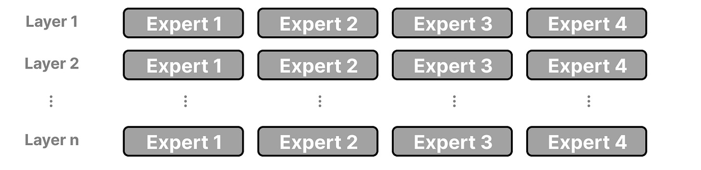

Know that an “expert” is not specialized in a specific domain like “Psychology” or “Biology”. At most, it learns syntactic information on a word level instead:  
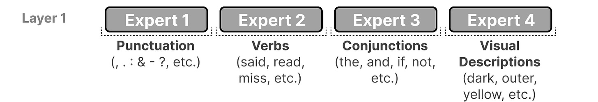

More specifically, their expertise is in handling specific tokens in specific contexts.

The router (gate network) selects the expert(s) best suited for a given input:  
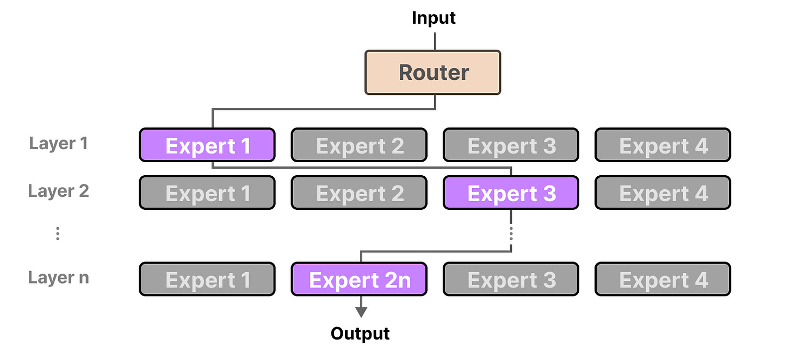

Each expert is not an entire LLM but a submodel part of an LLM’s architecture.

**The Experts**  
To explore what experts represent and how they work, let us first examine what MoE is supposed to replace; the *dense layers*.

**Dense Layers**  
Mixture of Experts (MoE) all start from a relatively basic functionality of LLMs, namely the *Feedforward Neural Network* (FFNN).

Remember that a standard decoder-only Transformer architecture has the FFNN applied after layer normalization:  
[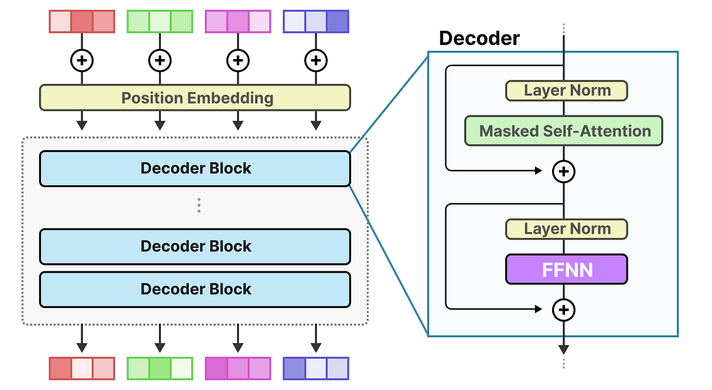](https://substackcdn.com/image/fetch/f_auto,q_auto:good,fl_progressive:steep/https%3A%2F%2Fsubstack-post-media.s3.amazonaws.com%2Fpublic%2Fimages%2Fd4729d2a-a51a-4224-93fe-c5674b9b38eb_1460x800.png)

Encoder = reads the whole input bidirectionally and turns it into contextual representations.  
Decoder = generates output one token at a time, using only the past.  
Encoder–decoder = encoder understands the input, decoder generates the output while attending to the encoder.

An FFNN allows the model to use the contextual information created by the attention mechanism, transforming it further to capture more complex relationships in the data.

The FFNN, however, does grow quickly in size. To learn these complex relationships, it typically expands on the input it receives:  
[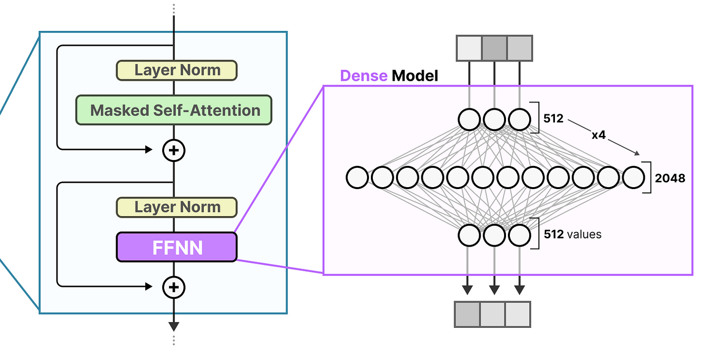](https://substackcdn.com/image/fetch/f_auto,q_auto:good,fl_progressive:steep/https%3A%2F%2Fsubstack-post-media.s3.amazonaws.com%2Fpublic%2Fimages%2F091ec102-45f0-4456-9e0a-7218a49e01df_1460x732.png)

**Sparse Layers**  
The FFNN in a traditional Transformer is called a **dense** model since all parameters (its weights and biases) are activated. Nothing is left behind and everything is used to calculate the output.

explain: In a normal Transformer, the FFNN is dense: every token goes through the same full network, and every weight and bias is used. Nothing is left behind. That’s different from sparse models, where only a small part of the network is used for each token.

If we take a closer look at the dense model, notice how the input activates all parameters to some degree:  
[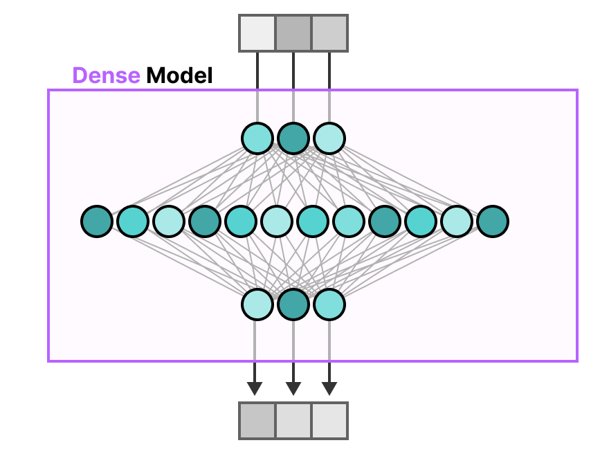](https://substackcdn.com/image/fetch/f_auto,q_auto:good,fl_progressive:steep/https%3A%2F%2Fsubstack-post-media.s3.amazonaws.com%2Fpublic%2Fimages%2F101e8ddc-9aa7-4e24-92fc-78d25da73399_880x656.png)

In contrast, **sparse** models only activate a portion of their total parameters and are closely related to Mixture of Experts.

To illustrate, we can chop up our dense model into pieces (so-called experts), retrain it, and only activate a subset of experts at a given time:  
[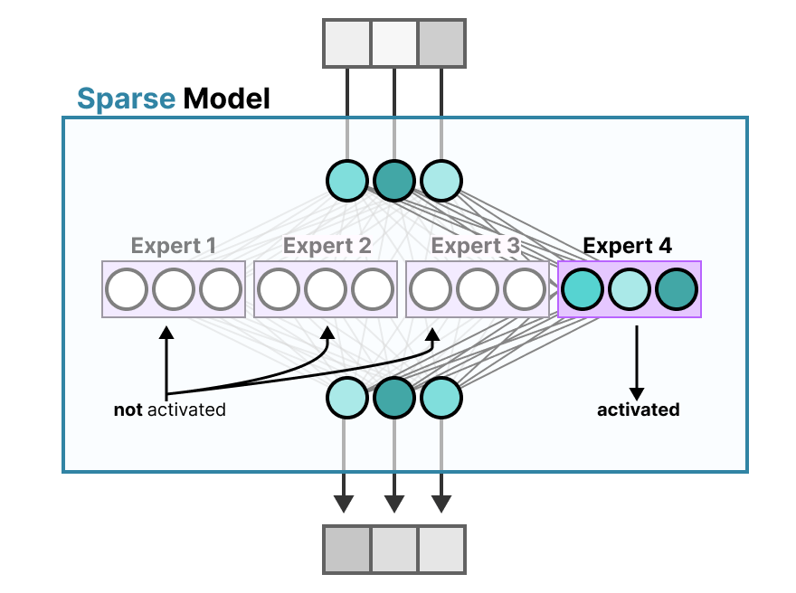](https://substackcdn.com/image/fetch/f_auto,q_auto:good,fl_progressive:steep/https%3A%2F%2Fsubstack-post-media.s3.amazonaws.com%2Fpublic%2Fimages%2Fcc4eeaf8-166b-419f-896c-463498af5692_880x656.png)

The underlying idea is that each expert learns different information during training. Then, when running inference, only specific experts are used as they are most relevant for a given task.

When asked a question, we can select the expert best suited for a given task:  
[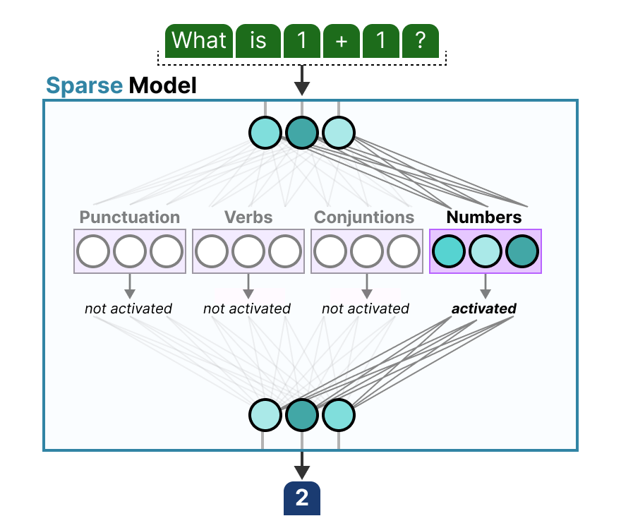](https://substackcdn.com/image/fetch/f_auto,q_auto:good,fl_progressive:steep/https%3A%2F%2Fsubstack-post-media.s3.amazonaws.com%2Fpublic%2Fimages%2Fce63e5cc-9b82-45b4-b3dc-9db0cac47da3_880x748.png)

**What does an Expert Learn?**  
As we have seen before, experts learn more fine-grained information than entire domains.[1](https://newsletter.maartengrootendorst.com/p/a-visual-guide-to-mixture-of-experts#footnote-1-148217245) As such, calling them “experts” has sometimes been seen as misleading.

[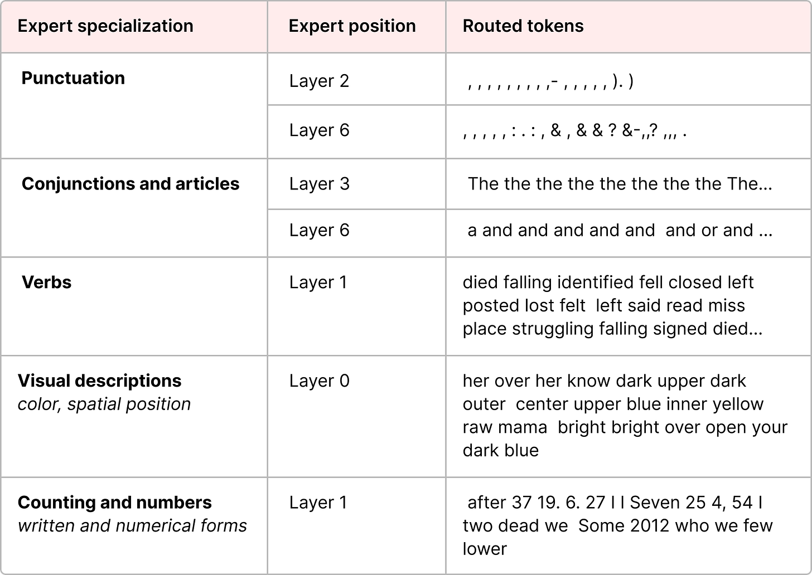](https://substackcdn.com/image/fetch/f_auto,q_auto:good,fl_progressive:steep/https%3A%2F%2Fsubstack-post-media.s3.amazonaws.com%2Fpublic%2Fimages%2F04123f9e-b798-4712-bcfb-70a26438f3b9_2240x1588.png)  
Expert specialization of an encoder model in the ST-MoE paper.

Experts in decoder models, however, do not seem to have the same type of specialization. That does not mean though that all experts are equal.  
A great example can be found in the [Mixtral 8x7B paper](https://arxiv.org/pdf/2401.04088) where each token is colored with the first expert choice.  
[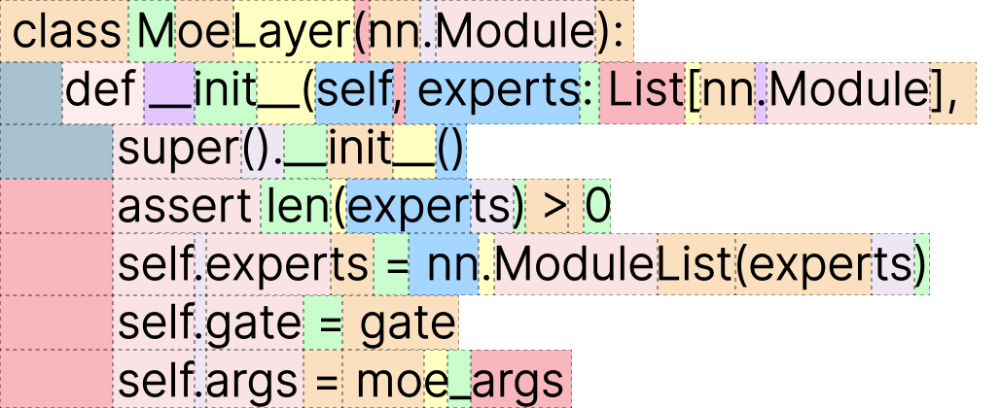](https://substackcdn.com/image/fetch/f_auto,q_auto:good,fl_progressive:steep/https%3A%2F%2Fsubstack-post-media.s3.amazonaws.com%2Fpublic%2Fimages%2Fd03e32b4-5830-4d98-8514-0c1a28127ed9_1028x420.png)

This visual also demonstrates that experts tend to focus on syntax rather than a specific domain.

Thus, although decoder experts do not seem to have a specialism they do seem to be used consistently for certain types of tokens.

**The Architecture of Experts**  
Although it’s nice to visualize experts as a hidden layer of a dense model cut in pieces, they are often whole FFNNs themselves:  
[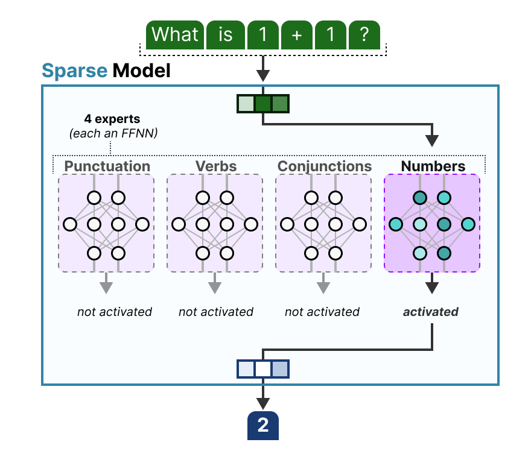](https://substackcdn.com/image/fetch/f_auto,q_auto:good,fl_progressive:steep/https%3A%2F%2Fsubstack-post-media.s3.amazonaws.com%2Fpublic%2Fimages%2Fe51561eb-f3d6-45ca-a2f8-c71abfa7c2a9_880x748.png)

Since most LLMs have several decoder blocks, a given text will pass through multiple experts before the text is generated:  
[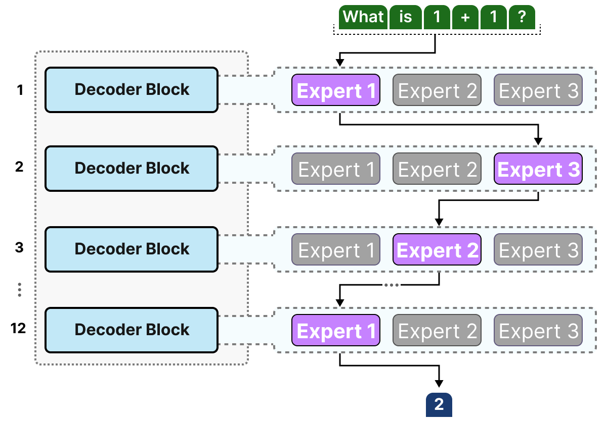](https://substackcdn.com/image/fetch/f_auto,q_auto:good,fl_progressive:steep/https%3A%2F%2Fsubstack-post-media.s3.amazonaws.com%2Fpublic%2Fimages%2F89b1caad-5201-43fe-b7de-04ebe877eb2d_1196x836.png)

The chosen experts likely differ between tokens which results in different “paths” being taken:  
[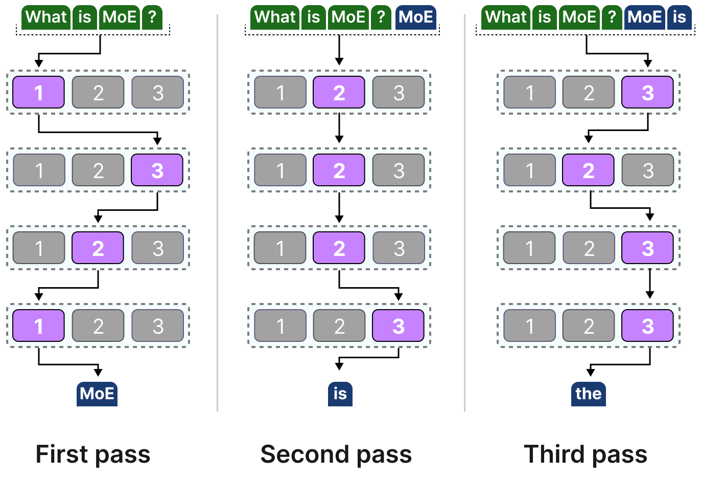](https://substackcdn.com/image/fetch/f_auto,q_auto:good,fl_progressive:steep/https%3A%2F%2Fsubstack-post-media.s3.amazonaws.com%2Fpublic%2Fimages%2Fcde4794d-8b3e-454d-9a1c-88c1999fdd45_1372x932.png)

If we update our visualization of the decoder block, it would now contain more FFNNs (one for each expert) instead:  
[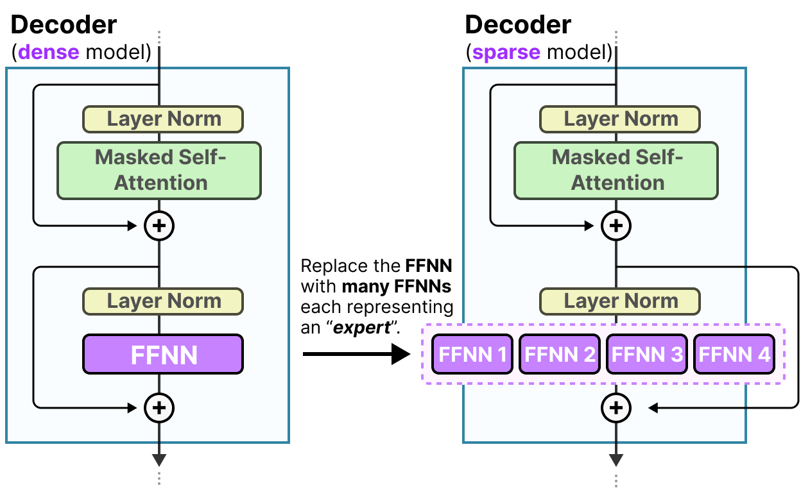](https://substackcdn.com/image/fetch/f_auto,q_auto:good,fl_progressive:steep/https%3A%2F%2Fsubstack-post-media.s3.amazonaws.com%2Fpublic%2Fimages%2Fb97a8ac7-db97-497f-866d-10400729d51e_1248x764.png)

The decoder block now has multiple FFNNs (each an “expert”) that it can use during inference.

**The Routing Mechanism**

Now that we have a set of experts, how does the model know which experts to use?  
Just before the experts, a **router** (also called a **gate network** ) is added which is trained to choose which expert to choose for a given token.

**The Router**

The **router** (or **gate network** ) is also an FFNN and is used to choose the expert based on a particular input. It outputs probabilities which it uses to select the best matching expert:  
[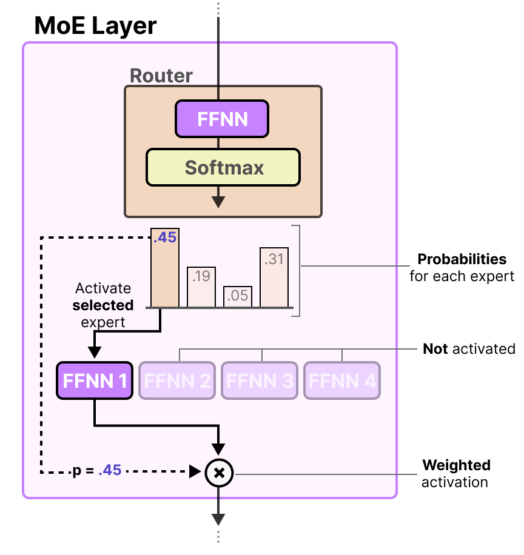](https://substackcdn.com/image/fetch/f_auto,q_auto:good,fl_progressive:steep/https%3A%2F%2Fsubstack-post-media.s3.amazonaws.com%2Fpublic%2Fimages%2Facc49abf-bc55-45fd-9697-99c9434087d0_864x916.png)

The expert layer returns the output of the selected expert multiplied by the gate value (selection probabilities).  
The router together with the experts (of which only a few are selected) makes up the **MoE Layer** :  
[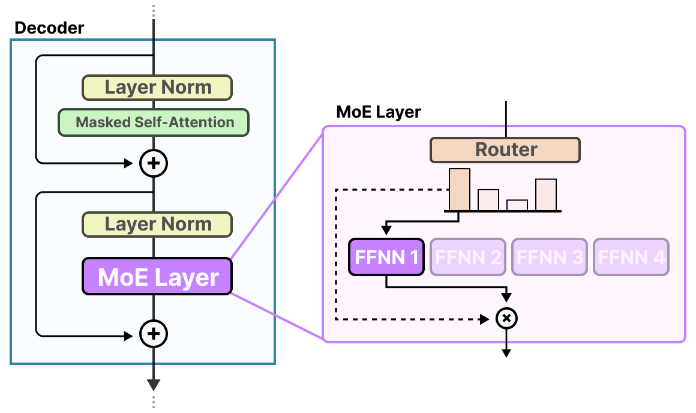](https://substackcdn.com/image/fetch/f_auto,q_auto:good,fl_progressive:steep/https%3A%2F%2Fsubstack-post-media.s3.amazonaws.com%2Fpublic%2Fimages%2Fa6fcabc6-78cd-477f-ac4e-2260cb06e230_1160x688.png)

A given MoE layer comes in two sizes, either a *sparse* or a *dense* mixture of experts.

Both use a router to select experts but a Sparse MoE only selects a few whereas a Dense MoE selects them all but potentially in different distributions.  
[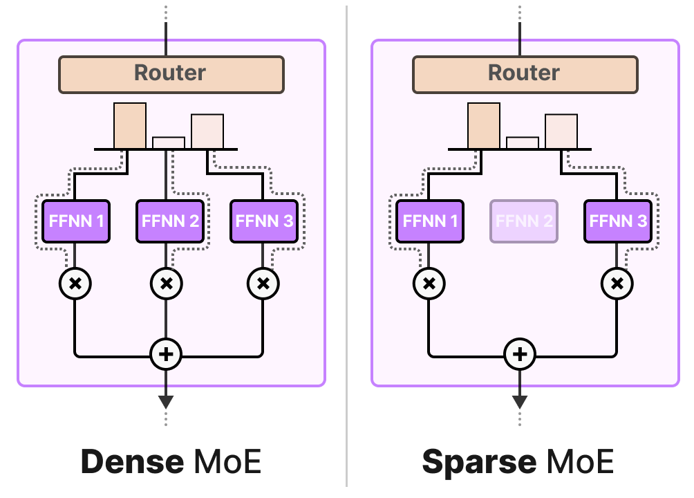](https://substackcdn.com/image/fetch/f_auto,q_auto:good,fl_progressive:steep/https%3A%2F%2Fsubstack-post-media.s3.amazonaws.com%2Fpublic%2Fimages%2F46aadf17-3afe-4c98-b57c-83b7b38918b2_1004x720.png)

For instance, given a set of tokens, a MoE will distribute the tokens across all experts whereas a Sparse MoE will only select a few experts.

In the current state of LLMs, when you see a “MoE” it will typically be a Sparse MoE as it allows you to use a subset of experts. This is computationally cheaper which is an important trait for LLMs.

**Selection of Experts**

The gating network is arguably the most important component of any MoE as it not only decides which experts to choose during *inference* but also *training*.

In its most basic form, we multiply the input ( \_ **x** *) by the router weight matrix ( \_* **W)** :  
[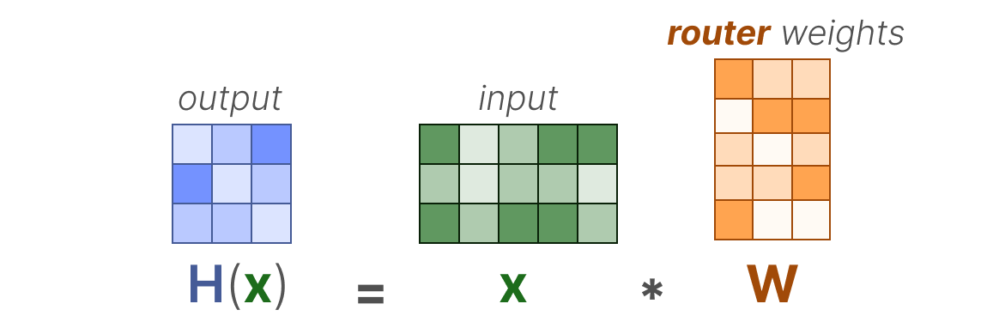](https://substackcdn.com/image/fetch/f_auto,q_auto:good,fl_progressive:steep/https%3A%2F%2Fsubstack-post-media.s3.amazonaws.com%2Fpublic%2Fimages%2F58234ce0-bf96-49ab-b414-674a710a1c3c_1164x368.png)

Then, we apply a **SoftMax** on the output to create a probability distribution **G** ( \_ **x**\_ ) per expert:  
[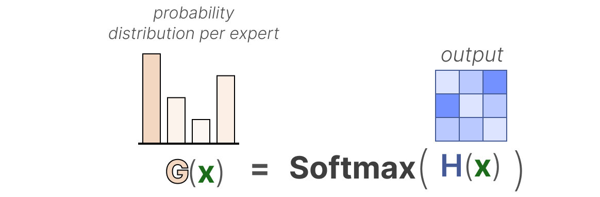](https://substackcdn.com/image/fetch/f_auto,q_auto:good,fl_progressive:steep/https%3A%2F%2Fsubstack-post-media.s3.amazonaws.com%2Fpublic%2Fimages%2Fb888a32f-acef-4fff-9d4b-cc70e148a8f2_1164x384.png)

The router uses this probability distribution to choose the best matching expert for a given input.  
Finally, we multiply the output of each router with each selected expert and sum the results.  
[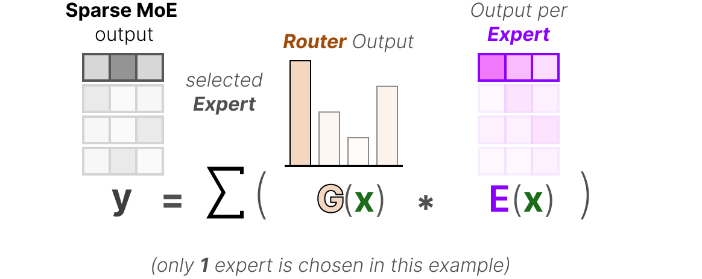](https://substackcdn.com/image/fetch/f_auto,q_auto:good,fl_progressive:steep/https%3A%2F%2Fsubstack-post-media.s3.amazonaws.com%2Fpublic%2Fimages%2Fe6e46ea4-dbd4-4cc4-aa2b-2c5474917f31_1164x464.png)

Let’s put everything together and explore how the input flows through the router and experts:  
[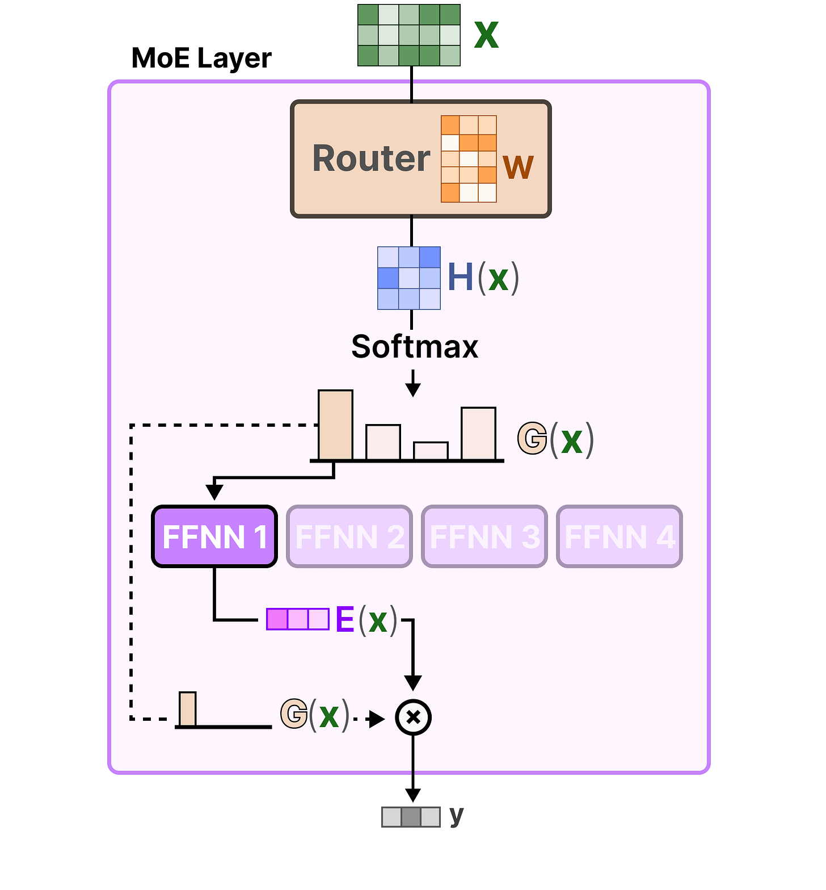](https://substackcdn.com/image/fetch/f_auto,q_auto:good,fl_progressive:steep/https%3A%2F%2Fsubstack-post-media.s3.amazonaws.com%2Fpublic%2Fimages%2Fd5d24a0b-2d78-4c69-b6fe-d75ba34bdd0c_2080x2240.png)

[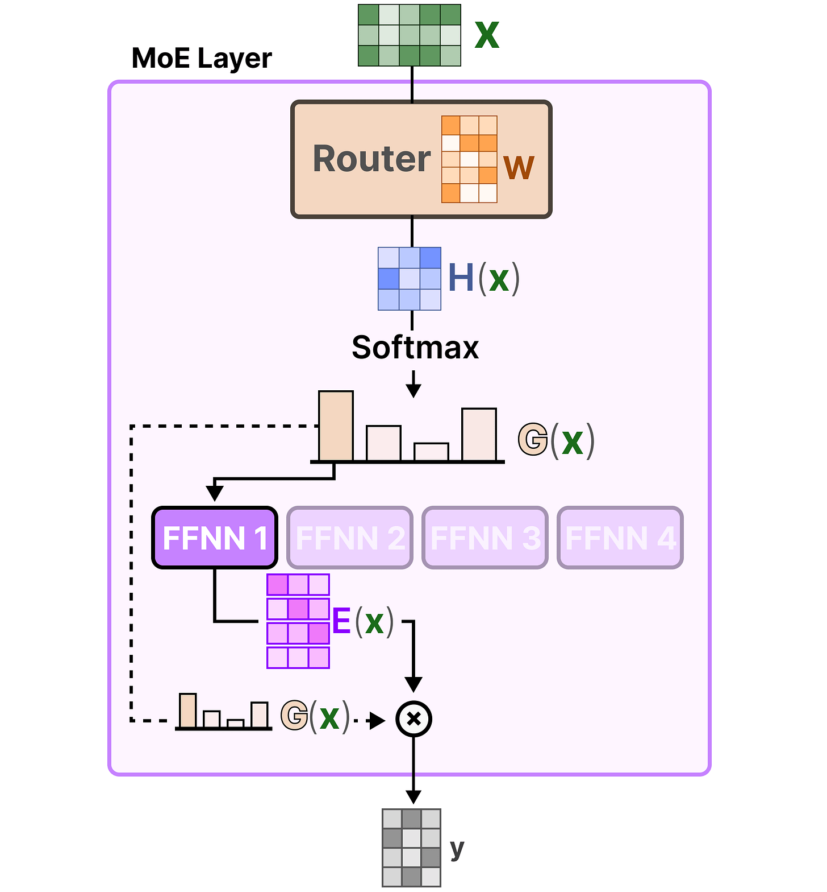](https://substackcdn.com/image/fetch/f_auto,q_auto:good,fl_progressive:steep/https%3A%2F%2Fsubstack-post-media.s3.amazonaws.com%2Fpublic%2Fimages%2F3d1122aa-7248-47d0-8e01-caa941ce0aa9_2080x2240.png)

**The Complexity of Routing**

However, this simple function often results in the router choosing the same expert since certain experts might learn faster than others:

[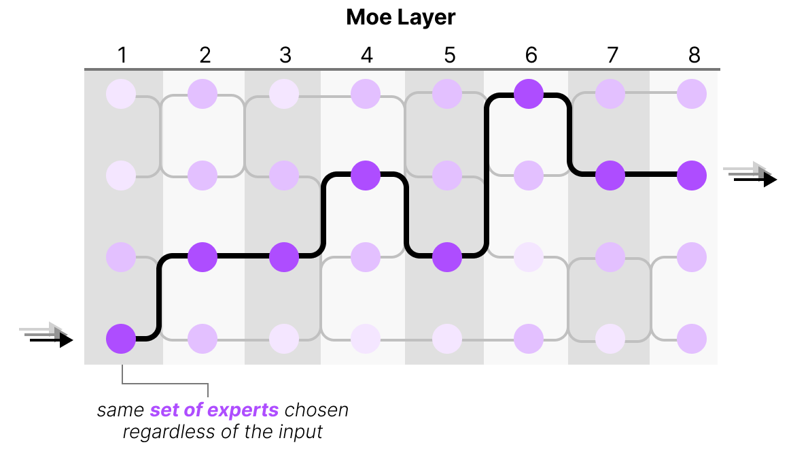](https://substackcdn.com/image/fetch/f_auto,q_auto:good,fl_progressive:steep/https%3A%2F%2Fsubstack-post-media.s3.amazonaws.com%2Fpublic%2Fimages%2F9233733c-c152-428a-ae99-1ed185fc3d50_1164x660.png)

Not only will there be an uneven distribution of experts chosen, but some experts will hardly be trained at all. This results in issues during both training and inference.

Instead, we want equal importance among experts during training and inference, which we call **load balancing**. In a way, it’s to prevent overfitting on the same experts.

**Load Balancing**  
To balance the importance of experts, we will need to look at the router as it is the main component to decide which experts to choose at a given time.

**KeepTopK**  
One method of load balancing the router is through a straightforward extension called [KeepTopK](https://arxiv.org/pdf/1701.06538)[2](https://newsletter.maartengrootendorst.com/p/a-visual-guide-to-mixture-of-experts#footnote-2-148217245). By introducing trainable (gaussian) noise, we can prevent the same experts from always being picked:  
[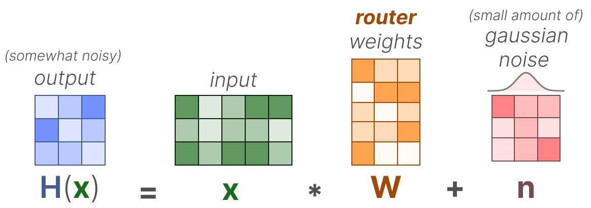](https://substackcdn.com/image/fetch/f_auto,q_auto:good,fl_progressive:steep/https%3A%2F%2Fsubstack-post-media.s3.amazonaws.com%2Fpublic%2Fimages%2F1b95b020-ae34-40f0-a5c4-9542343beea9_1164x412.png)

Then, all but the top k experts that you want activating (for example 2) will have their weights set to -∞ **:**  
[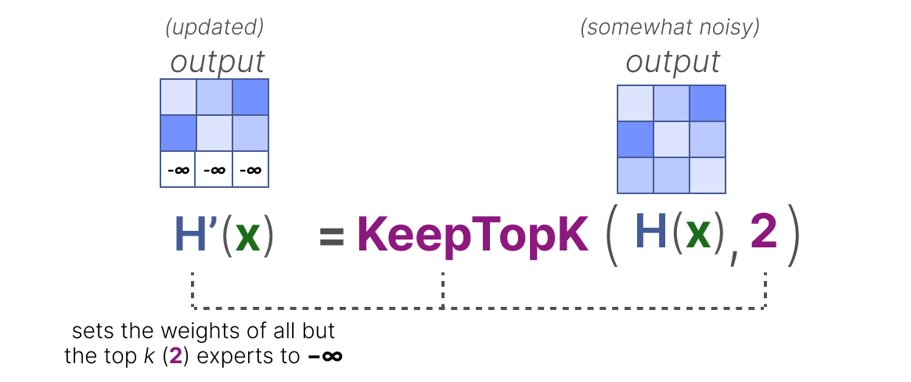](https://substackcdn.com/image/fetch/f_auto,q_auto:good,fl_progressive:steep/https%3A%2F%2Fsubstack-post-media.s3.amazonaws.com%2Fpublic%2Fimages%2F66bea40e-3fb0-4937-88d5-2852af456cf3_1164x488.png)

By setting these weights to **-∞** , the output of the SoftMax on these weights will result in a probability of **0** :  
[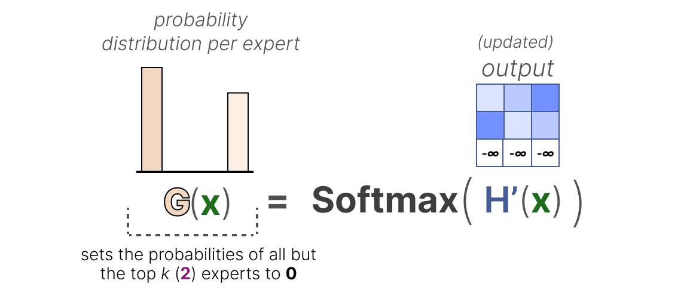](https://substackcdn.com/image/fetch/f_auto,q_auto:good,fl_progressive:steep/https%3A%2F%2Fsubstack-post-media.s3.amazonaws.com%2Fpublic%2Fimages%2F687d2279-1d8b-4af1-b55e-55d618ee877f_1164x496.png)

The KeepTopK strategy is one that many LLMs still use despite many promising alternatives. Note that KeepTopK can also be used without the additional noise.

**Token Choice**  
The KeepTopK strategy routes each token to a few selected experts. This method is called *Token Choice*[3](https://newsletter.maartengrootendorst.com/p/a-visual-guide-to-mixture-of-experts#footnote-3-148217245) and allows for a given token to be sent to one expert ( *top-1 routing* ):  
[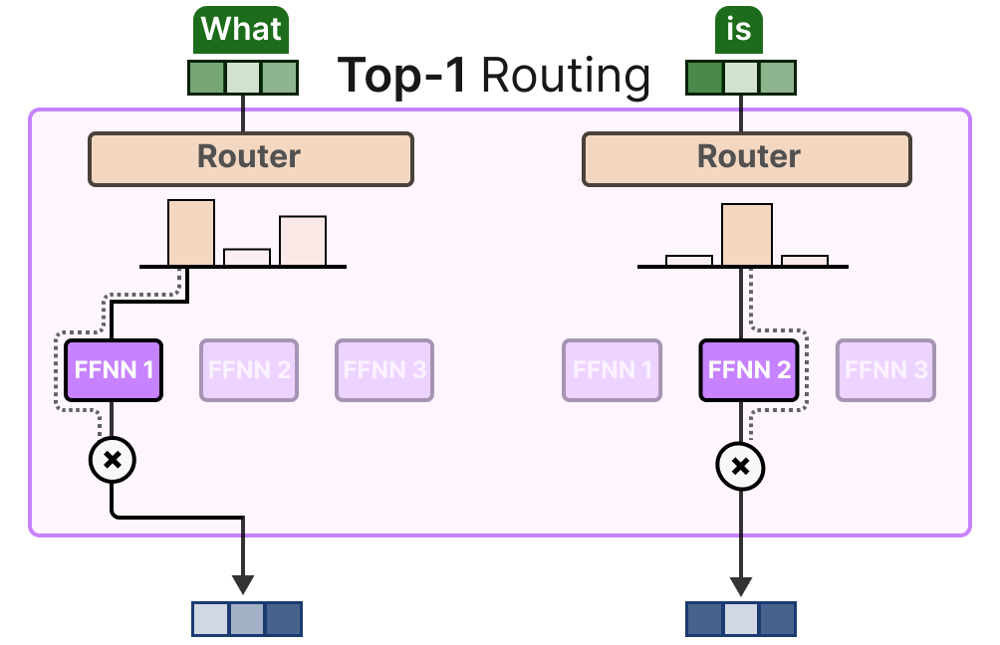](https://substackcdn.com/image/fetch/f_auto,q_auto:good,fl_progressive:steep/https%3A%2F%2Fsubstack-post-media.s3.amazonaws.com%2Fpublic%2Fimages%2Fdf7a9988-d4c8-4b1b-a968-073a6b3bfc6a_1004x648.png)

or to more than one expert (top-k routing):  
[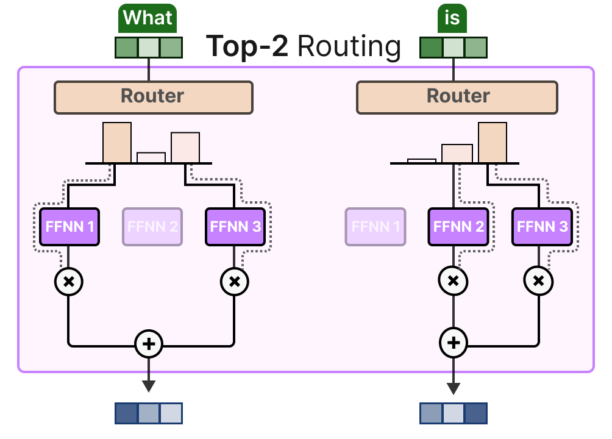](https://substackcdn.com/image/fetch/f_auto,q_auto:good,fl_progressive:steep/https%3A%2F%2Fsubstack-post-media.s3.amazonaws.com%2Fpublic%2Fimages%2Fb3f283f1-c359-4baf-8d01-8ebb2a90665f_1004x720.png)

A major benefit is that it allows the experts’ respective contributions to be weighed and integrated.

**Auxiliary Loss**  
To get a more even distribution of experts during training, the auxiliary loss (also called *load balancing loss* ) was added to the network’s regular loss.  
It adds a constraint that forces experts to have equal importance.

The first component of this auxiliary loss is to sum the router values for each expert over the entire batch:  
[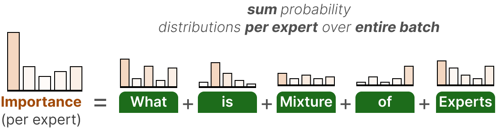](https://substackcdn.com/image/fetch/f_auto,q_auto:good,fl_progressive:steep/https%3A%2F%2Fsubstack-post-media.s3.amazonaws.com%2Fpublic%2Fimages%2Ff3624da0-3137-42ba-95e8-88fcbddb5f9f_1108x288.png)

This gives us the *importance scores* per expert which represents how likely a given expert will be chosen regardless of the input.

We can use this to calculate the *coefficient variation* ( **CV** ), which tells us how different the importance scores are between experts.  
[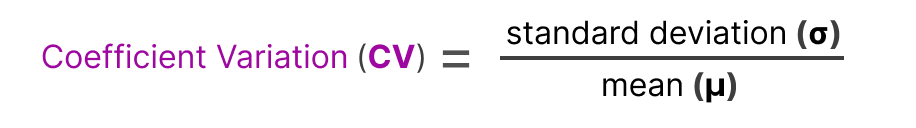](https://substackcdn.com/image/fetch/f_auto,q_auto:good,fl_progressive:steep/https%3A%2F%2Fsubstack-post-media.s3.amazonaws.com%2Fpublic%2Fimages%2F94def8dc-2a65-4a02-855f-219f0df2a119_916x128.png)

For instance, if there are a lot of differences in importance scores, the **CV** will be high:  
[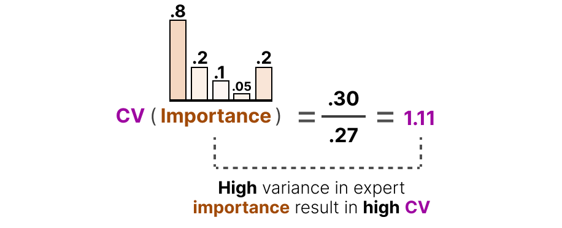](https://substackcdn.com/image/fetch/f_auto,q_auto:good,fl_progressive:steep/https%3A%2F%2Fsubstack-post-media.s3.amazonaws.com%2Fpublic%2Fimages%2Fab71b90c-ba29-42a9-944b-3dee52fc5c32_916x372.png)

In contrast, if all experts have similar importance scores, the **CV** will be low (which is what we aim for):  
[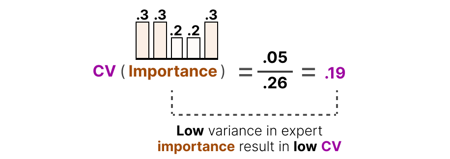](https://substackcdn.com/image/fetch/f_auto,q_auto:good,fl_progressive:steep/https%3A%2F%2Fsubstack-post-media.s3.amazonaws.com%2Fpublic%2Fimages%2Fc5cb91ac-4aab-4eb5-80bf-84e2bd4dc576_916x324.png)

Using this **CV** score, we can update the **auxiliary** **loss** during training such that it aims to lower the **CV** score as much as  
possible ( *thereby* *giving equal importance to each expert* ):  
[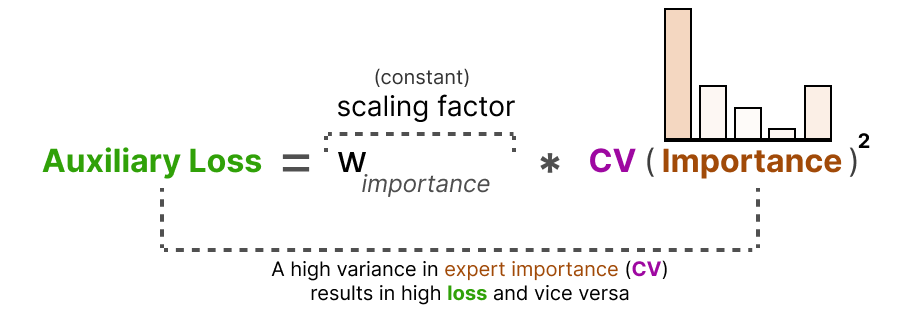](https://substackcdn.com/image/fetch/f_auto,q_auto:good,fl_progressive:steep/https%3A%2F%2Fsubstack-post-media.s3.amazonaws.com%2Fpublic%2Fimages%2Ff4aac801-af89-44e7-aaea-c57a55ff282c_916x312.png)

Finally, the auxiliary loss is added as a separate loss to optimize during training.

**Expert Capacity**  
Imbalance is not just found in the experts that were chosen but also in the distributions of tokens that are sent to the expert.

For instance, if input tokens are disproportionally sent to one expert over another then that might also result in undertraining:  
[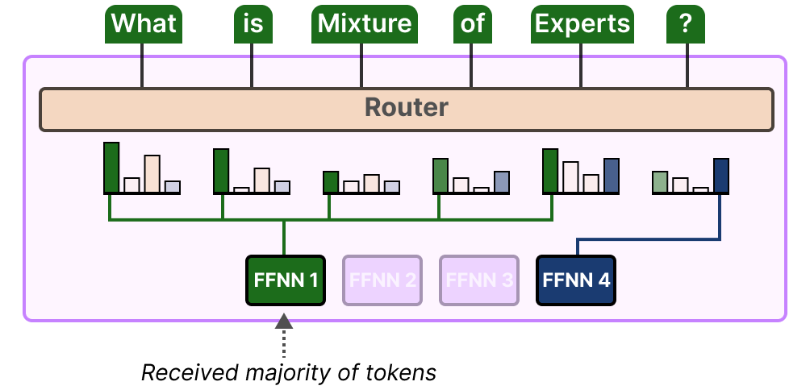](https://substackcdn.com/image/fetch/f_auto,q_auto:good,fl_progressive:steep/https%3A%2F%2Fsubstack-post-media.s3.amazonaws.com%2Fpublic%2Fimages%2F749eac8e-36e5-450f-a6fc-fbe48b7a1312_1004x484.png)

Here, it is not just about which experts are used but **how much** they are used.

A solution to this problem is to limit the amount of tokens a given expert can handle, namely *Expert Capacity*[4](https://newsletter.maartengrootendorst.com/p/a-visual-guide-to-mixture-of-experts#footnote-4-148217245). By the time an expert has reached capacity, the resulting tokens will be sent to the next expert:  
[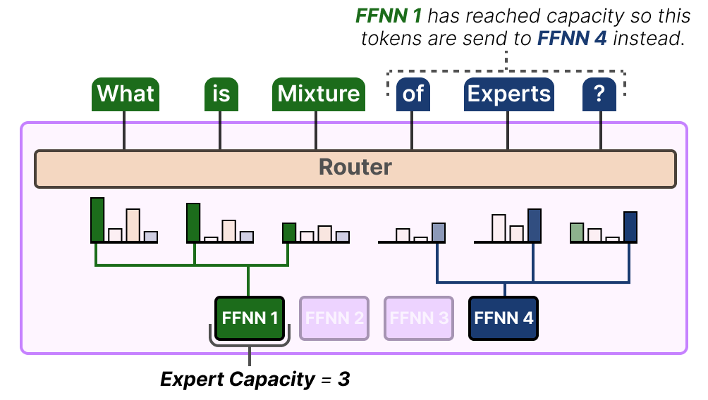](https://substackcdn.com/image/fetch/f_auto,q_auto:good,fl_progressive:steep/https%3A%2F%2Fsubstack-post-media.s3.amazonaws.com%2Fpublic%2Fimages%2Fdf67563f-755a-47a7-bebc-c1ac81a01f8f_1004x568.png)

If both experts have reached their capacity, the token will not be processed by any expert but instead sent to the next layer. This is referred to as *token overflow*.  
[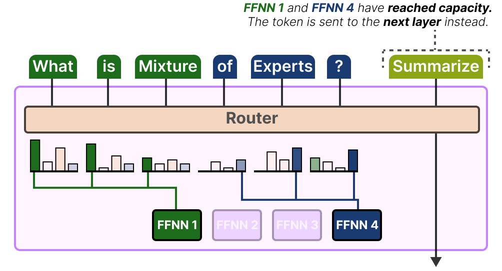](https://substackcdn.com/image/fetch/f_auto,q_auto:good,fl_progressive:steep/https%3A%2F%2Fsubstack-post-media.s3.amazonaws.com%2Fpublic%2Fimages%2Fe92ce4c5-affa-454d-8fd2-4debf9a08ce2_1004x544.png)

**Simplifying MoE with the Switch Transformer**  
One of the first transformer-based MoE models that dealt with the training instability issues of MoE (such as load balancing) is the Switch Transformer.[5](https://newsletter.maartengrootendorst.com/p/a-visual-guide-to-mixture-of-experts#footnote-5-148217245) It simplifies much of the architecture and training procedure while increasing training stability.

**The Switching Layer**

The Switch Transformer is a T5 model (encoder-decoder) that replaces the traditional FFNN layer with a Switching Layer. The Switching Layer is a Sparse MoE layer that selects a single expert for each token ( *Top-1 routing* ).  
[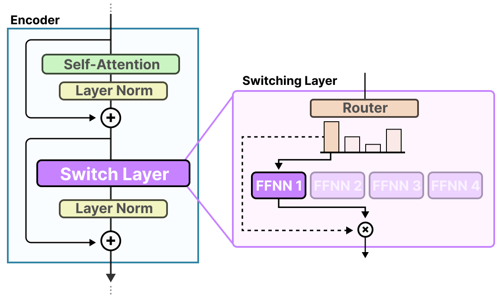](https://substackcdn.com/image/fetch/f_auto,q_auto:good,fl_progressive:steep/https%3A%2F%2Fsubstack-post-media.s3.amazonaws.com%2Fpublic%2Fimages%2F024d1788-9007-4953-9bf7-883da0db7f8d_1160x688.png)

The router does no special tricks for calculating which expert to choose and takes the softmax of the input multiplied by the expert’s weights (same as we did previously).  
[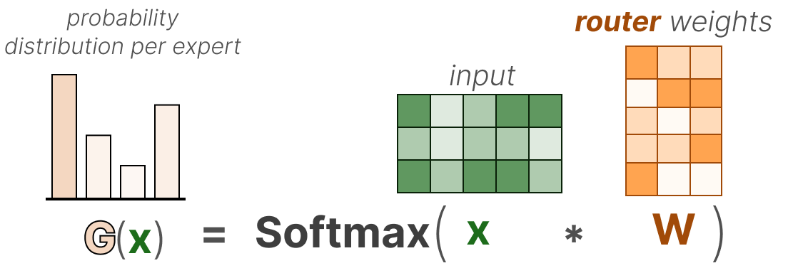](https://substackcdn.com/image/fetch/f_auto,q_auto:good,fl_progressive:steep/https%3A%2F%2Fsubstack-post-media.s3.amazonaws.com%2Fpublic%2Fimages%2Ff0758a7f-e26b-44b9-9d75-80ac6caa9802_1104x384.png)

This architecture ( *top-1 routing* ) assumes that only 1 expert is needed for the router to learn how to route the input. This is in contrast to what we have seen previously where we assumed that tokens should be routed to multiple experts ( *top-k routing* ) to learn the routing behavior.

**Capacity Factor**  
The capacity factor is an important value as it determines how many tokens an expert can process. The Switch Transformer extends upon this by introducing a **capacity factor** directly influencing the expert capacity.

The components of expert capacity are straightforward:  
[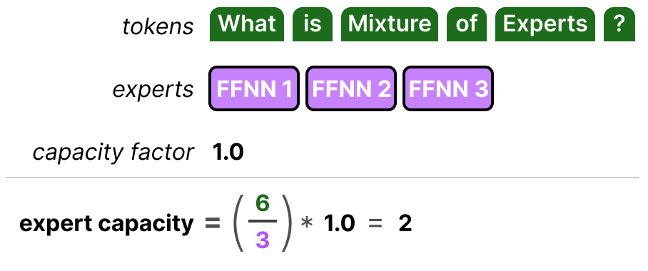](https://substackcdn.com/image/fetch/f_auto,q_auto:good,fl_progressive:steep/https%3A%2F%2Fsubstack-post-media.s3.amazonaws.com%2Fpublic%2Fimages%2Ff4b399c6-723b-4de6-94ca-7020cd1bb181_908x380.png)

If we increase the capacity factor each expert will be able to process more tokens.  
[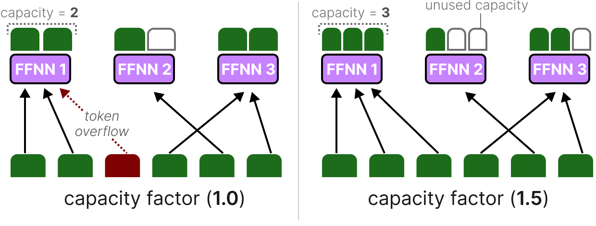](https://substackcdn.com/image/fetch/f_auto,q_auto:good,fl_progressive:steep/https%3A%2F%2Fsubstack-post-media.s3.amazonaws.com%2Fpublic%2Fimages%2F7fd2aea0-fddf-4a43-ac79-7c5e5194c115_1240x472.png)

However, if the capacity factor is too large, we waste computing resources. In contrast, if the capacity factor is too small, the model performance will drop due to *token overflow*.

**Mixture of Experts in Vision Models**  
MoE is not a technique that is only available to language models. Vision models (such as ViT) leverage transformer-based architectures and therefore have the potential to use MoE.

As a quick recap, ViT (Vision-Transformer) is an architecture that splits images into patches that are processed similarly to tokens.[6](https://newsletter.maartengrootendorst.com/p/a-visual-guide-to-mixture-of-experts#footnote-6-148217245)  

These patches (or tokens) are then projected into embeddings (with additional positional embeddings) before being fed into a regular encoder:  

The moment these patches enter the encoder, they are processed like tokens which makes this architecture leverage itself well for MoE.

**Mixture of Experts in Vision Models**  
MoE is not a technique that is only available to language models. Vision models (such as ViT) leverage transformer-based architectures and therefore have the potential to use MoE.

As a quick recap, ViT (Vision-Transformer) is an architecture that splits images into patches that are processed similarly to tokens.[6](https://newsletter.maartengrootendorst.com/p/a-visual-guide-to-mixture-of-experts#footnote-6-148217245)  
[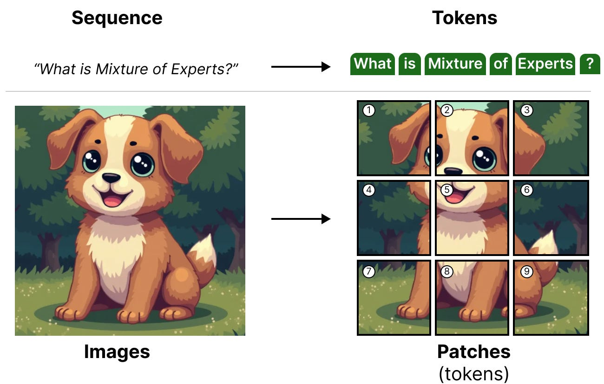](https://substackcdn.com/image/fetch/f_auto,q_auto:good,fl_progressive:steep/https%3A%2F%2Fsubstack-post-media.s3.amazonaws.com%2Fpublic%2Fimages%2F11b64fce-4069-4c73-995d-c3059fda0dcc_1300x828.png)

These patches (or tokens) are then projected into embeddings (with additional positional embeddings) before being fed into a regular encoder:  
[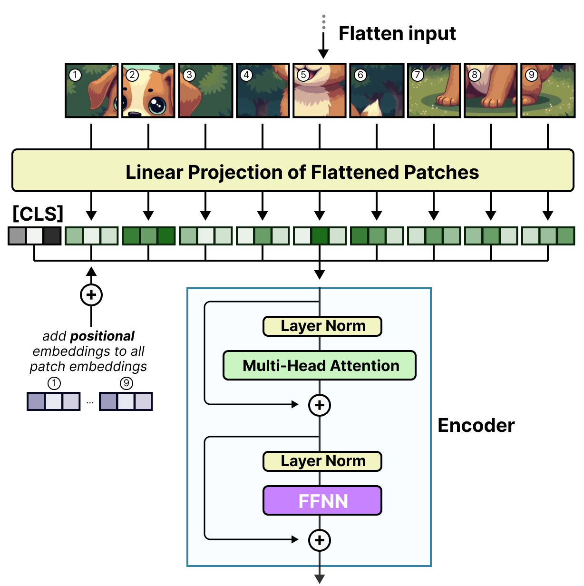](https://substackcdn.com/image/fetch/f_auto,q_auto:good,fl_progressive:steep/https%3A%2F%2Fsubstack-post-media.s3.amazonaws.com%2Fpublic%2Fimages%2Fc0b2ea60-238b-446a-ab59-503efb6ca061_1228x1232.png)

The moment these patches enter the encoder, they are processed like tokens which makes this architecture leverage itself well for MoE.

**Vision-MoE**  
Vision-MoE (V-MoE) is one of the first implementations of MoE in an image model.[7](https://newsletter.maartengrootendorst.com/p/a-visual-guide-to-mixture-of-experts#footnote-7-148217245) It takes the ViT as we saw before and replaces the dense FFNN in the encoder with a Sparse MoE.  
[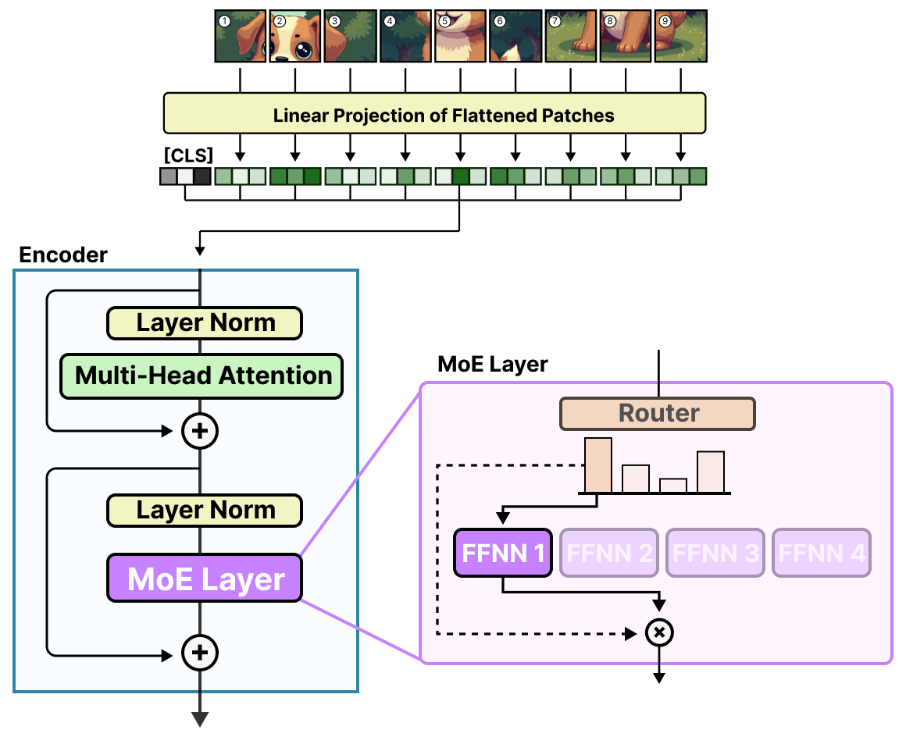](https://substackcdn.com/image/fetch/f_auto,q_auto:good,fl_progressive:steep/https%3A%2F%2Fsubstack-post-media.s3.amazonaws.com%2Fpublic%2Fimages%2F10e9721d-4b3f-4062-ad72-97ffd1049077_1160x944.png)

This allows ViT models, typically smaller in size than language models, to be massively scaled by adding experts.

A small pre-defined expert capacity was used for each expert to reduce hardware constraints since images generally have many patches. However, a low capacity tends to lead to patches being dropped (akin to *token overflow* ).  
[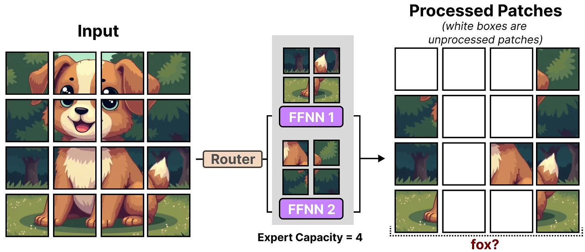](https://substackcdn.com/image/fetch/f_auto,q_auto:good,fl_progressive:steep/https%3A%2F%2Fsubstack-post-media.s3.amazonaws.com%2Fpublic%2Fimages%2F219141c9-51ff-4d85-9f8a-c705c6e9ece4_1720x744.png)

To keep the capacity low, the network assigns importance scores to patches and processes those first so that overflowed patches are generally less important. This is called Batch *Priority Routing*.  
[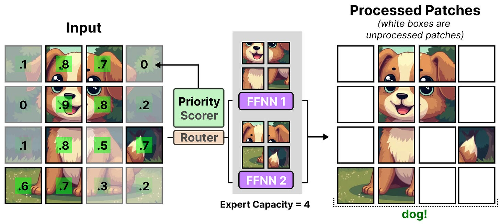](https://substackcdn.com/image/fetch/f_auto,q_auto:good,fl_progressive:steep/https%3A%2F%2Fsubstack-post-media.s3.amazonaws.com%2Fpublic%2Fimages%2Fa0ef5323-4b4c-4ee7-8a53-51fbe4213283_1720x772.png)

As a result, we should still see important patches routed if the percentage of tokens decreases.  
[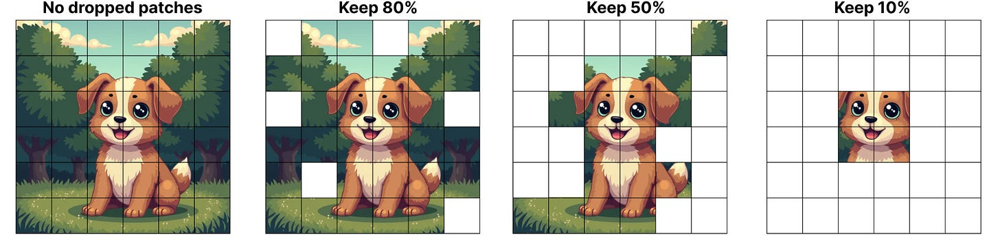](https://substackcdn.com/image/fetch/f_auto,q_auto:good,fl_progressive:steep/https%3A%2F%2Fsubstack-post-media.s3.amazonaws.com%2Fpublic%2Fimages%2F65f972b9-640b-4a76-b77d-2d2ef1b40609_1736x420.png)

The priority routing allows fewer patches to be processed by focusing on the most important ones.  
**From Sparse to Soft MoE**

In V-MoE, the priority scorer helps differentiate between more and less important patches. However, patches are assigned to each expert, and information in unprocessed patches is lost.  
Soft-MoE aims to go from a discrete to a soft patch (token) assignment by mixing patches.[8](https://newsletter.maartengrootendorst.com/p/a-visual-guide-to-mixture-of-experts#footnote-8-148217245)

In the first step, we multiply the input **x** (the patch embeddings) with a learnable matrix Φ. This gives us *router information* which tells us how related a certain token is to a given expert.  
[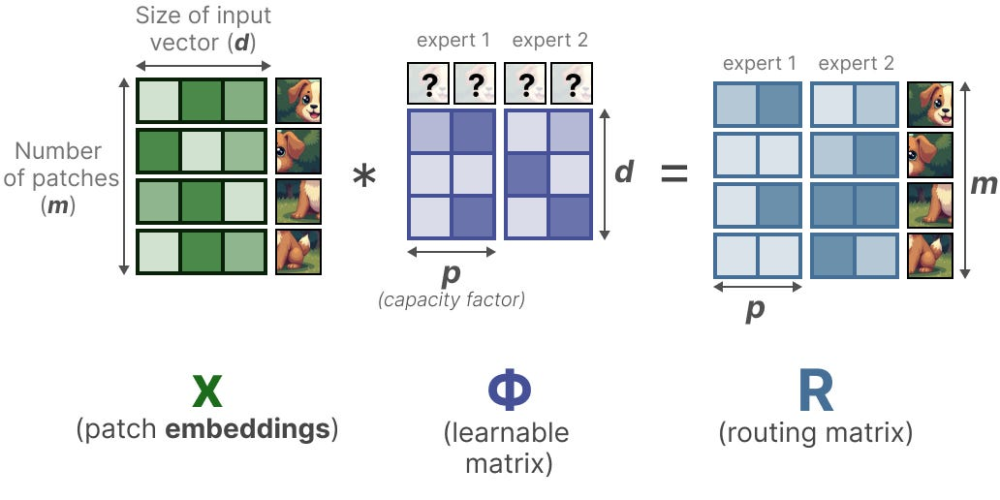](https://substackcdn.com/image/fetch/f_auto,q_auto:good,fl_progressive:steep/https%3A%2F%2Fsubstack-post-media.s3.amazonaws.com%2Fpublic%2Fimages%2F644c0c1c-24d3-491b-a9a2-fdd9658ad589_1032x516.png)

By then taking the softmax of the router information matrix (on the columns), we update the embeddings of each patch.  
[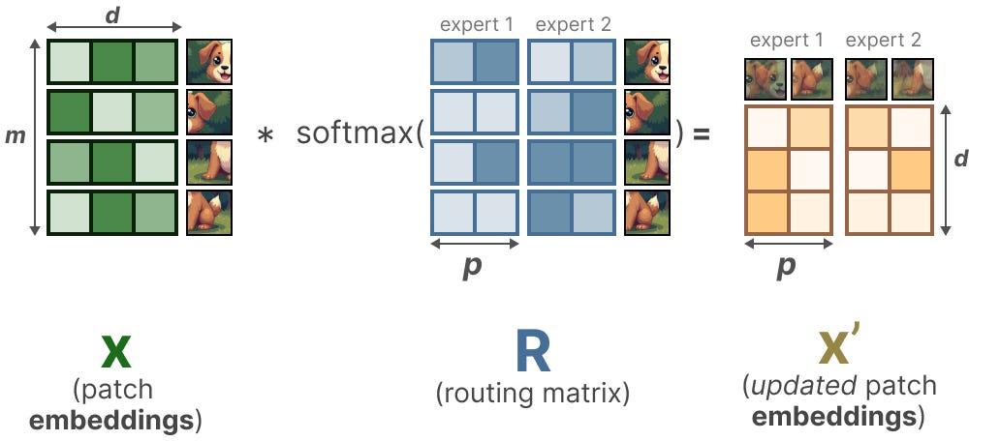](https://substackcdn.com/image/fetch/f_auto,q_auto:good,fl_progressive:steep/https%3A%2F%2Fsubstack-post-media.s3.amazonaws.com%2Fpublic%2Fimages%2F6c3187d8-5bf2-4c73-8c22-547107fe1152_1032x456.png)

The updated patch embeddings are essentially the weighted average of all patch embeddings.  
[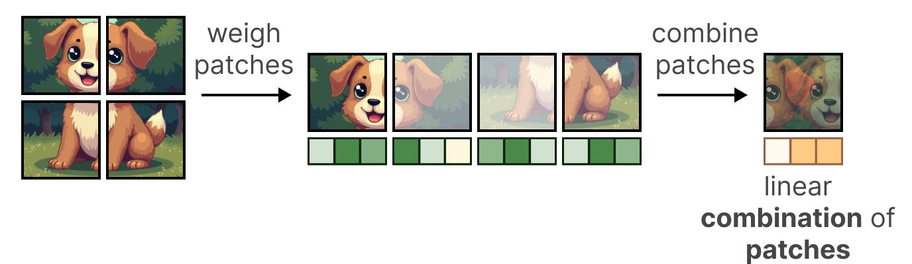](https://substackcdn.com/image/fetch/f_auto,q_auto:good,fl_progressive:steep/https%3A%2F%2Fsubstack-post-media.s3.amazonaws.com%2Fpublic%2Fimages%2F7cfeb30a-1b04-4b9a-8f5a-d3c5d47e6499_1376x400.png)

Visually, it is as if all patches were mixed. These combined patches are then sent to each expert. After generating the output, they are again multiplied with the router matrix.  
[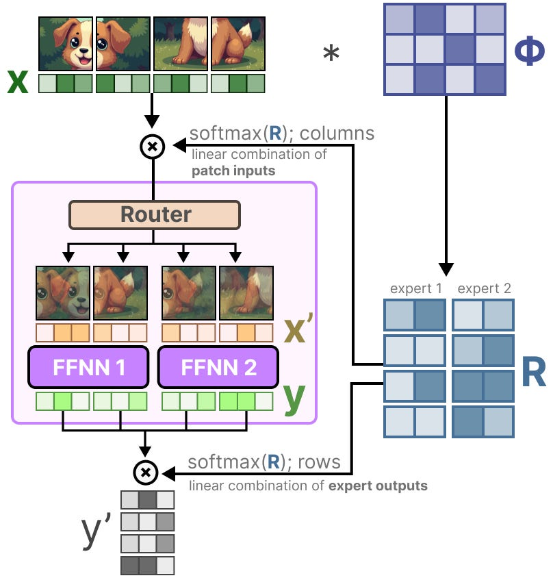](https://substackcdn.com/image/fetch/f_auto,q_auto:good,fl_progressive:steep/https%3A%2F%2Fsubstack-post-media.s3.amazonaws.com%2Fpublic%2Fimages%2F86020d75-c881-4418-82a6-a228f091abe8_808x844.png)  
The router matrix affects the input on a token level and the output on an expert level.  
As a result, we get “soft” patches/tokens that are processed instead of discrete input.

**Active vs. Sparse Parameters with Mixtral 8x7B**  
A big part of what makes MoE interesting is its computational requirements. Since only a subset of experts are used at a given time, we have access to more parameters than we are using.

Although a given MoE has more parameters to load ( *sparse parameters* ), fewer are activated since we only use some experts during inference ( *active parameters* ).  

In other words, we still need to load the entire model (including all experts) onto your device ( *sparse parameters* ) but when we run inference, we only need to use a subset ( *active parameters* ). MoE models need more VRAM to load in all experts but run faster during inference.

Let’s explore the number of sparse vs active parameters with an example, Mixtral 8x7B.[9](https://newsletter.maartengrootendorst.com/p/a-visual-guide-to-mixture-of-experts#footnote-9-148217245)  

Here, we can see that each expert is **5.6B** in size and not 7B (although there are 8 experts).  
  
We will have to *load* **8x5.6B (** *46.7B* **)** parameters (along with all shared parameters) but we only need to use **2x5.6B (** *12.8B* **)** parameters for *inference*.

Summary:

- Mixture of Experts (MoE) is a technique that uses many different sub-models (or “experts”) to improve the quality of LLMs.
- Two main components define a MoE:
    - Experts in each FNNN, Experts in handling specific tokens in specific contexts.
    - Router which determines which tokens are sent to which experts.
- Encoder only Transformer architecture.= reads the whole input bidirectionally and turns it into contextual representations.
- Decoder only Transformer architecture= generates output one token at a time, using only the past.
- Encoder–decoder Transformer architecture.= encoder understands the input, decoder generates the output while attending to the encoder.
- An FFNN allows the model to use the contextual information created by the attention mechanism, transforming it (expand the input it receive) further to capture more complex relationships in the data.
- In a normal Transformer, the FFNN is dense: every token goes through the same full network, and every weight and bias is used. Nothing is left behind. That’s different from sparse models, where only a small part of the network is used for each token.
- Experts learn more fine-grained information than entire domains
- A given MoE layer comes in two sizes:
    - Sparse MoE: has a router, but each token activates only a few experts (e.g., top-2).
    - Dense MoE (soft MoE, dense routing): also has a router, but each token uses all experts, just with different weights. This is not the same Dense FFNN where we have no router, and all weights used.
- A MoE router picks experts from a probability distribution. Without balancing, a few experts dominate and the rest starve. Load balancing spreads usage so all experts learn and the model uses its full capacity.
- KeepTopK is part of the gating function — it enforces sparsity. Token Choice is the routing direction — tokens pick experts. Both can suffer from routing collapse. Auxiliary Loss is the training-time fix — it penalizes skewed distributions and encourages balanced expert usage. A fourth common approach is Expert Choice routing, where experts pick tokens instead, which enforces balance by construction.
- Expert Capacity: Max tokens per expert — a per-expert cap that limits how many tokens an expert can process, with overflow often dropped or passed through.
- Switch Transformer replaces the T5 FFN with a sparse MoE switching layer that routes each token to only one expert (Top-1 routing). It improves stability using a capacity factor to limit tokens per expert and a simplified auxiliary loss to encourage balanced expert usage.
- V-MoE brings sparse MoE to ViT by replacing dense FFNs with experts and using a small expert capacity plus Batch Priority Routing to process important patches first and reduce dropped patches. Soft-MoE replaces hard token-to-expert assignment with soft mixing, using a learnable router matrix to create weighted-average patch embeddings for each expert and then recombine their outputs.
- MoE stores all experts as sparse parameters in memory but activates only a few experts per token as active parameters, so it needs more VRAM yet uses less compute per token, making inference faster.

Source:  
[https://www.maartengrootendorst.com/blog/moe/](https://www.maartengrootendorst.com/blog/moe/)
