# Word2vec

Word2vec is a method to efficiently create word embeddings and has been around since 2013. But in addition to its utility as a word-embedding method, some of its concepts have been shown to be effective in creating recommendation engines and making sense of sequential data even in commercial, non-language tasks. Companies like [Airbnb](https://www.kdd.org/kdd2018/accepted-papers/view/real-time-personalization-using-embeddings-for-search-ranking-at-airbnb), [Alibaba](https://www.kdd.org/kdd2018/accepted-papers/view/billion-scale-commodity-embedding-for-e-commerce-recommendation-in-alibaba), [Spotify](https://www.slideshare.net/AndySloane/machine-learning-spotify-madison-big-data-meetup), and [Anghami](https://towardsdatascience.com/using-word2vec-for-music-recommendations-bb9649ac2484) have all benefitted from carving out this brilliant piece of machinery from the world of NLP and using it in production to empower a new breed of recommendation engines.

When dealing with vectors, a common way to calculate a similarity score is [cosine_similarity](https://en.wikipedia.org/wiki/Cosine_similarity)

The problem with many dimensions is that we lose the ability to draw neat little arrows in two dimensions. This is a common challenge in machine learning where we often have to think in higher-dimensional space. The good thing is, though, that cosine_similarity still works. It works with any number of dimensions

At the end of this section, I want us to come out with two central ideas:

1. We can represent people (and things) as vectors of numbers (which is great for machines!).
2. We can easily calculate how similar vectors are to each other.

**Word Embeddings**  
This is a word embedding for the word “king” (GloVe vector trained on Wikipedia):  
\[ 0.50451 , 0.68607 , -0.59517 , -0.022801, 0.60046 , -0.13498 , -0.08813 , 0.47377 , -0.61798 , -0.31012 , -0.076666, 1.493 , -0.034189, -0.98173 , 0.68229 , 0.81722 , -0.51874 , -0.31503 , -0.55809 , 0.66421 , 0.1961 , -0.13495 , -0.11476 , -0.30344 , 0.41177 , -2.223 , -1.0756 , -1.0783 , -0.34354 , 0.33505 , 1.9927 , -0.04234 , -0.64319 , 0.71125 , 0.49159 , 0.16754 , 0.34344 , -0.25663 , -0.8523 , 0.1661 , 0.40102 , 1.1685 , -1.0137 , -0.21585 , -0.15155 , 0.78321 , -0.91241 , -1.6106 , -0.64426 , -0.51042 \]  
Let’s color code the cells based on their values (red if they’re close to 2, white if they’re close to 0, blue if they’re close to -2).  
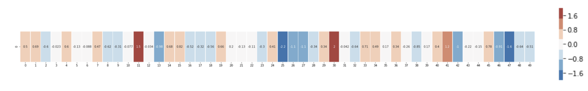

We’ll proceed by ignoring the numbers and only looking at the colors to indicate the values of the cells. Let’s now contrast “King” against other words:  
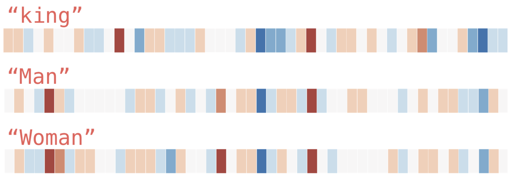

**Analogies**  
The famous examples that show an incredible property of embeddings is the concept of analogies. We can add and subtract word embeddings and arrive at interesting results. The most famous example is the formula: “king” - “man” + “woman”:  
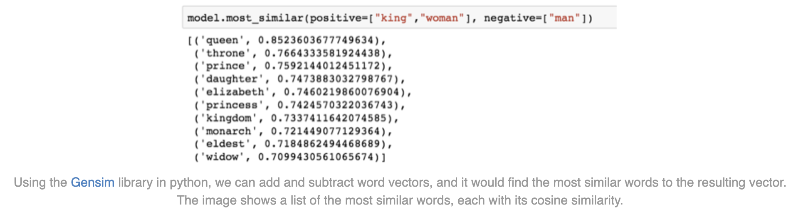

We can visualize this analogy as we did previously:  
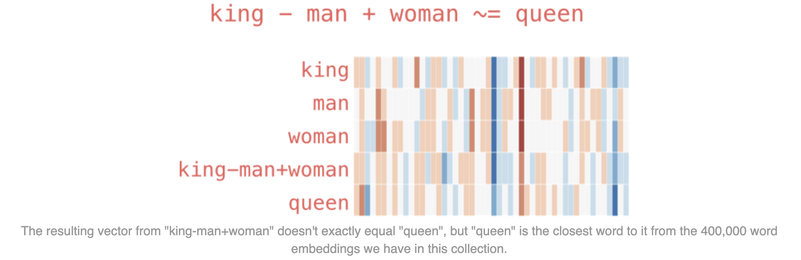

**Language Modeling**  
If one wanted to give an example of an NLP application, one of the best examples would be the next-word prediction feature of a smartphone keyboard. It’s a feature that billions of people use hundreds of times every day.

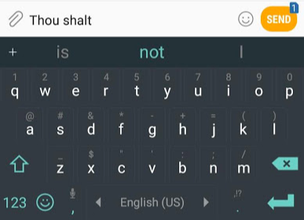

Next-word prediction is a task that can be addressed by a *language model*. A language model can take a list of words (let’s say two words), and attempt to predict the word that follows them.

In the screenshot above, we can think of the model as one that took in these two green words (thou shalt) and returned a list of suggestions (“not” being the one with the highest probability).

But in practice, the model doesn’t output only one word. It actually outputs a probability score for all the words it knows (the model’s “vocabulary”, which can range from a few thousand to over a million words). The keyboard application then has to find the words with the highest scores, and present those to the user.

The output of the neural language model is a probability score for all the words the model knows.

After being trained, early neural language models ([Bengio 2003](http://www.jmlr.org/papers/volume3/bengio03a/bengio03a.pdf)) would calculate a prediction in three steps:  
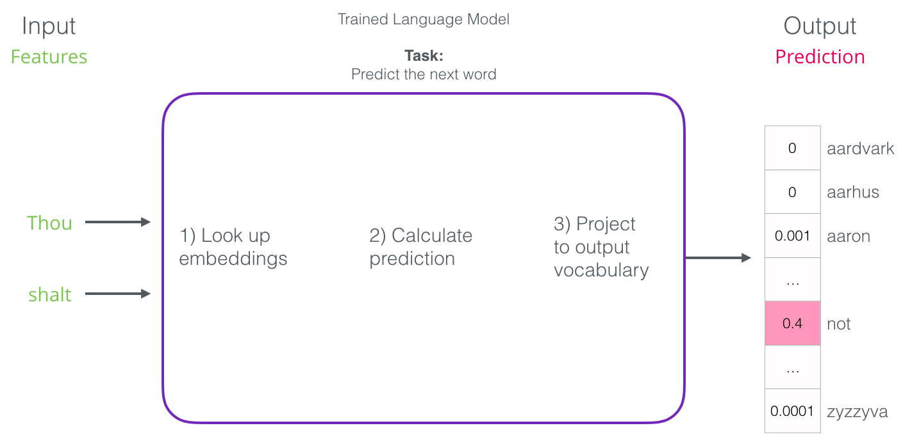

**Language Model Training**  
Language models have a huge advantage over most other machine learning models. That advantage is that we are able to train them on running text – which we have an abundance of. Think of all the books, articles, Wikipedia content, and other forms of text data we have lying around. Contrast this with a lot of other machine learning models which need hand-crafted features and specially-collected data.

Words get their embeddings by us looking at which other words they tend to appear next to. The mechanics of that is that

1. We get a lot of text data (say, all Wikipedia articles, for example). then
2. We have a window (say, of three words) that we slide against all of that text.
3. The sliding window generates training samples for our model

As this window slides against the text, we (virtually) generate a dataset that we use to train a model. We take the first two words to be features, and the third word to be a label:  
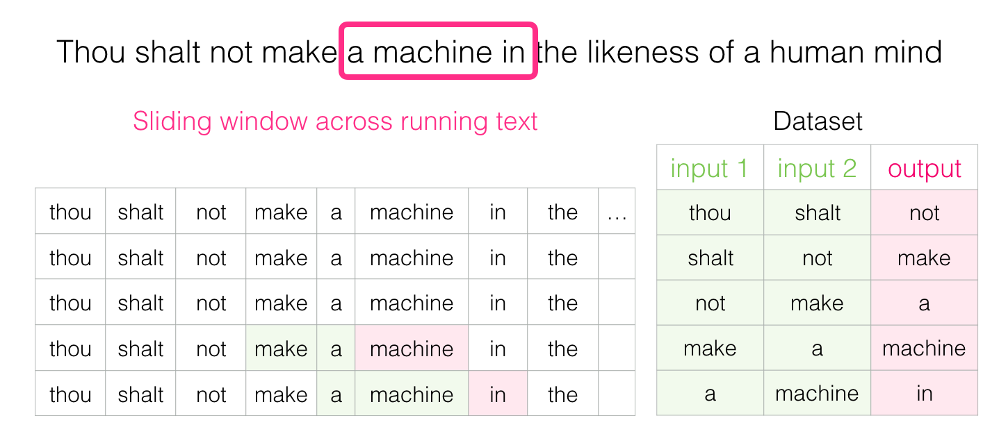

The words both before and after a specific word carry informational value. It turns out that accounting for both directions (words to the left and to the right of the word we’re guessing) leads to better word embeddings.

Skip-gram and Continuous Bag of Words (CBOW) are the two different architectures used by the original Word2Vec algorithm to learn those static word embeddings we just talked about.  
The core difference is simply the direction of prediction:

- CBOW predicts a target word based on its surrounding context words.
- Skip-gram predicts the surrounding context words based on a single target word.

**1. Continuous Bag of Words (CBOW)**

- How it works: You take a window of context words, hide the middle word, and ask the model to predict the missing word.
- Example: If the context window is "The quick brown \_\_\_ over the lazy dog," the model takes the input words ( The , quick , brown , over , the , lazy , dog ), averages their vectors together, and tries to output the target word: fox .
- The "Bag" part: The order of the context words doesn't matter. quick brown and brown quick are treated exactly the same.
- Pros: It is computationally fast and works very well for frequent words. It smoothes over a lot of data.
- Cons: Because it averages all context words together, it loses information about word order and struggles a bit with rare words.

**2. Skip-gram**

- How it works: You take a single target word, and ask the model to predict the words that are likely to appear around it.
- Example: If the target word is fox , and the context window is 2 words to the left and 2 words to the right, the model takes the input fox and tries to output brown , quick , jumps , and over (each as separate predictions).
- The "Skip" part: It doesn't predict the context as a single averaged blob. It treats every context word as an independent prediction task.
- Pros: It works exceptionally well with small amounts of training data and does a much better job at representing rare words and capturing subtle semantic relationships.
- Cons: It is computationally much slower and more expensive to train because it has to do multiple predictions for every single word in the training data.

Both CBOW and Skip-gram produce static embeddings. The word "work" gets one single, fixed vector, regardless of whether it's used as a noun ("a work of art") or a verb ("I work hard"). Modern LLMs (like DeepSeek) use the same foundational idea, but they update the vector dynamically through attention layers, giving us contextual embeddings instead.  
Now that we have our skipgram training dataset that we extracted from existing running text, let’s glance at how we use it to train a basic neural language model that predicts the neighboring word.  
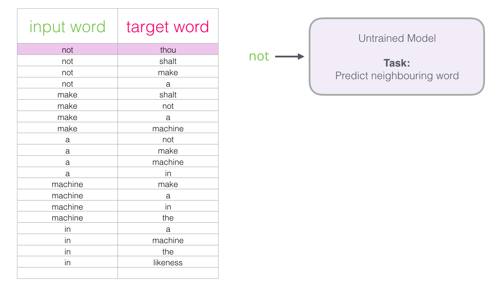  
We start with the first sample in our dataset. We grab the feature and feed to the untrained model asking it to predict an appropriate neighboring word.  
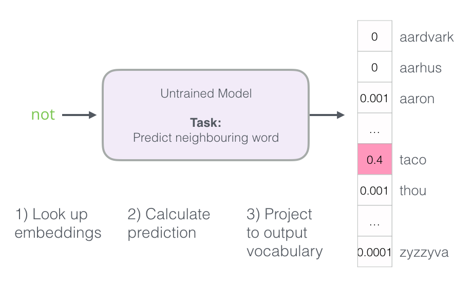  
The model conducts the three steps and outputs a prediction vector (with a probability assigned to each word in its vocabulary). Since the model is untrained, it’s prediction is sure to be wrong at this stage. But that’s okay. We know what word it should have guessed – the label/output cell in the row we’re currently using to train the model:  
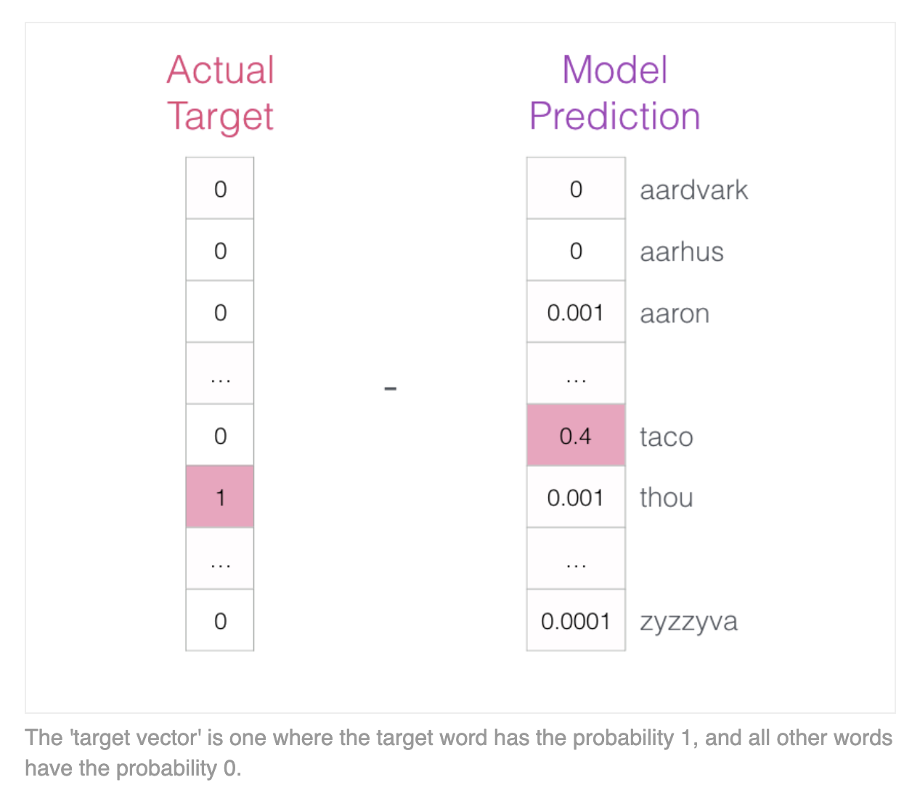

How far off was the model? We subtract the two vectors resulting in an error vector.This error vector can now be used to update the model so the next time, it’s a little more likely to guess thou when it gets not as input.

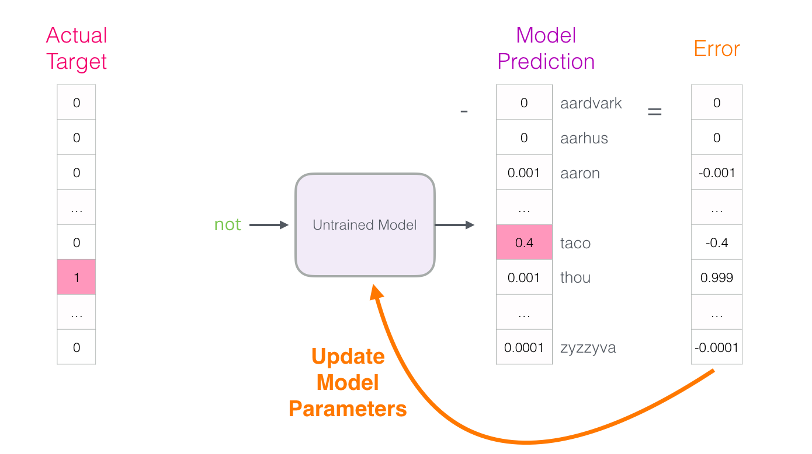

And that concludes the first step of the training. We proceed to do the same process with the next sample in our dataset, and then the next, until we’ve covered all the samples in the dataset. That concludes one epoch of training. We do it over again for a number of epochs, and then we’d have our trained model and we can extract the embedding matrix from it and use it for any other application.

An embedding matrix is simply a giant lookup table that stores all the word (or token) embeddings in a model. It is the very first thing a text passes through when entering a neural network. Where the rows of the matrix are the vocabulary and the columns/dimensions is the length of the vectors. If a model has a hidden size of 5,120, the embedding matrix has 5,120 columns.

How It Works (The Lookup): When you feed text into a model, the tokenizer breaks it into tokens and assigns each token a unique integer ID (e.g., "cat" = 42). The model then uses that ID to grab a specific row from the embedding matrix. Token ID 42 -> Look at row 42 -> Retrieve the 5,120 numbers in that row. Those 5,120 numbers are the initial embedding for that token.

In older models like Word2Vec, the embedding matrix was the final product. You looked up a word, got its vector, and that was that. In modern models like DeepSeek or Claude, the embedding matrix is just the starting point. Once a token gets its initial vector from the embedding matrix, it enters the transformer layers. The attention and feed-forward blocks then constantly add to and modify that vector, turning it from a generic "cat" vector into a highly specific contextual vector that understands the exact sentence it is in.

Negative sampling is a computationally efficient replacement for the standard softmax, which is too slow because it requires updating every word in the vocabulary at every training step. Instead of predicting the exact context word from the entire vocabulary, it simplifies the task into a binary classification: determining whether a given word pair is a genuine neighbor from the training data (a positive sample, labeled 1) or a randomly chosen fake pair (a negative sample, labeled 0).

During training, for every real word-context pair, the model samples a few random words as negatives, calculates the dot product between their embeddings, and applies a sigmoid to get a score. The model then updates the embeddings to pull real pairs closer together while pushing the randomly sampled fake pairs further apart. This acts like a tug-of-war in vector space and makes training massively faster because the model only updates a tiny handful of word vectors per step instead of the entire vocabulary.

**Word2vec Training Process**  
The Word2Vec training process, as described by Jay Alammar, is a straightforward iterative procedure for learning word embeddings. Before training begins, the text is pre-processed to determine the vocabulary size, and two matrices are created: an Embedding matrix (for input words) and a Context matrix (for output/context words), both initialized with random values.

Context words are simply the words that appear immediately before and after a specific target word in a sentence. They provide the surrounding environment that helps define the target word's meaning.

In each training step, the model takes one positive example (a real word-neighbor pair) along with its associated negative examples (random non-neighbor words). It looks up the embeddings for the input word in the Embedding matrix and for the context words in the Context matrix, then computes the dot product between the input embedding and each context embedding to produce a similarity score. These scores are passed through a sigmoid function to turn them into probabilities between 0 and 1. The model then calculates the error by subtracting these predicted scores from the target labels (1 for positive examples, 0 for negative ones). This error is used to adjust the embeddings of all words involved so that the next prediction will be closer to the target.

The process repeats for every positive sample and its negatives across the entire dataset for a number of epochs. After training, the Context matrix is discarded, and the Embedding matrix is kept as the final pre-trained word embeddings.

The window size determines how many context words are considered to the left and right of the target word, directly shaping what kind of relationships the model learns. A small window (e.g., 2) focuses on immediate neighbors, capturing syntactic and functional similarity, which groups words like "dog" and "cat" together or even places antonyms like "good" and "bad" close in vector space. A larger window (e.g., 5–10) looks further out, capturing topical or semantic similarity, which links words like "dog" and "bark" because they appear in the same broader context. The Gensim default window size is 5 (five words before and five words after the input word, in addition to the input word itself)

The number of negative samples controls how many random "fake" words are drawn for every real word-context pair during training. Common practice is to use 5 to 20 negative samples for small datasets and 2 to 5 for very large datasets. This creates a trade-off: more negatives improve model accuracy and quality but slow down training, while fewer negatives speed up training at the cost of poorer embeddings.

Source: [https://jalammar.github.io/illustrated-word2vec/](https://jalammar.github.io/illustrated-word2vec/)
