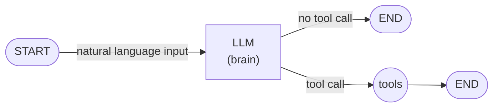
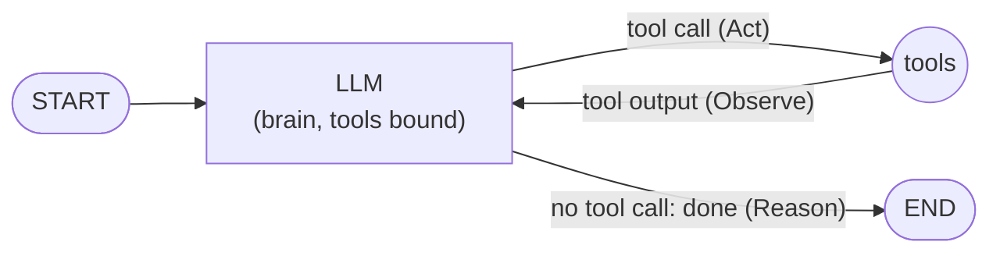
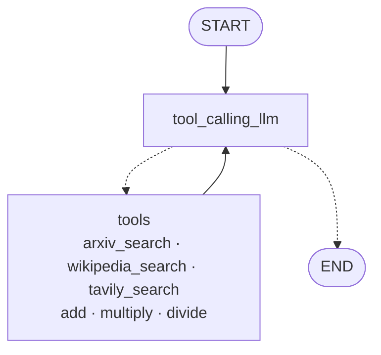

# Agents and the ReAct Agent Architecture

> **Agents series · Lecture 1** — Previous: [Building Chatbot With Multiple Tool Integration](../LangGraph/Building%20Chatbot%20With%20Multiple%20Tool%20Integration.md)

**Goal:** turn the "chatbot with tools" into a real **agent**. In the old graph, the conversation ended as soon as a tool ran (a tool message returned). In a **ReAct** agent, the tool's result goes **back to the LLM**, which then decides what to do next: call another tool, or give the final answer.

This note covers two lectures:
- **Part A, the concept (§1–4):** what ReAct is, its three steps (Act, Observe, Reason), and the whiteboard example.
- **Part B, the implementation (§5–13):** building the ReAct graph in LangGraph with arXiv, Wikipedia, Tavily and math tools, traced in LangSmith.

---

# Part A — The concept

## 1. Recap: how we got here

| # | Topic | What it added |
|---|---|---|
| 1 | Chains | Steps that run in a fixed order |
| 2 | Routers | A **conditional edge** that picks the next node |
| 3 | Tools | `ToolNode` runs tools, and `tools_condition` decides whether to go there |
| 4 | Basic agent | The LLM decides **by itself** whether a tool is needed |

The chatbot with tools from the last lecture:



The LLM node is already a **basic agent**. From the natural-language input it decides, with no human help, whether to call a tool.

**The limitation:** after the tool runs, the graph ends. The LLM never sees the tool's result, so it can't:
- turn the raw tool output into a proper answer, or
- use the result for a next step, such as feeding it into a second tool.

## 2. ReAct: Reason + Act

**ReAct** (*Re*ason + *Act*) is a **general agent architecture**. It is the first agent architecture in this course; others come later, for example in the different types of RAG. ReAct is a loop of three steps:

| Step | What happens |
|---|---|
| **1. Act** | Based on the input, the model **calls a specific tool**, or answers directly when no tool is needed. |
| **2. Observe** | The tool runs, and its output is **passed back to the model**. The conversation does **not** end here. |
| **3. Reason** | The model looks at the **tool's output together with the original input** and decides **what to do next**: call another tool, or answer and end. |

The loop **Act → Observe → Reason → Act …** repeats until the model decides it has everything it needs.

## 3. The one change in the graph

The ReAct graph is the chatbot-with-tools graph with **one edge changed**. The edge from `tools` goes back to the LLM instead of to `END`.



In code, that's the whole difference:

```python
builder.add_edge("tools", END)                  # before: chatbot with tools
builder.add_edge("tools", "tool_calling_llm")   # after:  ReAct agent
```

Now the **only** way to reach `END` is for the LLM to decide it needs no more tools. That decision is the *Reason* step.

---

# Part B — Implementation in LangGraph

## 5. What changed since the lecture was recorded

The lecture used some packages and names that are now legacy. The code in this note uses current stable releases instead (checked 2026-11-28: `langgraph` 1.2, `langchain` 1.5, `langchain-core` 1.8, `langsmith` 0.16, `arxiv` 4.1, `wikipedia-api` 0.16).

| Lecture used | Problem | Used here instead |
|---|---|---|
| `ArxivQueryRun` + `ArxivAPIWrapper` (`langchain_community`) | Needs the large catch-all `langchain-community` package for a 10-line tool | A small `@tool` around the `arxiv` package |
| `WikipediaQueryRun` + `WikipediaAPIWrapper` (`langchain_community`) | Built on the `wikipedia` package, last released in **2014** | A `@tool` around the maintained `wikipedia-api` package |
| `TavilySearchResults` (`langchain_community`) | Deprecated | `TavilySearch` from `langchain-tavily` |
| Groq model `qwen-2.5-32b` | Retired on Groq | `llama-3.3-70b-versatile` (or another production model with tool calling, e.g. `openai/gpt-oss-120b`) |
| `LANGCHAIN_API_KEY`, `LANGCHAIN_TRACING_V2`, `LANGCHAIN_PROJECT` | Legacy variable names | `LANGSMITH_API_KEY`, `LANGSMITH_TRACING`, `LANGSMITH_AGENT_ID` + `LANGSMITH_AGENT_ENVIRONMENT` (see §7) |
| `langgraph.prebuilt.create_react_agent` (common in tutorials) | Deprecated since LangGraph 1.0 | `langchain.agents.create_agent` (see §13) |

## 6. Setup

You need **Python 3.11 or newer**, because LangChain 1.x no longer supports 3.9 or 3.10.

```bash
pip install -U langgraph langchain langchain-groq langchain-tavily langsmith arxiv wikipedia-api python-dotenv ipython
```

`.env` file:

```
GROQ_API_KEY=...
TAVILY_API_KEY=...

LANGSMITH_API_KEY=...
LANGSMITH_TRACING=true
LANGSMITH_AGENT_ID=react-agent
LANGSMITH_AGENT_ENVIRONMENT=local
```

```python
from dotenv import load_dotenv
load_dotenv()      # loads every key in .env into os.environ
```

The lecture also copied each key into `os.environ` by hand (`os.environ["LANGCHAIN_API_KEY"] = os.getenv(...)`). `load_dotenv()` already does that, so you don't need those lines.

## 7. LangSmith: tracing and monitoring

LangSmith records every run: each node, each LLM call and each tool call, with inputs, outputs, latency and token usage. This matters for agents, because **the path through the graph changes from question to question**. LangSmith shows exactly which tools the LLM chose, in what order and with which arguments.

Tracing is switched on by **environment variables only**. You don't change the code.

| Variable | Value | Purpose |
|---|---|---|
| `LANGSMITH_TRACING` | `true` | Turns tracing on (formerly `LANGCHAIN_TRACING_V2`) |
| `LANGSMITH_API_KEY` | your key | Authentication (formerly `LANGCHAIN_API_KEY`) |
| `LANGSMITH_AGENT_ID` | `react-agent` | Which agent the traces belong to |
| `LANGSMITH_AGENT_ENVIRONMENT` | `local` | One of `local`, `development`, `staging`, `production` |
| `LANGSMITH_ENDPOINT` | e.g. `https://eu.api.smith.langchain.com` | Only needed for accounts outside the US |

Steps:
1. Create the agent **once** in the LangSmith UI: **Connect → Connect an existing agent**. Enter a name and the ID `react-agent`.
2. Set the variables above and run your graph.
3. In LangSmith, select the agent, go to **Tracing**, and pick the environment (`local`).

Gotchas:
- The agent ID may only contain **lowercase letters, digits and hyphens**, and it must start with a letter. `react-agent` works. `react_agent` and `React Agent`, the names used in the lecture, don't.
- **Older setup, still supported:** set `LANGSMITH_PROJECT=react-agent` (formerly `LANGCHAIN_PROJECT`) instead of the two `AGENT` variables. Traces then go to a named project, and you don't have to create an agent first. The SDK uses the project only when no agent ID is set.
- **Don't set both** `LANGSMITH_AGENT_ID` and `LANGSMITH_PROJECT`. If you do, the SDK prints a warning and **traces nothing**.

## 8. The tools

We use six tools: two knowledge sources, one internet search and three custom math functions.

### 8.1 arXiv: research papers

```python
import arxiv
from langchain_core.tools import tool

@tool
def arxiv_search(query: str) -> str:
    """Search arXiv for research papers. Use for scientific or academic questions.

    Args:
        query: Topic keywords, or an exact title written as ti:"<title>".
    """
    client = arxiv.Client()
    papers = client.results(arxiv.Search(query=query, max_results=2))   # top 2 results
    return "\n\n".join(
        f"Title: {p.title}\nPublished: {p.published.date()}\n"
        f"Authors: {', '.join(a.name for a in p.authors)}\nSummary: {p.summary[:500]}"   # max 500 chars
        for p in papers
    ) or "No results."
```

```python
arxiv_search.invoke('ti:"attention is all you need"')    # Title: Attention Is All You Need ...
```

- `max_results=2` and `summary[:500]` do the same job as the lecture's `top_k_results=2` and `doc_content_chars_max=500`.
- Plain keywords match anywhere in a paper. A search for `attention is all you need` returned two *other* papers about attention. For an exact title, search `ti:"..."`. The docstring mentions this syntax, so the LLM can use it as well.

### 8.2 Wikipedia: general knowledge

```python
import wikipediaapi

wiki = wikipediaapi.Wikipedia(user_agent="react-agent-notes/1.0", language="en")

@tool
def wikipedia_search(query: str) -> str:
    """Look up general knowledge on Wikipedia.

    Args:
        query: The topic or question to look up.
    """
    pages = wiki.search(query, limit=1).pages            # best match only
    if not pages:
        return "No Wikipedia page found."
    page = next(iter(pages.values()))
    return f"{page.title}: {page.summary[:500]}"          # max 500 chars
```

```python
wikipedia_search.invoke("What is machine learning")
# 'Machine learning: Machine learning (ML) is a process in the field of artificial intelligence ...'
```

- `user_agent` is **required**. Wikipedia's API asks every client to identify itself, and `wikipedia-api` raises a `TypeError` without it.
- `search(..., limit=1)` is a full-text search, so a natural question finds the right page. `limit=1` matches the lecture's `top_k_results=1`.
- When nothing is found, the tool returns a readable message instead of crashing. The LLM *observes* that message and can try again.

### 8.3 Tavily: internet search

```python
from langchain_tavily import TavilySearch

tavily = TavilySearch(max_results=2)     # reads TAVILY_API_KEY; the LLM sees it as "tavily_search"
```

### 8.4 Custom math functions

```python
@tool
def add(a: int, b: int) -> int:
    """Add a and b.

    Args:
        a: first int
        b: second int
    """
    return a + b

@tool
def multiply(a: int, b: int) -> int:
    """Multiply a and b.

    Args:
        a: first int
        b: second int
    """
    return a * b

@tool
def divide(a: int, b: int) -> float:
    """Divide a by b.

    Args:
        a: first int
        b: second int
    """
    return a / b
```

> **The docstring is what the LLM reads.** "Multiply a and b", together with the typed arguments, is the natural-language description that tells the LLM *when* to use the tool and *what to pass* to it.

### 8.5 Put them in one list

```python
tools = [arxiv_search, wikipedia_search, tavily, add, multiply, divide]
```

## 9. The LLM with tools bound

```python
from langchain_groq import ChatGroq

llm = ChatGroq(model="llama-3.3-70b-versatile")    # any model that supports tool calling
llm_with_tools = llm.bind_tools(tools)
```

Test it before building the graph:

```python
from langchain_core.messages import HumanMessage

result = llm_with_tools.invoke([HumanMessage(content="What is the recent AI news?")])
result.content       # ''  (empty: the model didn't answer in text)
result.tool_calls    # [{'name': 'tavily_search', 'args': {'query': 'recent AI news'}, ...}]
```

The LLM picked internet search on its own. This is only a **request** to call the tool. Nothing has run yet.

## 10. Build the ReAct graph

> **Shortcut:** you can build the whole flow below with a single call to `create_agent`. See [§13](#13-shortcut-create_agent). It's built by hand here so you can see what that function does for you.
>
> - **Use `create_agent`** when the standard ReAct loop is all you need. That's most of the time.
> - **Build the graph by hand** when you need a different shape. Examples include an extra node before or after the LLM, a human approval step, or the other architectures in the table at the end of this note. The LangGraph code in this section is what lets you change the graph.

### 10.1 State

```python
from typing import Annotated
from typing_extensions import TypedDict
from langchain_core.messages import AnyMessage
from langgraph.graph.message import add_messages

class State(TypedDict):
    messages: Annotated[list[AnyMessage], add_messages]    # the reducer appends instead of overwriting
```

### 10.2 LLM node

```python
def tool_calling_llm(state: State):
    return {"messages": [llm_with_tools.invoke(state["messages"])]}
```

Each time it runs, the LLM sees the **whole conversation so far**, including every earlier tool result. That is how it *observes*.

### 10.3 Graph

```python
from IPython.display import Image, display
from langgraph.graph import StateGraph, START, END
from langgraph.prebuilt import ToolNode, tools_condition

builder = StateGraph(State)

builder.add_node("tool_calling_llm", tool_calling_llm)
builder.add_node("tools", ToolNode(tools))

builder.add_edge(START, "tool_calling_llm")
builder.add_conditional_edges("tool_calling_llm", tools_condition)  # tool call -> "tools", else -> END
builder.add_edge("tools", "tool_calling_llm")                       # THE ReAct change: back to the LLM

graph = builder.compile()
display(Image(graph.get_graph().draw_mermaid_png()))
```



- Dotted edges are conditional: `tools_condition` picks one of them.
- `tools_condition` routes to `"tools"` if the last AI message contains a tool call, and to `END` otherwise. The node must therefore be named `"tools"`.
- The same `tools` list goes to `bind_tools` (so the LLM knows about the tools) and to `ToolNode` (so the graph can run them).

## 11. Run it

### 11.1 A multi-step question (the lecture's example)

```python
messages = graph.invoke({"messages": [HumanMessage(content=
    "Provide me the top 10 recent AI news for March 3rd 2025, "
    "add 5 plus 5 and then multiply by 10")]})

for m in messages["messages"]:
    m.pretty_print()
```

What happened in the lecture's run:

| # | Message | Content |
|---|---|---|
| 1 | Human | the question |
| 2 | AI | **three tool calls in one message**: `tavily_search(...)`, `add(5, 5)`, `multiply(...)` |
| 3–5 | Tool × 3 | the news results, `10`, `100` |
| 6 | AI | the final answer: a news summary, 5 + 5 = 10, and 10 × 10 = 100 |

- **Parallel tool calls:** a model can request several tools in one turn. `ToolNode` runs them all and sends every result back to the LLM together. Because all three calls came in one message, the model must have filled in `multiply(10, 10)` itself, without waiting for `add`.
- When a step needs a result the model can't know in advance, such as a search result, it waits for the observation and loops again. That's the sequential pattern from §4.
- Runs vary. The same question may produce one turn with three calls, or several turns with one call each.

### 11.2 A simple question

```python
messages = graph.invoke({"messages": [HumanMessage(content="What is machine learning?")]})
```

Path: `START → tool_calling_llm → tools (wikipedia_search) → tool_calling_llm → END`.

The LLM picks Wikipedia, observes the summary, decides nothing else is needed, and writes the answer.

> **Compare with the previous lecture:** there, the last message was the **raw tool output**. Now it is an **AI answer written from that output**, because the result goes back to the LLM before the graph ends.

## 12. Safety net: limit the loop

A loop can run forever, for example if the model keeps calling tools. LangGraph stops a run after `recursion_limit` steps, where one step is one node run. In LangGraph 1.2 the default is **10,007 steps** (it used to be 25). That's far too many LLM calls for an agent like this one, so set your own limit:

```python
from langgraph.errors import GraphRecursionError

try:
    graph.invoke({"messages": [HumanMessage(content="...")]}, config={"recursion_limit": 25})
except GraphRecursionError:
    print("Agent stopped: too many steps")
```

## 13. Shortcut: `create_agent`

The graph you built by hand is the standard ReAct agent, and LangChain ships it as a single function:

```python
from langchain.agents import create_agent

agent = create_agent(model=llm, tools=tools, system_prompt="You are a helpful assistant.")
agent.invoke({"messages": [HumanMessage(content="Please add 5 plus 5 and then multiply by 3")]})
```

It builds the same `model ⇄ tools` loop as §10. Building it by hand first shows you what the function does, and it's the starting point for the custom agent architectures that come later. See [Create Agents Using Langchain](../LangChain/Create%20Agents%20Using%20Langchain.md).

| | §10, built by hand | `create_agent` |
|---|---|---|
| Lines of code | About 15 (state, node, `ToolNode`, edges, compile) | One call |
| Binding tools | You call `llm.bind_tools(tools)` yourself | Done for you. Pass the plain `llm`, not `llm_with_tools` |
| Node names | Your choice (`tool_calling_llm`, `tools`) | Fixed: `model`, `tools` |
| System prompt | You add a `SystemMessage` yourself | `system_prompt="..."` |
| Extras | You build them yourself | Built-in options, e.g. `middleware`, `response_format` (structured output) and `checkpointer` (memory) |

**Which one to use:**
- **Use `create_agent`** when the standard ReAct loop is all you need. That's most of the time.
- **Build the graph by hand** when you need a different shape. Examples include an extra node before or after the LLM, a human approval step, or the other architectures in the table at the end of this note. The LangGraph code in §10 is what lets you change the graph.

Don't use `langgraph.prebuilt.create_react_agent`, which older tutorials show. It has been deprecated since LangGraph 1.0.

> **How this code was checked:** I installed the current packages on Python 3.12 and ran the arXiv and Wikipedia tools live. I then ran the graph with a scripted stand-in for the LLM, since there are no API keys here. Example 2 took the path `START → llm → tools → llm → tools → llm → END` and ended with 30, and parallel calls returned `10` and `100`. `recursion_limit=25` raised `GraphRecursionError`, and `create_agent` built the same loop. The Groq and Tavily calls themselves were not run.

---

## Summary

| Step | What | Code |
|---|---|---|
| 1 | Turn on tracing | `.env`: `LANGSMITH_TRACING`, `LANGSMITH_API_KEY`, `LANGSMITH_AGENT_ID`, `LANGSMITH_AGENT_ENVIRONMENT` |
| 2 | Create the tools (typed arguments plus docstrings) | `@tool def arxiv_search(...)`, `wikipedia_search`, `TavilySearch(...)`, `add`, `multiply`, `divide` |
| 3 | Bind them to the LLM | `llm.bind_tools(tools)` |
| 4 | State with the reducer | `messages: Annotated[list[AnyMessage], add_messages]` |
| 5 | LLM node | `llm_with_tools.invoke(state["messages"])` |
| 6 | Tools node | `ToolNode(tools)` |
| 7 | Router | `add_conditional_edges("tool_calling_llm", tools_condition)` |
| 8 | **The ReAct loop** | `add_edge("tools", "tool_calling_llm")` |
| 9 | Cap the loop | `config={"recursion_limit": 25}` |

## Key takeaways

- **ReAct = Act → Observe → Reason, in a loop.** The model calls a tool, sees the result, and decides the next step from that result *and* the original input.
- In LangGraph, the only change from a chatbot with tools is **one edge**: `tools → LLM` instead of `tools → END`.
- The graph ends only when the LLM decides that no more tool calls are needed.
- The loop lets one tool's output feed the next tool (5 + 5 = 10, then 10 × 3 = 30), and the final message is a real answer instead of raw tool output.
- A model can also request **several tools in one turn**, and `ToolNode` runs them in parallel.
- Good **docstrings** and a model that supports tool calling decide how well the agent picks its tools.
- Use **LangSmith** to see which path the agent took on each run, and always set a **`recursion_limit`**.
- `create_agent` builds this same graph in one line. Build it by hand first to understand it.

---

## Other agent architectures

ReAct is the most common starting point, but it is not the only design. Anthropic, OpenAI and LangChain all document the patterns below for production use. Anthropic splits them into two kinds. The difference is **who decides the next step**:

- **Workflow:** *you* decide the steps, in code. You write the order (step 1 → step 2 → step 3), and the LLM only does the work inside each step. It never chooses what happens next, so every run follows the same path.
- **Agent:** the *LLM* decides the steps while it runs. You give it a goal and some tools, and it chooses which tool to call, in what order, and when to stop. Two runs can take different paths.

| | Workflow | Agent |
|---|---|---|
| Who chooses the next step? | You, in code | The LLM, while it runs |
| Same path every run? | Yes | No. It depends on the input and on what the tools return |
| Strengths | Predictable, cheaper, easy to test | Handles open-ended tasks you can't plan in advance |
| Weaknesses | Can't adapt when something unexpected comes up | More LLM calls (more cost), and one wrong decision can lead to more wrong decisions |
| Example from your notes | [Chains Using Langgraph](../LangGraph/Chains%20Using%20Langgraph.md): fixed steps, one after another | The ReAct graph in this note: the LLM decides whether to call a tool and when to stop |

ReAct is an **agent**. Anthropic describes agents as "typically just LLMs using tools based on environmental feedback in a loop". In plain words: the LLM calls a tool, reads what the tool returned (the "feedback"), decides what to do next, and repeats. That is the act → observe → reason loop from this note.

| # | Architecture | Type | How it works | Good for (example) | Documented by |
|---|---|---|---|---|---|
| 1 | **Prompt chaining** | Workflow | A fixed sequence of LLM calls. Each call works on the previous call's output, and code checks ("gates") between steps can stop the run if something is off. | Tasks that split cleanly into fixed steps: write an outline, check it, then write the document | Anthropic, OpenAI |
| 2 | **Routing** | Workflow | A first step (an LLM or a classifier) sorts the input and sends it to a specialised prompt, model or agent. | Distinct kinds of input: support requests split into general, refund and technical; easy questions to a small model, hard ones to a large one | Anthropic, OpenAI, LangChain |
| 3 | **Parallelization** | Workflow | Several LLM calls run at the same time and code merges the results. **Sectioning** gives each call a different subtask. **Voting** runs the same task several times. | Speed, or more confidence: one call answers while another screens for unsafe content; several reviewers check code for vulnerabilities | Anthropic, OpenAI |
| 4 | **Orchestrator–workers** | Workflow | A central LLM splits the task **at run time**, hands each part to a worker LLM, and combines the results. Unlike parallelization, the subtasks aren't fixed in advance. | Tasks whose parts you can't predict: code changes across many files, research across many sources | Anthropic |
| 5 | **Evaluator–optimizer** | Workflow | One LLM writes an answer, a second LLM grades it and gives feedback, and the loop repeats until the answer passes. | Clear quality criteria where feedback helps: literary translation, multi-round search | Anthropic, OpenAI |
| 6 | **ReAct** (this note) | Single agent | One LLM with tools in a loop (act → observe → reason) until it needs no more tools. | Open-ended tasks where you can't predict the number of steps | Anthropic ("autonomous agent"), LangChain (`create_agent`) |
| 7 | **Plan-and-execute** | Single agent | A **planner** LLM writes a multi-step plan up front. **Executors** carry out each step with tools. A **re-plan** step then either gives the final answer or writes a new plan. | Long multi-step tasks. The big model is called only for planning, so each step can use a smaller, cheaper model | LangChain (2024), based on Plan-and-Solve prompting |
| 8 | **Reflexion** (self-reflection) | Single agent | An **actor** (e.g. a ReAct agent) tries the task. An **evaluator** checks the result. A **self-reflection** LLM writes a lesson about what went wrong, stores it in memory, and the actor tries again. | Tasks with an automatic pass/fail check, such as code with unit tests | Shinn et al. (2023) |
| 9 | **Supervisor** (manager, agents as tools, subagents) | Multi-agent | A main agent calls **specialist agents as if they were tools**, keeps control of the conversation, and writes the final answer. | Requests that span several domains, parallel work, separate teams each owning an agent | OpenAI (`Agent.as_tool()`), LangChain ("Subagents") |
| 10 | **Handoffs** (triage) | Multi-agent | A triage agent **passes the conversation** to a specialist agent, which then talks to the user directly. | Customer-support flows where a specialist should take over the conversation | OpenAI, LangChain |

Prompt chaining and routing are the ideas from your earlier notes, [Chains Using Langgraph](../LangGraph/Chains%20Using%20Langgraph.md) and [Introduction To Router In LangGraph](../LangGraph/Introduction%20To%20Router%20In%20LangGraph.md).

**Notes from the sources:**

- **Start simple.** Anthropic recommends the simplest solution that works, saying that for many applications "optimizing single LLM calls with retrieval and in-context examples is usually enough", and adding complexity "only when it demonstrably improves outcomes". LangChain says the same about multi-agent systems: a single agent with the right tools and prompt can often achieve similar results.
- **Plan-and-execute vs. its paper.** The original Plan-and-Solve paper (Wang et al., 2023) is **one prompt with no tools**. It replaces "Let's think step by step" with "Let's first understand the problem and devise a plan to solve the problem. Then, let's carry out the plan and solve the problem step by step." The authors used it to reduce missing-step errors in math reasoning. The plan-and-execute **agent**, with tool-using executors and re-planning, is LangChain's later design, which they describe as "based loosely" on that paper and on the BabyAGI project.
- **Reflexion results and limits.** In the paper, ReAct + Reflexion solved 130 of 134 ALFWorld household tasks, and Reflexion reached 91% pass@1 on HumanEval (Python), against 80% for GPT-4 alone. Memory keeps only the last 1–3 reflections. It gave no gain with a weaker open model (StarChat-beta), and it did not improve on WebShop, an online-shopping benchmark where success needs creative exploration. Its core loop (try, check, give feedback, retry) is also what the evaluator–optimizer workflow does.
- **Supervisor vs. handoffs.** With a supervisor, every result flows back through the main agent. That costs one extra LLM call per request, but it gives central control and lets specialists run in parallel. With handoffs, the specialist owns the rest of the conversation. That saves calls on follow-up questions, but specialists run one after another, never in parallel (from LangChain's comparison).
- **Patterns combine.** All three sources say you can mix them, for example a supervisor whose specialists are ReAct agents, or a router in front of several workflows.

**Sources** (read 2026-11-28):
- Anthropic, [Building effective agents](https://www.anthropic.com/engineering/building-effective-agents) (Dec 2024). The post now notes that its tooling advice is dated. The patterns above come from it.
- OpenAI Agents SDK, [Agent orchestration](https://openai.github.io/openai-agents-python/multi_agent/)
- LangChain docs, [Multi-agent](https://docs.langchain.com/oss/python/langchain/multi-agent)
- LangChain blog, [Plan-and-Execute Agents](https://blog.langchain.com/planning-agents/) (Feb 2024)
- Wang et al., [Plan-and-Solve Prompting](https://arxiv.org/abs/2305.04091) (2023)
- Shinn et al., [Reflexion: Language Agents with Verbal Reinforcement Learning](https://arxiv.org/abs/2303.11366) (2023)
