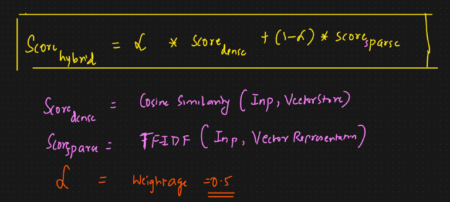
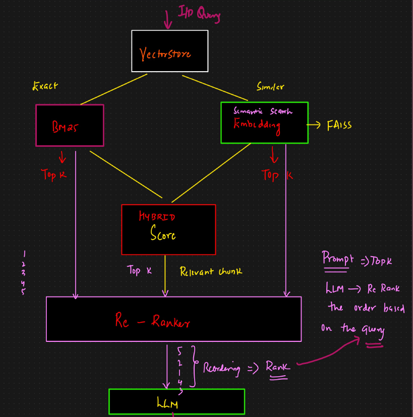

# Hybrid Search Strategies

## Combining Dense And Sparce Retrieval

Hybrid retrieval combines both dense and sparse scores (e.g. using a weighted sum or learning-to-rank  
methods) to improve recall and relevance.  
You get the semantic power of embeddings, and the exact match of keywords - best of both worlds.

Sparse Retrieval: Matches exacts words using techniques such as TF-IDF (Term frequency and inverse document frequency) (Other technique are BM25 and bag of words (BOW)) to convert text into sparse matrix to do exact search (keywords search) from the vector store.

Dense Retrieval (Embeddings + Cosine Similarity): Capture semantic meaning using vector embedding (dense matrix) to get similar matching sentence.

So hybrid search is Exact Search (sparse matrix) and semantic search (dense matrix)

This is the hybrid search scoring formula your app already uses (via Azure AI Search's RRF).  
Score dense: cosine similarity between the query embedding and each chunk's stored vector (text_vector field). Measures semantic closeness in the 3072-dim space.  
Score sparse: BM25/TF-IDF score between the query keywords and the chunk text (chunk_text_en / chunk_text_nl fields). Measures keyword overlap with linguistic analysis (stemming, stop words).  
In both cases you're comparing the query against each chunk — not chunks against each other. The hybrid score combines both signals so a chunk ranks high if it's both semantically similar AND keyword-relevant to the query.  
In your app α is not explicitly set, Azure AI Search uses RRF internally instead of this linear formula, which is more robust than a fixed weight.

## Re-ranking

is a second-stage filtering process in retrieval systems, especially in RAG pipelines, where we:

1. First use a fast retriever (like BM25, FAISS, hybrid) to fetch top-k documents quickly.
2. Then use a more accurate but slower model (like a cross-encoder or LLM) to re-score and reorder those documents by relevance to the query.

It ensures that the most relevant documents appear at the top, improving the final answer from the LLM.  

For the chatbot i have the following:

- Diminishing returns when LLMs are strong. If you're using GPT-4-class models with comfortable context windows and short answers, the LLM's implicit reranking is already pretty good. The lift from a reranker is real but smaller than benchmarks suggest.  
- Before adding reranking, look at your existing eval set (Evaluation/). For wrong answers, check: was the right chunk in the top 10 but ranked low? If yes → reranking will help. If the right chunk wasn't there at all → fix retrieval first (chunking, embeddings, query rewriting), don't add a reranker. That diagnostic pays off either way and tells you whether the engineering effort is worth it.

- In case you want to implement reranker check Azure's built-in: Semantic Ranker (L2): : A cross-encoder model (Microsoft's, similar in spirit to MS MARCO trained models) that re-scores the top ~50 RRF-fused results using the actual query and chunk text. Adds ~100–300 ms latency, big quality jump for natural-language queries. Tier requirement: Basic or higher. Not available on free tier

## What is MMR?

MMR (Maximal Marginal Relevance) is a powerful diversity-aware retrieval technique used in  
information retrieval and RAG pipelines to balance relevance and novelty when selecting documents.  
MMR selects documents that are both:  
1. Relevant to the query  
2. Diverse from each other (non-redundant)

It prevents the retriever from returning very similar documents that repeat the same content.

When to use MMR:

- To avoid feeding the LLM redundant docs
- To get more diverse results

When not to use it:

- Extremely short context window. You may just want top-1 most relevant
- You need precision only. Not focused on coverage
- Documents are already diverse. No need to enforce diversity
- You're already reranking with LLM. Redundancy handled by post-filtering
