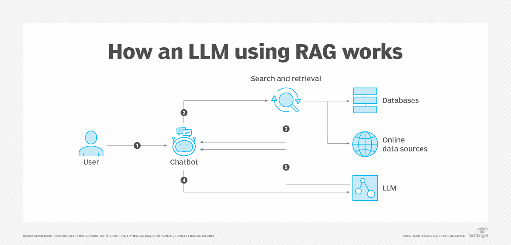

# Intro

Retrieval-augmented generation enables generative AI applications to access external knowledge stores -- a particularly useful approach for enterprises seeking to use their proprietary data. By implementing RAG as part of a broader generative AI strategy, organizations can create AI applications that use internal, current knowledge while maintaining accuracy, security and regulatory compliance.

In a non-RAG generative AI application, a large language model ([LLM](https://web.archive.org/web/20260309084554/https:/www.techtarget.com/whatis/definition/large-language-model-LLM)) draws exclusively on what it has learned from its training data: billions of parameters encoding statistical patterns mined from public data sets. The model responds to prompts based on calculations about what is most likely to be the next word. However, an LLM does not have access to any information past the cutoff date of its training data, nor anything proprietary to a given business. It is a freestanding prediction engine.

RAG changes this process by incorporating external data for the LLM to access in real time when answering a query. The RAG process comprises three stages: retrieval, augmentation and generation.

## 1. Retrieval

When a user asks a question, a [RAG architecture](https://web.archive.org/web/20260309084554/https:/www.computerweekly.com/feature/Understanding-RAG-architecture-and-its-fundamentals?_gl=1*1b2jlmf*_ga*MTUzNDM3OTM2Ny4xNzQzMTk1NjM0*_ga_TQKE4GS5P9*czE3NDczMzQ1MTAkbzc5JGcxJHQxNzQ3MzM1OTA2JGowJGwwJGgw) does not immediately generate an answer from the LLM's existing internal knowledge. Instead, it first searches predefined knowledge repositories, such as internal documents, reports, curated databases or web sources. Retrieval is not guessing; it is a process of directed information-seeking to locate information that might be relevant to the query.

## 2. Augmentation

The retrieved documents are then fed into the context window of information that the LLM uses to answer the user's question. Augmentation injects live, specific and often proprietary information into the model's short-term memory, temporarily modifying the model's knowledge to help it answer the question.

## 3. Generation

The LLM begins crafting a [natural-language response](https://web.archive.org/web/20260309084554/https:/www.techtarget.com/searchenterpriseai/definition/natural-language-processing-NLP) after retrieval and augmentation. Generation draws simultaneously on the model's general language abilities and the retrieved data. The model no longer responds based solely on internal knowledge; instead, it responds based on retrieved facts relevant to the business and the user's query.

## Considerations for RAG in the enterprise

RAG addresses three critical limitations of typical LLMs:

- Knowledge cutoffs. LLMs have training data cutoff dates after which they are unaware of world events or company developments. RAG gives models access to recent and relevant data past those cutoff points.
- Hallucinations. LLMs sometimes generate incorrect information when asked questions outside their knowledge base. RAG reduces the risk of hallucination, although it still [can occur](https://web.archive.org/web/20260309084554/https:/techcrunch.com/2024/05/04/why-rag-wont-solve-generative-ais-hallucination-problem/) .
- Proprietary knowledge. Standard LLMs cannot access an organization's internal data, documents and expertise. RAG enables the [LLM to use specified company data](https://web.archive.org/web/20260309084554/https:/www.techtarget.com/searchenterpriseai/tip/How-to-train-an-LLM-on-your-own-data) .
