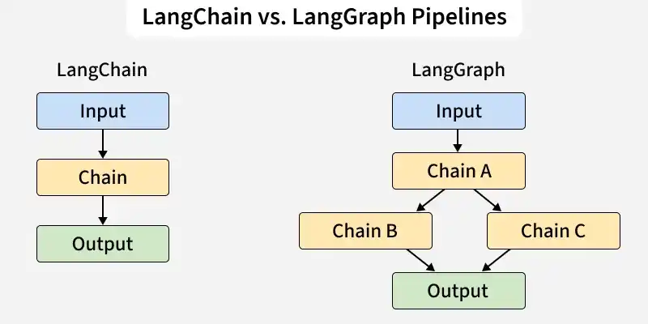

# Langraph

## What is LangGraph

LangGraph is an open-source framework from LangChain designed to build and manage AI agent workflows using graph-based structures. It allows developers to define workflows as nodes and edges, making complex agent interactions more structured, scalable and easier to control.

- Organises AI agent workflows using graph-based architectures
- Supports both simple use cases (chatbots) and complex multi-agent systems
- Integrates LLMs with external tools, APIs and memory
- Enables modular and customizable workflow design

## Components

These core components work together smoothly to help developers build, customize and manage complex AI driven workflows.

- **Monitoring mechanism:** [Human-in-the-loop](https://www.geeksforgeeks.org/artificial-intelligence/human-in-the-loop-hitl-decision-making/) (HITL) ensures humans remain part of the decision making process. It improves machine learning accuracy by using critical data points instead of relying on random sampling.
- **Stateful graphs:** Each node represents a step in computation and carries forward information from previous steps. This enables continuous, contextual processing of data throughout the workflow.
- **Cyclical graphs:** Graphs that contain loops is used for workflows where certain steps may repeat. It becomes important for complex agent run-times.
- **Nodes:** The individual components or agents within a workflow is called node. They act like “actors” performing tasks or calling tools (e.g., a ToolNode for tool integration).
- **Edges:** Edges determine which node should run next. They can follow fixed paths or branching conditions based on the system state.
- **RAG (Retrieval-Augmented Generation):** [RAG](https://www.geeksforgeeks.org/nlp/what-is-retrieval-augmented-generation-rag/) enhances LLMs by adding relevant external documents as context, improving the accuracy and richness of outputs.
- **Workflows:** Sequences of interactions between nodes. By designing workflows, users combine multiple nodes into powerful, dynamic AI processes.
- **APIs:** A set of tools to programmatically add nodes, modify workflows or extract data. Offers developers flexibility and seamless integration with other systems.
- **LangSmith:** [LangSmith](https://www.geeksforgeeks.org/nlp/introduction-to-langsmith/) is a platform for monitoring, debugging and evaluating LLM applications, helping developers track execution flows and improve performance.

## How LangGraph Scales

- **Graph based architecture:** Ensures AI workflows grow without slowing down or losing efficiency.
- **Enhanced decision making:** Models relationships between nodes, enabling AI agents to learn from past actions and feedback. For example Runtime self-evaluation (inside the chatbot flow)
- **Increased flexibility:** Open-source design lets developers add new components or adapt existing workflows with ease.
- **Multiagent workflows:** Supports networks of specialized LangChain agents. Tasks can be routed to the right agent, enabling parallel execution and efficient handling of complex, diverse workloads.
- **Decentralized coordination:** This multiagent setup creates a scalable system where automation doesn’t rely on a single agent but is distributed across a coordinated network.

## LangChain vs. LangGraph

Comparison Table Between LangChain and LangGraph:

| Aspect | LangChain | LangGraph |
| --- | --- | --- |
| **Goal** | Connects steps in order for structured, multi step reasoning | Builds flexible workflows using graph style task flow |
| **Flow Type** | Works in a straight, step by step manner | Supports parallel, conditional and adaptive paths |
| **Adaptability** | Limited flexibility with fixed order of steps | Very adaptable with loops, branches and complex logic |
| **Ease of Implementation** | Simple to use for straightforward tasks | More advanced setup needed for complex workflows |
| **Best Used For** | Chatbots, document analysis and summarization | Multi agent systems, dynamic AI pipelines and adaptive planning |

Source: [https://www.geeksforgeeks.org/machine-learning/what-is-langgraph/](https://www.geeksforgeeks.org/machine-learning/what-is-langgraph/)
