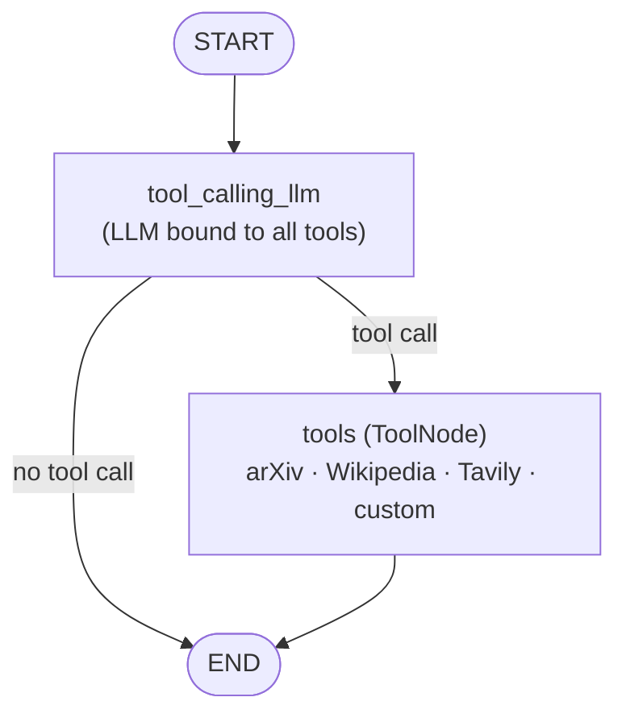

# Building a Chatbot with Multiple Tools in LangGraph

> **LangGraph series · Lecture 7 of 7** — Previous: [Introduction To Router In LangGraph](Introduction%20To%20Router%20In%20LangGraph.md)

**Goal:** extend the single-tool chatbot (`add`) to a chatbot with **several tools**: arXiv (research papers), Wikipedia (general knowledge) and Tavily (live internet search). The LLM is the brain that decides **which tool, if any** to call.



This lecture comes in two parts:
1. **Prepare the tools and bind them to the LLM.** We test the tool calls without a graph.
2. **Build the graph and test it** with different questions.

---

## 1. Setup

```bash
pip install -U langgraph langchain-groq langchain-tavily arxiv wikipedia python-dotenv ipython
```

`.env` file:

```
GROQ_API_KEY=...
TAVILY_API_KEY=...      # free tier available at tavily.com (sign up, copy the key)
```

```python
from dotenv import load_dotenv
load_dotenv()           # loads the keys into the environment
```

- arXiv and Wikipedia need **no API key**.
- Tavily (internet search) needs one. The free tier is enough for learning.
- LangChain offers many other ready-made tools (Brave search, DuckDuckGo, a code interpreter, image generators and more). Browse the tools list in the LangChain integrations docs. Any of them plugs in the same way.

---

## 2. Part 1 — Preparing the tools

A **tool** is a function with a clear name, typed arguments and a docstring. The LLM reads those to decide when to call it. With the `@tool` decorator, each function becomes a tool object.

### 2.1 arXiv tool: research papers

[arXiv.org](https://arxiv.org) hosts research papers in machine learning, data science, physics, mathematics and many other fields.

```python
import arxiv
from langchain_core.tools import tool

@tool
def arxiv_search(query: str) -> str:
    """Search arXiv for research papers. Use for scientific or academic questions.

    Args:
        query: Paper title, topic keywords, or arXiv id.
    """
    client = arxiv.Client()
    papers = client.results(arxiv.Search(query=query, max_results=2))     # top 2 results
    return "\n\n".join(
        f"Title: {p.title}\nPublished: {p.published.date()}\n"
        f"Authors: {', '.join(a.name for a in p.authors)}\nSummary: {p.summary[:500]}"   # max 500 chars of summary
        for p in papers
    ) or "No results."
```

- `max_results=2` limits the output to the **top 2 results**.
- `p.summary[:500]` limits each summary to **500 characters**, which keeps the LLM's context small.
- The docstring says *when* to use the tool ("research papers", "scientific or academic questions").

Test it:

```python
arxiv_search.name                                   # 'arxiv_search'
arxiv_search.invoke("attention is all you need")    # returns paper details taken from arxiv.org
```

### 2.2 Wikipedia tool: general knowledge

```python
import wikipedia

@tool
def wikipedia_search(query: str) -> str:
    """Look up general knowledge on Wikipedia.

    Args:
        query: The topic to look up.
    """
    try:
        return wikipedia.summary(query, sentences=5, auto_suggest=False)[:500]   # first 500 chars
    except wikipedia.exceptions.DisambiguationError as e:
        return f"Ambiguous query. Options: {e.options[:5]}"
    except wikipedia.exceptions.PageError:
        return "No Wikipedia page found."
```

- `[:500]` caps the text at 500 characters.
- `auto_suggest=False` stops the `wikipedia` library from "correcting" your query to a different page.
- The `try/except` returns a readable message to the LLM when the page is missing or the query is ambiguous, instead of crashing the graph.

```python
wikipedia_search.invoke("What is machine learning")     # a short summary of the Wikipedia page
```

### 2.3 Tavily: internet search

Tavily is a search engine built for AI agents. It returns real-time, factual results with links. Use it for anything the LLM can't know, such as recent news.

```python
from langchain_tavily import TavilySearch

tavily = TavilySearch(max_results=2)          # reads TAVILY_API_KEY from the environment

tavily.invoke({"query": "Provide me the recent AI news"})
```

- The input is a dict with a `query` key.
- The result contains a list of hits with title, URL and a content snippet. For date-specific questions, include the date in the query (e.g. "AI news for March 3rd, 2025"). The lecture got dated articles with their links that way.
- Its tool name, as the LLM sees it, is `tavily_search`.
- Other search tools (DuckDuckGo, Brave, Google) work similarly. Check which are free and which are paid.

### 2.4 Optional extras

- **Custom tools:** your own functions, like the `add` function from before. You can add `multiply` in the same way.
- **A retriever as a tool:** if you have documents in a vector database, you can wrap the retriever as a tool and add it to the list (beyond the scope of these notes).

### 2.5 Combine all tools into one list

```python
tools = [arxiv_search, wikipedia_search, tavily]
```

---

## 3. Part 1 (continued) — Bind tools to the LLM

```python
from langchain_groq import ChatGroq

llm = ChatGroq(model="llama-3.3-70b-versatile")      # any tool-calling-capable model works
llm_with_tools = llm.bind_tools(tools)
```

- `bind_tools` takes the **whole list**. The LLM now knows about every tool.
- Use a model that supports tool calling. Always check this when you pick a model.

### Testing the binding (no graph yet)

```python
from langchain_core.messages import HumanMessage

result = llm_with_tools.invoke([HumanMessage(content="What is the recent AI news?")])
result.content       # '' (empty: the model didn't answer in text)
result.tool_calls    # [{'name': 'tavily_search', 'args': {'query': 'recent AI news'}, 'type': 'tool_call', ...}]
```

What this shows:
- The LLM **chose the right tool by itself.** For news, it chose internet search, not arXiv or Wikipedia.
- It also produced the **arguments** (`query`).
- As before, it only *requests* the call. Nothing has run yet.

---

## 4. Part 2 — Build the graph

The pieces are the same as in [Tools And Tools Node Integration](Tools%20And%20Tools%20Node%20Integration.md), with more tools in the node. The routing pattern is explained in [Introduction To Router In LangGraph](Introduction%20To%20Router%20In%20LangGraph.md).

### 4.1 State

```python
from typing import Annotated
from typing_extensions import TypedDict
from langchain_core.messages import AnyMessage
from langgraph.graph.message import add_messages

class State(TypedDict):
    messages: Annotated[list[AnyMessage], add_messages]    # reducer appends instead of overwriting
```

You can add more fields (e.g. `name: str`), and Pydantic validation if you inherit from `BaseModel`.

### 4.2 LLM node

```python
def tool_calling_llm(state: State):
    return {"messages": [llm_with_tools.invoke(state["messages"])]}
```

It invokes the tool-bound LLM with the whole conversation so far, and the reducer appends the reply.

### 4.3 Graph

```python
from IPython.display import Image, display
from langgraph.graph import StateGraph, START, END
from langgraph.prebuilt import ToolNode, tools_condition

builder = StateGraph(State)

builder.add_node("tool_calling_llm", tool_calling_llm)
builder.add_node("tools", ToolNode(tools))                      # runs whichever tool(s) the LLM asked for

builder.add_edge(START, "tool_calling_llm")
builder.add_conditional_edges("tool_calling_llm", tools_condition)   # tool call -> "tools", else -> END
builder.add_edge("tools", END)

graph = builder.compile()
display(Image(graph.get_graph().draw_mermaid_png()))
```

- `ToolNode(tools)` takes the **same list** that was bound to the LLM, so it can execute any of them.
- `tools_condition` routes to `"tools"` if the last AI message contains a tool call, and to `END` otherwise. The node must be named `"tools"`.

**What happens at runtime**

```
START → tool_calling_llm → (tool call?) → tools → END
```

1. The LLM decides to call a tool and emits `tool_calls`.
2. `tools_condition` routes to `tools`.
3. `ToolNode` runs the tool and appends a `ToolMessage` with the raw result to `state["messages"]`.
4. The edge `tools → END` ends the graph.

**What the user gets**

The graph returns the whole `messages` list. The last item is the `ToolMessage`, which holds the raw tool output. Examples are the arXiv abstract, the Wikipedia text or the Tavily JSON.

No LLM writes a final answer from that result. If your app prints `result["messages"][-1]`, the user sees raw tool output. It does not see a written reply such as "The paper says…".

---

## 5. Testing the chatbot

```python
from langchain_core.messages import HumanMessage

result = graph.invoke({"messages": [HumanMessage(content="What is attention is all you need?")]})
for m in result["messages"]:
    m.pretty_print()
```

| Question | LLM's choice | Path |
|---|---|---|
| "Attention is all you need" (or its arXiv id `1706.03762`) | **arXiv** tool | `llm → tools → END` |
| "Provide me the top recent AI news for March 3rd, 2025" | **Tavily** (internet search) | `llm → tools → END` |
| "What is machine learning?" | **Wikipedia** tool | `llm → tools → END` |
| A question that needs no tool (e.g. "hello") | none, a direct answer | `llm → END` |

The output for a tool path is `Human message → AI message (tool call) → Tool message (the tool's result)`.

### Things worth noticing from the lecture's run

- **The LLM decides.** Nothing in the code says which tool to use for which question. The decision comes from the tool names, docstrings and the question.
- **Results can vary between runs.** The first time the lecturer sent only an arXiv id, the model *asked a clarifying question* instead of calling the tool. Running it again produced the tool call. Models make tool decisions probabilistically, and good docstrings and a strong model make them more reliable.
- **The graph ends right after the tools node.** You get the raw tool output, not a polished natural-language answer. To have the LLM write a final answer from the tool results, you would route `tools` back to the LLM node instead of to `END`. That loop is beyond the scope of these notes.

---

## 6. Summary

| Step | What | Code |
|---|---|---|
| 1 | Create tools (typed args plus clear docstring) | `@tool def arxiv_search(...)`, `wikipedia_search`, `TavilySearch(...)` |
| 2 | Put them in a list | `tools = [arxiv_search, wikipedia_search, tavily]` |
| 3 | Bind them to the LLM | `llm.bind_tools(tools)` |
| 4 | State with the `add_messages` reducer | `messages: Annotated[list[AnyMessage], add_messages]` |
| 5 | LLM node | `llm_with_tools.invoke(state["messages"])` |
| 6 | Tools node | `ToolNode(tools)` |
| 7 | Router | `add_conditional_edges("tool_calling_llm", tools_condition)` |
| 8 | Tools to the end | `add_edge("tools", END)` |

## 7. Key takeaways

- A tool-using chatbot is the same graph as before: an LLM node, a `ToolNode` and a `tools_condition` router. Only the tool list grows.
- Add as many tools as you like. The LLM chooses the right one per question, based on each tool's **name, arguments and docstring**.
- Cap tool output (`max_results`, character limits) to keep the LLM's context small.
- The same `tools` list is used twice: `bind_tools` (so the LLM knows the tools) and `ToolNode` (so the graph can run them).
- Tool choice is made by the model, so use a tool-calling-capable model and write clear docstrings.
- Retrievers over your own vector database can become tools too, which comes later.
