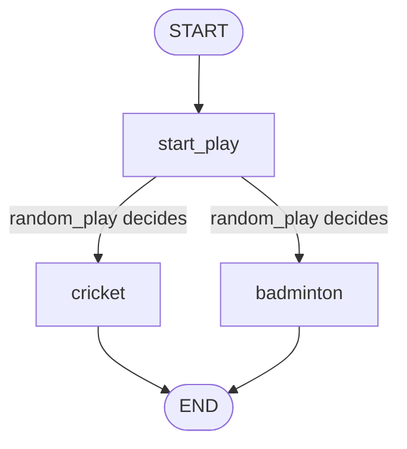
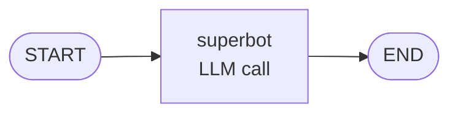

# Building LangGraph — Workflows and a Simple Chatbot

> **LangGraph series · Lecture 1 of 7** — Next: [State Schema With Data Classes](State%20Schema%20With%20Data%20Classes.md)

Two hands-on lessons:

1. **A simple workflow with no LLM.** It teaches nodes, edges, state and conditional edges.
2. **A simple chatbot ("SuperBot") that uses an LLM.** It adds reducers, `invoke` and `stream`.

---

## 1. Core concepts

LangGraph builds **stateful** applications as a graph. Information is passed from node to node, and a shared **state** holds it.

| Component | What it is | Remember it as |
|---|---|---|
| **Node** | A plain Python function that does one task | *the work* |
| **Edge** | A connection between two nodes | *the route* |
| **Conditional edge** | One node has several outgoing edges, and a function decides which one to follow | *the decision* |
| **State** | A schema (e.g. a `TypedDict`) whose fields are the input to every node and edge | *the memory* |
| **StateGraph** | The class that defines the structure of the whole graph | *the blueprint* |
| `START` / `END` | Special built-in nodes that mark where the flow begins and ends | *the entry and exit* |

---

## 2. Lesson 1 — Simple workflow (no LLM)

### 2.1 The workflow we build

`start_play` decides at random between `cricket` and `badminton`. There are no LLMs here. The point is to learn how nodes, edges and state work together.



### 2.2 Build steps

1. Define the **state** schema.
2. Define the **nodes** (functions).
3. Define the **conditional-edge function**, which decides where to go next.
4. Create a `StateGraph(State)`.
5. Add the nodes.
6. Add the edges, including the conditional edge.
7. `compile()` the graph.
8. Visualize it and `invoke()` it.

### 2.3 Step 1 — State

State is the input schema for all nodes and edges. We use `TypedDict` so the state is a dictionary with typed keys (`key: value` pairs).

```python
from typing_extensions import TypedDict

class State(TypedDict):
    graph_info: str      # the information shared between nodes
```

- You can define any number of fields. One is enough for this demo.
- Because it is a `TypedDict`, nodes return updates as dictionaries, for example `{"graph_info": "..."}`.

### 2.4 Step 2 — Nodes

A node is a Python function. **Its first positional argument is the state.** It returns a dictionary with the keys it wants to update.

```python
def start_play(state: State):
    print("start_play node has been called")
    return {"graph_info": state["graph_info"] + " I am planning to play"}

def cricket(state: State):
    print("cricket node has been called")
    return {"graph_info": state["graph_info"] + " cricket"}

def badminton(state: State):
    print("badminton node has been called")
    return {"graph_info": state["graph_info"] + " badminton"}
```

- Each node takes the previous `graph_info` and appends a message to it.
- The `print` calls are only there to debug the execution order.

### 2.5 Step 3 — Conditional-edge function

This function chooses the next node. It does **not** modify the state.

```python
import random
from typing import Literal

def random_play(state: State) -> Literal["cricket", "badminton"]:
    # (optional) previous value: state["graph_info"]
    if random.random() > 0.5:
        return "cricket"
    return "badminton"
```

- `Literal[...]` means the return value must be one of those constants.
- The returned strings must **exactly match the node names** registered in the graph.
- With three or more options you add them to the `Literal`, e.g. `Literal["cricket", "badminton", "football"]`.

### 2.6 Step 4 — Construct the graph

```python
from IPython.display import Image, display
from langgraph.graph import StateGraph, START, END

# 1. Initialise the graph with the state schema
graph = StateGraph(State)

# 2. Add nodes: add_node("<node name>", <function>)
graph.add_node("start_play", start_play)
graph.add_node("cricket", cricket)
graph.add_node("badminton", badminton)

# 3. Add edges (the flow)
graph.add_edge(START, "start_play")
graph.add_conditional_edges("start_play", random_play)   # picks cricket OR badminton
graph.add_edge("cricket", END)
graph.add_edge("badminton", END)

# 4. Compile
graph_builder = graph.compile()

# 5. Visualise
display(Image(graph_builder.get_graph().draw_mermaid_png()))
```

Notes:

- The node name does not have to equal the function name. Here they are the same only to avoid confusion.
- `add_edge(a, b)` is a fixed route from `a` to `b`.
- `add_conditional_edges(source, fn)` means "after `source`, call `fn(state)` and go to the node whose name it returns".
- `get_graph()` only exists on the **compiled** graph (`graph_builder`), not on the `StateGraph` (`graph`). Calling it on `graph` raises an `AttributeError`.

### 2.7 Step 5 — Invoke

```python
graph_builder.invoke({"graph_info": "Hi, my name is Krish."})
```

Example output (the branch is random):

```
start_play node has been called
badminton node has been called
{'graph_info': 'Hi, my name is Krish. I am planning to play badminton'}
```

The flow is:

1. The input fills the state.
2. `start_play` appends "I am planning to play".
3. `random_play` picks a branch.
4. The chosen node appends its sport.
5. The flow reaches `END`, and the final state is returned.

Run it several times and you will see both branches.

---

## 3. Lesson 2 — Simple chatbot with an LLM ("SuperBot")

### 3.1 Goal

Same building blocks, but the single node now calls an LLM.



### 3.2 Setup

**Install**

```bash
pip install -U langgraph langchain-openai langchain-groq python-dotenv ipython
```

(Or put these package names in `requirements.txt` and run `pip install -r requirements.txt`, with your virtual env activated.)

**`.env` file**

```
OPENAI_API_KEY=...
GROQ_API_KEY=...
```

**Load the keys**

```python
from dotenv import load_dotenv
load_dotenv()          # reads .env into environment variables
```

- `load_dotenv()` is enough. The libraries read `OPENAI_API_KEY` and `GROQ_API_KEY` from the environment automatically.
- The variable names must match exactly. For example, `OPEN_AI_API_KEY` will not work.

### 3.3 Choosing an LLM

You can use either provider. Groq hosts open-source models and has a free tier, which is handy for learning.

**OpenAI (paid)**

```python
from langchain_openai import ChatOpenAI

llm_openai = ChatOpenAI(model="gpt-5-mini")      # any model name from platform.openai.com/docs/models
llm_openai.invoke("Hello").content
```

**Groq (open-source models, free tier)**

```python
from langchain_groq import ChatGroq

llm_groq = ChatGroq(model="llama-3.3-70b-versatile")   # any model from console.groq.com/docs/models
llm_groq.invoke("Hi, I'm Krish and I like to play cricket.").content
```

- Pick a model name from the provider's models page and paste it into `model=`.
- Both classes expose the same `.invoke(...)` method, so you can swap one for the other without touching the graph.
- The rest of these notes use `llm_groq`.

### 3.4 State with a reducer

```python
from typing import Annotated
from typing_extensions import TypedDict
from langgraph.graph.message import add_messages

class State(TypedDict):
    messages: Annotated[list, add_messages]
```

What each part does:

| Piece | Role |
|---|---|
| `messages` | The key holding the whole conversation |
| `list` | The conversation is a list of messages (Human, AI, ...) |
| `Annotated[..., add_messages]` | Attaches extra metadata to the type: *"merge updates with `add_messages`"* |
| `add_messages` | The **reducer**: it appends new messages to the list instead of overwriting it |

**Why a reducer?** By default, when a node returns a value for a key, the new value **overwrites** the old one. In a chatbot we want the history to grow, for example `[Human "hi", AI "hello", Human "..."]`. `add_messages` merges the lists, so the state is append-only. The only exception is a new message with the same ID as an existing one, which updates that message. It also converts plain strings and dicts into proper `HumanMessage`/`AIMessage` objects.

```
WITHOUT reducer:  node returns [AI]        -> state = [AI]                  (history lost)
WITH add_messages: node returns [AI]       -> state = [Human, AI]           (history kept)
```

> **Shortcut.** LangGraph ships a prebuilt state that does exactly this:
> `from langgraph.graph import MessagesState`, then `class State(MessagesState): ...`.
> You can add extra fields in the subclass.

### 3.5 The node

```python
def superbot(state: State):
    return {"messages": [llm_groq.invoke(state["messages"])]}
```

- The node reads the full conversation from `state["messages"]` and sends it to the LLM.
- It returns `{"messages": [ai_reply]}`. The key must match the state schema.
- The returned value is a *list*, and the reducer appends it to the existing messages.

### 3.6 Build and compile the graph

```python
from IPython.display import Image, display
from langgraph.graph import StateGraph, START, END

graph = StateGraph(State)
graph.add_node("superbot", superbot)        # node name is case-sensitive!
graph.add_edge(START, "superbot")
graph.add_edge("superbot", END)

graph_builder = graph.compile()
display(Image(graph_builder.get_graph().draw_mermaid_png()))
```

Mistakes from the lecture, to avoid:

- **Spelling and case.** The edge's node name must exactly match the name in `add_node`. A mismatch gives "Found edge starting at unknown node".
- **Visualize the compiled graph.** Call `get_graph()` on `graph_builder`, not on `graph`.

### 3.7 Run it: `invoke`

The input must follow the state schema, so it uses the `messages` key.

```python
response = graph_builder.invoke({"messages": "Hi, my name is Krish and I like cricket."})
response["messages"]
```

The result contains **both** messages:

```
[HumanMessage(content='Hi, my name is Krish and I like cricket.'),
 AIMessage(content='Hello Krish! ...')]
```

Without the reducer you would only get the latest `AIMessage`.

### 3.8 Run it: `stream`

`stream()` returns a generator, so you loop over it to see the events.

```python
for event in graph_builder.stream({"messages": "Hello, my name is Krish"}):
    print(event)
```

This uses the default mode, `updates`. It yields **only what each node changed**:

```
{'superbot': {'messages': [AIMessage(content='Hello Krish! ...')]}}
```

Use `stream_mode` to change what you get:

```python
for event in graph_builder.stream({"messages": "Hello, my name is Krish"},
                                  stream_mode="values"):
    print(event)
```

| `stream_mode` | What each event contains |
|---|---|
| `"updates"` (default) | Only the update returned by the node that just ran |
| `"values"` | The **full state** after each step (human + AI messages so far) |

For `values` you get two events. The first is the state with just the human message, and the second is the state with human and AI messages.

LangGraph has other modes too, such as `"messages"` for token-by-token LLM output, `"custom"` and `"debug"`. They are beyond the scope of these notes.

---

## 4. Cheat sheet

```python
from typing import Annotated, Literal
from typing_extensions import TypedDict
from langgraph.graph import StateGraph, START, END
from langgraph.graph.message import add_messages

class State(TypedDict):                       # 1. state
    messages: Annotated[list, add_messages]   #    (reducer appends)

def my_node(state: State):                    # 2. nodes: state in, partial update out
    return {"messages": [...]}

def router(state: State) -> Literal["a", "b"]:  # 3. routing function for conditional edges
    return "a"

g = StateGraph(State)                         # 4. build
g.add_node("my_node", my_node)
g.add_edge(START, "my_node")
g.add_conditional_edges("my_node", router)
g.add_edge("a", END)
app = g.compile()                             # 5. compile

app.invoke({"messages": "hi"})                # 6. run
app.stream({"messages": "hi"}, stream_mode="values")
```

## 5. Key takeaways

- **Node** = function `(state) -> partial state update`. **Edge** = route. **Conditional edge** = a function returns the name of the next node.
- **State** is the shared memory. Define it with a `TypedDict`, and every node receives it as its first argument.
- A **reducer** (`Annotated[..., add_messages]`) controls how updates merge. `add_messages` appends, so chat history is preserved.
- Always `compile()` before `invoke`, `stream` or visualizing.
- `invoke` returns the final state. `stream` returns events as the graph runs, and `stream_mode` chooses between updates and full state.
- The LLM is just a function called inside a node, and swapping providers does not change the graph.

## 6. Next up

- State schemas in more depth (`TypedDict` vs `dataclass`): [State Schema With Data Classes](State%20Schema%20With%20Data%20Classes.md), then runtime validation in [Pydantic Data Validation](Pydantic%20Data%20Validation.md).
- Reducers explained in full: section 3b of [Chains Using Langgraph](Chains%20Using%20Langgraph.md).
