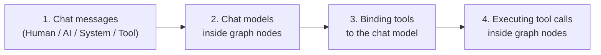

# Chains Using LangGraph — Messages and Chat Models

> **LangGraph series · Lecture 4 of 7** — Previous: [Pydantic Data Validation](Pydantic%20Data%20Validation.md) · Next: [Tools And Tools Node Integration](Tools%20And%20Tools%20Node%20Integration.md)

**What is a chain?** Nodes connected one after another (`START → node 1 → node 2 → … → node N → END`). In more complex workflows the flow can also go backwards, for example from node 2 back to node 1.

So far we have built graphs with nodes, normal edges and conditional edges. In this lesson we start building a **chain** that combines four concepts.

> **Scope.** This lecture covers **concepts 1 and 2**. Concepts 3 and 4 (tools) continue in [Tools And Tools Node Integration](Tools%20And%20Tools%20Node%20Integration.md). The routing idea behind them is in [Introduction To Router In LangGraph](Introduction%20To%20Router%20In%20LangGraph.md), and the finished multi-tool chatbot is in [Building Chatbot With Multiple Tool Integration](Building%20Chatbot%20With%20Multiple%20Tool%20Integration.md).

---

## 1. The four concepts of the chain



| # | Concept | The question it answers | Covered in |
|---|---|---|---|
| 1 | **Chat messages** | How do we represent a conversation, and keep it in the graph state? | This note |
| 2 | **Chat models in graph nodes** | How do we call an LLM from inside a node? | This note |
| 3 | **Binding tools** | How do we connect the LLM to external systems (APIs, vector DBs, ...)? | [Tools And Tools Node Integration](Tools%20And%20Tools%20Node%20Integration.md) |
| 4 | **Executing tool calls** | How does the LLM decide to call a tool, and how do we run it in a node? | [Tools And Tools Node Integration](Tools%20And%20Tools%20Node%20Integration.md) |

**Why tools?** An LLM is trained on past data. If you ask "what is today's news?", it can't answer by itself. If we bind a tool, such as a news API, to the model, the model can decide to call it, get fresh data, and then answer.

---

## 2. Setup

```python
from dotenv import load_dotenv
load_dotenv()          # loads OPENAI_API_KEY / GROQ_API_KEY from the .env file
```

- `load_dotenv()` puts the keys into the environment, and the LangChain integrations read them automatically.
- The lecture mostly uses **Groq** (free tier). OpenAI models are paid but are generally stronger. Pick whichever fits the use case.

---

## 3. Concept 1 — Chat messages

A chat is a list of **typed messages**. The type says who said what.

| Message class | Represents | Used for |
|---|---|---|
| `HumanMessage` | The **user** | The user's input |
| `AIMessage` | The **chat model** | The LLM's reply |
| `SystemMessage` | **Instructions** | Telling the LLM how to behave |
| `ToolMessage` | A **tool result** | The response from a tool call (see [Tools And Tools Node Integration](Tools%20And%20Tools%20Node%20Integration.md)) |

All of them are imported from `langchain_core.messages`:

```python
from langchain_core.messages import AIMessage, HumanMessage
```

### Main fields of a message

| Field | Meaning |
|---|---|
| `content` | The text of the message |
| `name` | (optional) Who is the author |
| `response_metadata` | (optional) A dictionary of extra information. For model replies it holds token counts, timing, model name and so on. |

### Building a conversation by hand

The aim is to see what a stored conversation looks like. Here we hard-code it. No model produced these messages.

```python
messages = [AIMessage(content="Please tell me how can I help?", name="LLMModel")]

messages.append(HumanMessage(content="I want to learn coding.", name="Krish"))

messages.append(AIMessage(content="Which programming language do you want to learn?", name="LLMModel"))

messages.append(HumanMessage(content="I want to learn the Python programming language.", name="Krish"))

for m in messages:
    m.pretty_print()
```

Output:

```
================================== Ai Message ==================================
Name: LLMModel

Please tell me how can I help?
================================ Human Message =================================
Name: Krish

I want to learn coding.
================================== Ai Message ==================================
Name: LLMModel

Which programming language do you want to learn?
================================ Human Message =================================
Name: Krish

I want to learn the Python programming language.
```

This is exactly how a real chatbot works: the AI speaks, the human replies, the AI responds, and so on. Each message is labelled with its role and appended to a list.

> **Note:** keep `name` values to letters, digits, `_` and `-` (e.g. `LLMModel`, not `LLM model`). Some providers, such as OpenAI, reject names with spaces.

### Messages as graph state

In a LangGraph application this list lives in the **graph state**, in a `messages` key. Every node appends to it using the `add_messages` reducer, which appends instead of overwriting. See the next section for what a reducer is. (`add_messages` was first used in [Building LangGraph](bulding%20langgrapg.md).)

```python
from langgraph.graph import MessagesState     # ready-made state: messages + add_messages reducer
```

---

## 3b. What is a reducer?

A **reducer** is a function attached to a state field. It tells LangGraph **how to combine the field's current value with the new value a node returns**.

```
new state value = reducer(current value, value returned by the node)
```

### Default behaviour: overwrite

A field with no reducer is **overwritten** by whatever a node returns for it.

```python
class State(TypedDict):
    messages: list            # no reducer -> each update replaces the previous value
```

If node A returns `{"messages": [Human]}` and node B returns `{"messages": [AI]}`, the final state is `[AI]`. The history is lost.

### With a reducer: merge

You attach a reducer with `Annotated[type, reducer]`:

```python
from typing import Annotated
from langgraph.graph.message import add_messages

class State(TypedDict):
    messages: Annotated[list, add_messages]
```

Now the same two updates give `[Human, AI]`.

| Piece | Meaning |
|---|---|
| `Annotated[X, ...]` | Attaches extra metadata to the type `X`. LangGraph reads the metadata as "use this reducer". |
| `list` | The type of the value |
| `add_messages` | The reducer. It **appends** new messages to the list, and a message with an existing ID updates that message instead. |

### Other reducers

A reducer is just a function `(current, new) -> merged`. For example, `operator.add` concatenates lists:

```python
import operator

class State(TypedDict):
    plain: list[str]                                  # overwritten
    appended: Annotated[list[str], operator.add]      # appended
```

If node A returns `["a"]` and node B returns `["b"]` for both fields, the result is:

```
{'plain': ['b'], 'appended': ['a', 'b']}
```

### Why chatbots need one

A conversation must keep **all** earlier messages so the model has context. `add_messages` does this, and it also converts plain strings and dicts into `HumanMessage` or `AIMessage` objects. This is why you can invoke a graph with `{"messages": "hi"}`.

### Summary

| | No reducer | With reducer |
|---|---|---|
| Node returns a value for the field | Replaces the old value | Merged with the old value by the reducer |
| Typical use | Single values such as `name` or `game` | Growing lists such as `messages` |

---

## 4. Concept 2 — Chat models

A chat model takes a **sequence of messages** as input and returns an `AIMessage`.

```python
from langchain_groq import ChatGroq

llm = ChatGroq(model="llama-3.3-70b-versatile")   # pick a model from console.groq.com/docs/models
result = llm.invoke(messages)
```

You can use any provider here, for example `langchain_openai.ChatOpenAI(model="gpt-5-mini")`. The `.invoke(messages)` call is the same.

### What the model answers

- The model sees the **whole conversation** and replies to the **last message**.
- That is why the list must end with a `HumanMessage`. In the lecture the last one is "I want to learn the Python programming language", so the reply is about Python.

### Reading the result

```python
result                    # AIMessage(content="Great choice! Python is a versatile and beginner-friendly language...", ...)
result.content            # just the text of the reply
result.response_metadata  # token counts, timings, model name, finish reason
```

`response_metadata` typically contains:

| Info | Example from the lecture |
|---|---|
| Prompt tokens | 75 |
| Total tokens | 521 |
| Completion time | ~2.2 s |
| Model name | the model that answered |
| Finish reason | `stop` |

The exact keys depend on the provider.

> The result is a normal `AIMessage`. That is why you can drop it straight into the graph state's `messages` list.

---

## 5. Putting it together (preview of the next step)

```python
from langgraph.graph import StateGraph, START, END, MessagesState

def chat_node(state: MessagesState):
    return {"messages": [llm.invoke(state["messages"])]}   # reducer appends the AIMessage

builder = StateGraph(MessagesState)
builder.add_node("chat_node", chat_node)
builder.add_edge(START, "chat_node")
builder.add_edge("chat_node", END)
graph = builder.compile()

graph.invoke({"messages": [HumanMessage(content="I want to learn Python")]})
```

This is the same pattern as the SuperBot chatbot in [Building LangGraph](bulding%20langgrapg.md). [Tools And Tools Node Integration](Tools%20And%20Tools%20Node%20Integration.md) extends this graph with tool binding and tool execution.

---

## 6. Key takeaways

- A **chain** is nodes connected in sequence. This lecture builds one around four concepts: messages, chat models, tool binding and tool execution.
- A conversation is a **list of typed messages**: `HumanMessage` (user), `AIMessage` (model), `SystemMessage` (instructions) and `ToolMessage` (tool result).
- Messages have `content`, an optional `name` and optional `response_metadata`.
- A chat model takes a list of messages and returns an `AIMessage`. It answers the **last** message, using the earlier ones as context.
- `result.content` is the text and `result.response_metadata` holds token usage and timing.
- In a graph, the message list lives in the **state** and is kept up to date by the `add_messages` **reducer**.
- LLMs don't know current information. **Tools** connect them to external sources, and that is the next lecture: [Tools And Tools Node Integration](Tools%20And%20Tools%20Node%20Integration.md).
