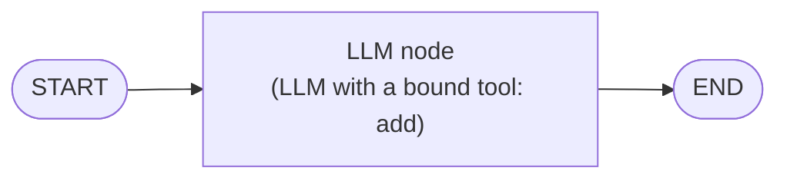
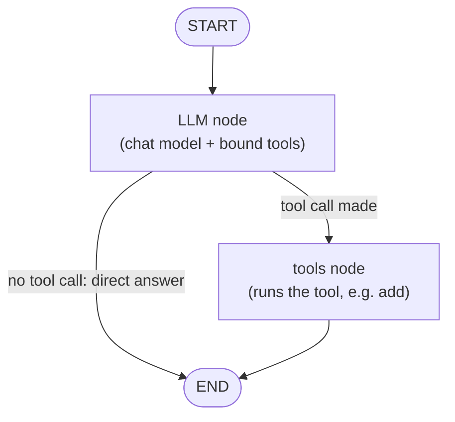
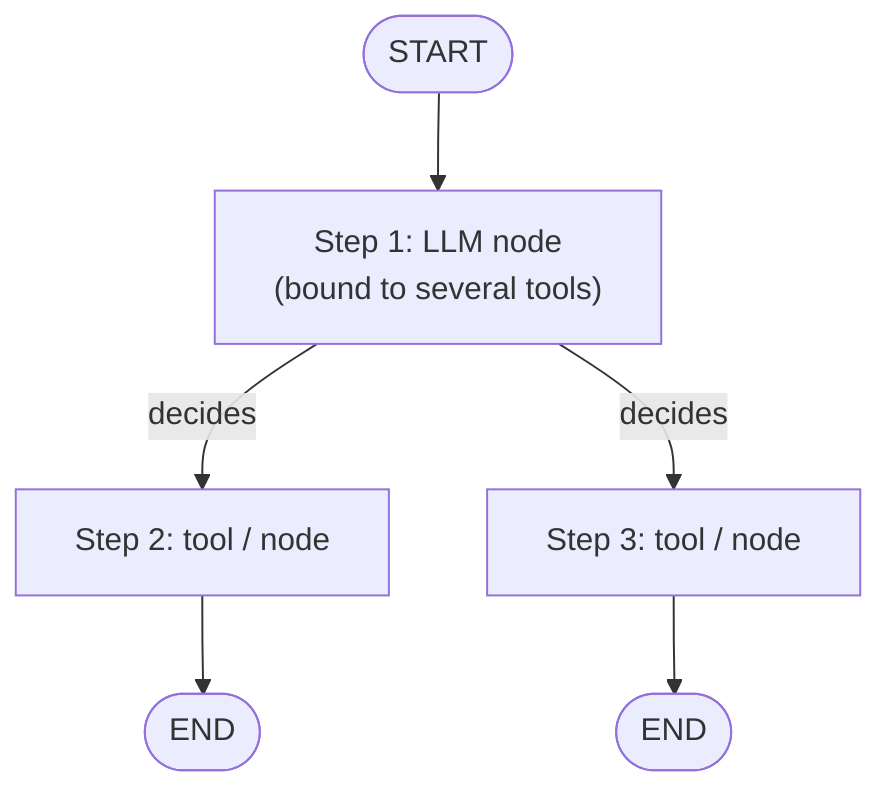

# Introduction to Routers in LangGraph

> **LangGraph series · Lecture 6 of 7** — Previous: [Tools And Tools Node Integration](Tools%20And%20Tools%20Node%20Integration.md) · Next: [Building Chatbot With Multiple Tool Integration](Building%20Chatbot%20With%20Multiple%20Tool%20Integration.md)

**Why this lecture?** Before implementing more about tools, we need the **router** idea. It is what turns an LLM-powered node into a basic **agent**. This lecture is conceptual, with no code. The code in section 6 is a preview of how it is built.

---

## 1. Recap: where we left off

In the previous lecture ([Tools And Tools Node Integration](Tools%20And%20Tools%20Node%20Integration.md)) we built this graph:



- The state uses **messages**.
- The chat model has a **bound tool**, our custom `add` function.
- For an input like "what is 2 + 2?", the LLM understood from the natural language that it should call a tool. It returned a **tool call** with the function name and its parameters (`a=2, b=2`).

**The gap:** the LLM only said *"I want to call `add` with these arguments"*. **Nothing actually ran the tool**, so we never got the answer 4.

What we want:

1. The LLM decides whether it needs a tool.
2. If yes, the tool is executed with those arguments, and the result comes back.
3. If no, the LLM's direct answer goes to the end.

---

## 2. The new workflow



The fork after the LLM node is a **conditional edge**: one path goes to the tools node and the other goes straight to `END`.

---

## 3. What is a router?

> **Router:** the chat model **routes between a direct response and a tool call**, based on the user's input.

- The LLM does the routing. It decides which path the graph takes next.
- The **conditional edge** carries out that decision.

| User input | LLM decision | Route |
|---|---|---|
| "What is 2 + 2?" | needs the `add` tool | LLM node → **tools node** → END |
| "Hello, who are you?" | can answer directly | LLM node → **END** |

The tools node takes the arguments the LLM produced (`a`, `b`), executes the function and returns the result.

---

## 4. From router to agent

This simple router is a **basic agent**.

> **Agent:** a system where an LLM **directs the control flow** itself. It decides whether to call a tool or answer directly, and it acts on that decision **automatically, without a human in the loop**.

Why call it an agent?
- The LLM is the **brain** that takes the decision.
- It only knows which **tools** are bound to it, and chooses among them.
- Nobody tells it step by step what to do.

### How it scales

The graph can grow as the number of tools grows:



- A single LLM node can have 4 or 5 tools bound to it.
- Ask for "today's news" and it will look for a bound tool that can fetch news. If one exists, it calls it.
- As the graph gets more complex, the LLM is the one deciding where to go.

### Analogy from the lecture

You have **5 books** on your desk and someone asks you a question you can't answer.
- You pick the right book, look up the answer and respond.
- An LLM with tools works the same way. It has its own knowledge, plus a set of tools it can reach for when it needs them.

---

## 5. Summary table

| Concept | Meaning |
|---|---|
| **Bound tool** | A function attached to the chat model so it can request calls to it |
| **Tool call** | The LLM's *request* to run a tool, with the function name and arguments. It does **not** run the tool. |
| **Tool execution node** | The graph node that actually runs the requested tool and returns the result |
| **Conditional edge** | The fork after the LLM node: tool call → tools node, otherwise → END |
| **Router** | The LLM choosing between a direct answer and a tool call |
| **Agent** | An LLM that decides its own path and acts on it automatically |

---

## 6. Preview: how it looks in code

This preview is not from the lecture. It uses LangGraph's prebuilt helpers (`ToolNode` and `tools_condition`), and I ran it with a stub standing in for the LLM node. With a real model, the LLM node would be `llm_with_tools.invoke(state["messages"])`.

```python
from langchain_core.tools import tool
from langgraph.graph import StateGraph, START, END, MessagesState
from langgraph.prebuilt import ToolNode, tools_condition

@tool
def add(a: int, b: int) -> int:
    """Add a and b."""
    return a + b

llm_with_tools = llm.bind_tools([add])             # llm = ChatGroq(...) or ChatOpenAI(...)

def llm_node(state: MessagesState):
    return {"messages": [llm_with_tools.invoke(state["messages"])]}

builder = StateGraph(MessagesState)
builder.add_node("llm_node", llm_node)
builder.add_node("tools", ToolNode([add]))         # executes the tool calls

builder.add_edge(START, "llm_node")
builder.add_conditional_edges("llm_node", tools_condition)   # the ROUTER
builder.add_edge("tools", END)
graph = builder.compile()
```

- `tools_condition` is the routing function: it returns `"tools"` if the last AI message contains tool calls, and `END` otherwise.
- `ToolNode([add])` runs the requested tool and returns a `ToolMessage` with the result.
- Running the stub version:
  - Input "hi" gave `[Human, AI "Hello! (direct answer)"]`.
  - Input "what is 2+2" gave `[Human, AI (tool call), Tool "4"]`.

The next lecture, [Building Chatbot With Multiple Tool Integration](Building%20Chatbot%20With%20Multiple%20Tool%20Integration.md), implements this with several real tools.

---

## 7. Key takeaways

- Binding a tool lets the LLM **request** a call, but something else must **execute** it.
- A **router** is an LLM node followed by a conditional edge that goes to a tools node when the LLM asks for a tool, and to `END` otherwise.
- This pattern is a **basic agent**: the LLM chooses its own path automatically.
- The more tools you bind, the more routes the LLM can choose between, and the more complex the graph becomes.
