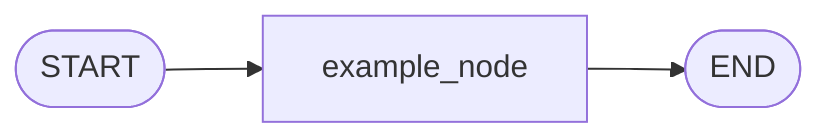

# Pydantic State Schema — Runtime Data Validation in LangGraph

> **LangGraph series · Lecture 3 of 7** — Previous: [State Schema With Data Classes](State%20Schema%20With%20Data%20Classes.md) · Next: [Chains Using Langgraph](Chains%20Using%20Langgraph.md)

**Goal of the lesson:** fix the weakness from the previous lesson. `TypedDict` and `dataclass` state schemas only *hint* at types, and nothing stops a wrong type at runtime. **Pydantic** actually validates the input.

---

## 1. The problem we are solving

From the previous lesson ([State Schema With Data Classes](State%20Schema%20With%20Data%20Classes.md)):

```python
class State(TypedDict):
    name: str

graph.invoke({"name": 123})     # no error at invoke time, even though name should be a str
```

We want a state where passing an `int` for `name` **fails immediately with a clear error**.

---

## 2. What is Pydantic?

- The most widely used **data validation library** for Python.
- You define a class that inherits from **`BaseModel`** and declare fields with type annotations.
- At runtime Pydantic **checks the values you pass in** against those types. If a value is invalid, it raises a **`ValidationError`**.
- It is also useful beyond LangGraph, and we will use it in many GenAI applications later.

Setup: Pydantic is installed automatically with LangGraph and LangChain. To install it explicitly, run `pip install -U pydantic`.

---

## 3. Comparison of the three ways to define state

| | `TypedDict` | `dataclass` | **Pydantic `BaseModel`** |
|---|---|---|---|
| Define with | `class S(TypedDict)` | `@dataclass class S` | `class S(BaseModel)` |
| Read a field | `state["x"]` | `state.x` | `state.x` |
| Invoke with | dict | dataclass object | dict (or model object) |
| **Validates types at runtime** | no | no | **yes** |

---

## 4. Example

The graph is the simplest possible one: `START → example_node → END`.



### 4.1 State: inherit from `BaseModel`

```python
from pydantic import BaseModel

class State(BaseModel):
    name: str
```

By inheriting from `BaseModel`, every field is validated whenever the state is created.

### 4.2 Node

```python
def example_node(state: State):
    return {"name": "Hello " + state.name}      # attribute access, like a dataclass
```

- Read fields with `state.name`.
- Return a dictionary with the fields to update.

### 4.3 Build the graph

```python
from langgraph.graph import StateGraph, START, END

builder = StateGraph(State)                       # pass the Pydantic class
builder.add_node("example_node", example_node)
builder.add_edge(START, "example_node")
builder.add_edge("example_node", END)

graph = builder.compile()
```

Everything here is the same as in the earlier lessons. Only the state class changed.

### 4.4 Valid input

```python
graph.invoke({"name": "Krish"})
# {'name': 'Hello Krish'}
```

### 4.5 Invalid input: the error we wanted

```python
graph.invoke({"name": 123})
```

```
ValidationError: 1 validation error for State
name
  Input should be a valid string [type=string_type, input_value=123, input_type=int]
```

The error appears at `invoke` time, **before** the node runs. Compare this with `TypedDict`, where `123` got into the graph and only failed later (if at all) inside your own code.

Other inputs are also rejected:

| Input | Result |
|---|---|
| `{"name": "Krish"}` | works |
| `{"name": 123}` | `ValidationError` (not a valid string) |
| `{"name": None}` | `ValidationError` (not a valid string) |
| `{}` | `ValidationError` (field required) |

---

## 5. Things to know

These points go beyond the lecture and were confirmed by running the code and by the LangGraph docs.

- **Only the graph input is validated.** Runtime validation happens on the input to the **first node**. Values that nodes *return* are **not** validated. For example, a node returning `{"name": 123}` passes through without an error.
- **The output is a plain dict**, not a Pydantic model instance, even though the state is a `BaseModel`.
- **Errors don't name the failing node.** The `ValidationError` trace doesn't tell you which node it came from.
- **Pydantic may coerce values.** In its default mode it converts some compatible inputs. For example, an `int` field given `"5"` becomes `5`. This is convenient but can surprise you. However, an `int` is **not** coerced into a `str`, which is why `name=123` fails.
- **Performance.** Validation adds overhead. For performance-sensitive graphs the LangGraph docs suggest a `dataclass`. Use Pydantic when input validation matters more.
- **Defaults and extra fields** work the usual Pydantic way, e.g. `age: int = 0`.

---

## 6. Key takeaways

- `TypedDict` and `dataclass` give type **hints**. Pydantic gives type **enforcement**.
- To use it, inherit your state class from `pydantic.BaseModel` and pass it to `StateGraph(...)`.
- Read fields with `state.field` and return updates as a dict.
- Passing a wrong type to `invoke` raises a `ValidationError` right away.
- Validation covers the **graph input only**, not node outputs.
- Choose the state style by need:
  - `TypedDict` for simple dict-like state.
  - `dataclass` for object-style state with a lighter overhead.
  - `BaseModel` when you need runtime validation.

## 7. Next up

[Chains Using Langgraph](Chains%20Using%20Langgraph.md): chat messages, chat models inside nodes, and how a conversation is kept in the graph state.
