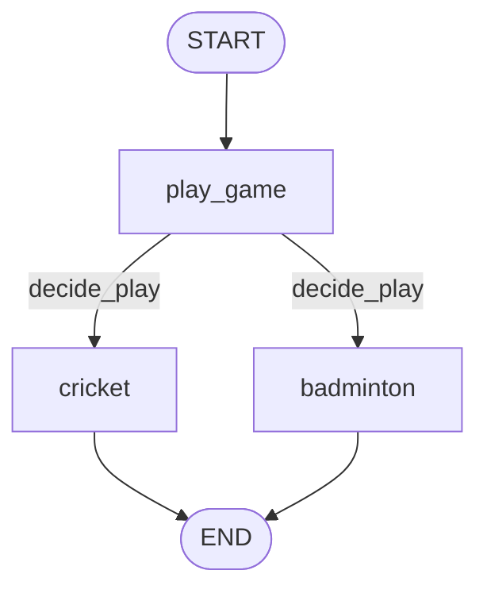

# State Schema in LangGraph — `TypedDict` vs `dataclass`

> **LangGraph series · Lecture 2 of 7** — Previous: [Building LangGraph](bulding%20langgrapg.md) · Next: [Pydantic Data Validation](Pydantic%20Data%20Validation.md)

**Goal of the lesson:** learn two ways to define the state schema, and see what neither of them enforces at runtime. This sets up the next lesson, [Pydantic Data Validation](Pydantic%20Data%20Validation.md).

---

## 1. Recap: what the state schema is

- The **state** is the input to the whole graph and to every node. Nodes read it and return updates to it.
- Earlier ([Building LangGraph](bulding%20langgrapg.md)) we defined it with `TypedDict` plus a reducer:

```python
class State(TypedDict):
    messages: Annotated[list, add_messages]   # reducer appends instead of overwriting
```

- A **reducer** appends to a variable instead of overwriting it.
- This lesson uses a state with **more than one field**. There is no limit on how many fields a state can have.

---

## 2. The example we build

The same workflow as before (`play_game` → `cricket` or `badminton`), but the state now has two fields:

| Field | Type | Meaning |
|---|---|---|
| `name` | `str` | Who is playing |
| `game` | `Literal["badminton", "cricket"]` | Which game. It can only be one of these two values. |



`Literal[...]` restricts a value to a fixed set of constants.

---

## 3. Way 1 — `TypedDict`

### State

```python
from typing import Literal
from typing_extensions import TypedDict

class TypedDictState(TypedDict):
    name: str
    game: Literal["badminton", "cricket"]
```

### Nodes

With `TypedDict`, the state is a dictionary, so you access fields with **`state["name"]`**.

```python
def play_game(state: TypedDictState):
    print("play_game node has been called")
    return {"name": state["name"] + " wants to play"}

def cricket(state: TypedDictState):
    print("cricket node has been called")
    return {"name": state["name"] + " cricket", "game": "cricket"}

def badminton(state: TypedDictState):
    print("badminton node has been called")
    return {"name": state["name"] + " badminton", "game": "badminton"}
```

- Nodes return a **dictionary with the keys they want to update**. Any key you omit stays unchanged.
- Each node here updates both `name` and `game`. You can update either one or both.

### Routing function

```python
import random

def decide_play(state: TypedDictState) -> Literal["cricket", "badminton"]:
    if random.random() < 0.5:
        return "cricket"
    return "badminton"
```

The return strings must match the node names.

### Build the graph

```python
from IPython.display import Image, display
from langgraph.graph import StateGraph, START, END

builder = StateGraph(TypedDictState)            # pass the state class

builder.add_node("play_game", play_game)
builder.add_node("cricket", cricket)
builder.add_node("badminton", badminton)

builder.add_edge(START, "play_game")
builder.add_conditional_edges("play_game", decide_play)
builder.add_edge("cricket", END)
builder.add_edge("badminton", END)

graph = builder.compile()
display(Image(graph.get_graph().draw_mermaid_png()))
```

### Invoke — input is a **dictionary**

```python
graph.invoke({"name": "Krish"})
# {'name': 'Krish wants to play cricket', 'game': 'cricket'}
```

Run it several times. The branch is random, and both `name` and `game` are updated by whichever node runs.

### The weakness: type hints are not enforced

`name: str` is only a **type hint**. It helps your IDE and static type checkers (such as mypy) catch mistakes before the code runs, but **Python does not check it while the program runs**.

```python
graph.invoke({"name": 123})
```

- This is **not rejected** when it enters the graph, even though `name` is declared as `str`.
- In the lecture it only failed later, inside the node, with `TypeError: unsupported operand type(s) for +: 'int' and 'str'`. That error came from `123 + " wants to play"`, not from any type check.
- With the string concatenation removed from the nodes, the graph ran fine and returned `name = 123`.

> **Takeaway:** `TypedDict` documents the types but does not validate them.

---

## 4. Way 2 — `dataclass`

A **data class** is a class mainly used to store data. The `@dataclass` decorator generates the boilerplate (`__init__`, `__repr__`, etc.) for you.

### State

```python
from dataclasses import dataclass
from typing import Literal

@dataclass
class DataclassState:
    name: str
    game: Literal["badminton", "cricket"]
```

### What changes compared with `TypedDict`

| | `TypedDict` | `dataclass` |
|---|---|---|
| Read a field in a node | `state["name"]` | `state.name` |
| Return value from a node | dict of updates | **dict of updates (unchanged)** |
| Invoke input | `{"name": "Krish"}` | `DataclassState(name="Krish", game="cricket")` |
| `StateGraph(...)` argument | the `TypedDict` class | the dataclass |
| Runtime type checking | none | none |

### Nodes: the only change is attribute access

```python
def play_game(state: DataclassState):
    print("play_game node has been called")
    return {"name": state.name + " wants to play"}         # state.name, not state["name"]

def cricket(state: DataclassState):
    print("cricket node has been called")
    return {"name": state.name + " cricket", "game": "cricket"}

def badminton(state: DataclassState):
    print("badminton node has been called")
    return {"name": state.name + " badminton", "game": "badminton"}

def decide_play(state: DataclassState) -> Literal["cricket", "badminton"]:
    return "cricket" if random.random() < 0.5 else "badminton"
```

Nodes still **return a dictionary** of updates. Only *reading* the state changes.

### Build the graph (same as before, different state class)

```python
builder = StateGraph(DataclassState)
builder.add_node("play_game", play_game)
builder.add_node("cricket", cricket)
builder.add_node("badminton", badminton)
builder.add_edge(START, "play_game")
builder.add_conditional_edges("play_game", decide_play)
builder.add_edge("cricket", END)
builder.add_edge("badminton", END)
graph = builder.compile()
```

### Invoke — input is a **dataclass instance**

```python
graph.invoke(DataclassState(name="Krish", game="cricket"))
# {'name': 'Krish wants to play cricket', 'game': 'cricket'}
```

- You **must supply every field** that has no default value. Leaving out `game` raises `TypeError: __init__() missing 1 required positional argument: 'game'`.
- The `game` you pass in is only the starting value. The routing function chooses a branch at random, and that node overwrites `game`.
- The result of `invoke` still comes back as a plain dict, not a dataclass instance.
- You can give a field a default (`game: Literal[...] = "cricket"`) so you don't have to pass it.

### Still no runtime enforcement

`@dataclass` does not validate types either. Even though `name: str`, passing other values is accepted, and any failure comes from your own code (such as a bad concatenation), not from a type check.

---

## 5. Comparison

| | `TypedDict` | `dataclass` |
|---|---|---|
| Access style | `state["key"]` | `state.key` |
| Input to `invoke` | dict | dataclass object |
| Node return | dict | dict |
| Reducers via `Annotated[...]` | yes | yes (same idea) |
| Validates types at runtime | no | no |
| Good for | simple, dict-like state | an object-style state with defaults and attribute access |

---

## 6. Key takeaways

- A state can have **any number of fields**, and nodes can update one or several of them.
- Use `Literal[...]` to restrict a field to a fixed set of values, but remember this is only a hint.
- **`TypedDict`:** the state is a dict, accessed with `state["x"]` and invoked with a dict.
- **`dataclass`:** the state is an object, accessed with `state.x` and invoked with an instance. Nodes still return dicts.
- **Neither enforces types at runtime.** `name: str` does not stop `name=123` from entering the graph.

## 7. Next up

[Pydantic Data Validation](Pydantic%20Data%20Validation.md): Pydantic provides runtime validation, so a field declared as `str` raises an error if you pass something else.
