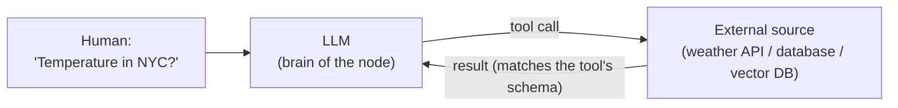
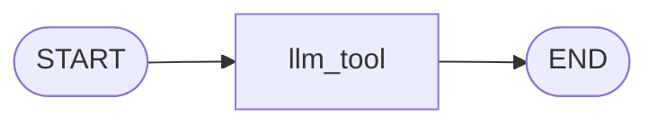
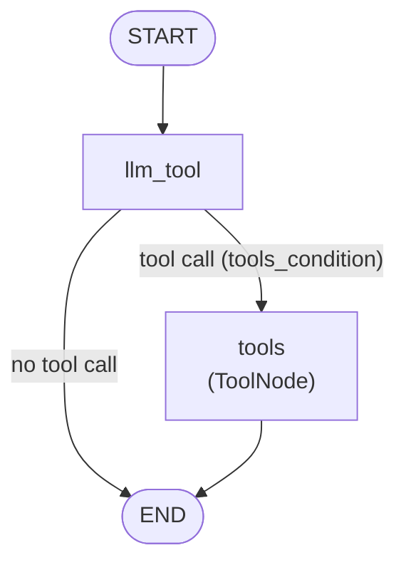

# Tools and the Tools Node in LangGraph

> **LangGraph series · Lecture 5 of 7** — Previous: [Chains Using Langgraph](Chains%20Using%20Langgraph.md) · Next: [Introduction To Router In LangGraph](Introduction%20To%20Router%20In%20LangGraph.md)

**Where we are:** the previous lecture, [Chains Using Langgraph](Chains%20Using%20Langgraph.md), covered chat messages and chat models. Now we connect an LLM to **tools** and build the full loop: LLM → decide → run the tool → return the result.

---

## 1. What are tools, and why do we need them?

Tools let an LLM interact with **external systems**, such as APIs, third-party services, databases and vector databases.

An LLM can't answer "What is the current temperature in New York City?" by itself, because:
- it was trained on past data, and
- it isn't connected to the internet.



How it works:
1. We **bind** the tool to the LLM, which tells the LLM that the tool exists.
2. When the query needs the tool, the LLM **chooses to call it**. This is based on the natural-language input.
3. The tool returns an output that matches the **tool's schema**, for example JSON.
4. The output can later be parsed and shown to the user.

The LLM is the **brain** of the node. It decides whether a tool call is needed.

---

## 2. The running example: an `add` tool

We use a simple custom tool: addition. The LLM can add 2 + 2 by itself, but here it should recognise that it has a tool for this and use it.

### 2.1 Define the tool

```python
def add(a: int, b: int) -> int:
    """Add a and b.

    Args:
        a: first int
        b: second int
    """
    return a + b
```

- **Type hints** (`int`, `-> int`) define the tool's input and output schema.
- The **docstring is important.** It explains what the function does, and the LLM uses it to decide *when* to call the tool. A vague docstring means poor tool choices.

### 2.2 Bind the tool to the LLM

```python
from langchain_groq import ChatGroq

llm = ChatGroq(model="llama-3.3-70b-versatile")
llm_with_tools = llm.bind_tools([add])      # a list: you can bind many tools
```

- Use **`bind_tools`**, which takes a list of tools.
- `llm_with_tools` is a new model object that knows about `add`.
- I checked that a plain function with a docstring works. LangChain builds the tool definition from the function name, type hints and docstring. You can also decorate it with `@tool` from `langchain_core.tools`.

### 2.3 What happens when we invoke it

```python
from langchain_core.messages import HumanMessage

tool_call = llm_with_tools.invoke([HumanMessage(content="What is 2 plus 2?", name="Krish")])
tool_call
```

The reply is an `AIMessage` with **empty content** and a tool call:

```python
tool_call.tool_calls
# [{'name': 'add', 'args': {'a': 2, 'b': 2}, 'type': 'tool_call', ...}]
```

| What we see | Meaning |
|---|---|
| `content` is empty | The LLM did not answer in text |
| `tool_calls[0]["name"]` = `add` | The function it wants to call |
| `args` = `{'a': 2, 'b': 2}` | The arguments it extracted from the natural language |

The LLM **understood when and how** to call the tool. But a tool call is only a **request**. Nothing has executed `add` yet, so we have no result.

---

## 3. Graph state: messages with a reducer

We need a state that holds the conversation.

```python
from typing import Annotated
from typing_extensions import TypedDict
from langchain_core.messages import AnyMessage
from langgraph.graph.message import add_messages

class State(TypedDict):
    messages: Annotated[list[AnyMessage], add_messages]
```

| Piece | Meaning |
|---|---|
| `list[AnyMessage]` | A list that can hold any message type (Human, AI, System, Tool) |
| `Annotated[..., add_messages]` | Attaches the **`add_messages` reducer** to this field |
| `add_messages` | Appends new messages instead of overwriting the list |

> **Why the reducer?** With no reducer, each node's returned `messages` **overwrites** the previous value. A reducer controls *how updates are merged*. `add_messages` appends, and a message with an existing ID updates that message. You will use it in nearly every chat-style graph. You can add other fields (e.g. `name: str`), and inheriting from `BaseModel` adds Pydantic validation.

### Seeing `add_messages` work

```python
from langchain_core.messages import AIMessage, HumanMessage
from langgraph.graph.message import add_messages

initial = [
    AIMessage(content="So you said you were researching ocean mammals?", name="Model"),
    HumanMessage(content="Yes, I know about whales. But what others should I learn about?", name="Krish"),
]
new = AIMessage(content="Fantastic: dolphins, seals...", name="Model")

add_messages(initial, new)
# [AIMessage(...), HumanMessage(...), AIMessage("Fantastic: ...")]
```

The new message is **appended** to the list. This is what happens to `state["messages"]` after every node.

---

## 4. Graph version 1: LLM node only (the problem)

```python
def llm_tool(state: State):
    return {"messages": [llm_with_tools.invoke(state["messages"])]}
```

```python
from langgraph.graph import StateGraph, START, END

builder = StateGraph(State)
builder.add_node("llm_tool", llm_tool)
builder.add_edge(START, "llm_tool")
builder.add_edge("llm_tool", END)
graph = builder.compile()
```



```python
result = graph.invoke({"messages": "What is 2 plus 2?"})
for m in result["messages"]:
    m.pretty_print()
```

Output: a Human message and an AI message that contains a **tool call**, but **no Tool message**.

**Why no result?** The graph has no node that *executes* the tool. The LLM requested the call, and then the graph reached `END`.

---

## 5. Graph version 2: add the tools node and a router

We fix this with two prebuilt helpers from `langgraph.prebuilt`:

| Helper | Role |
|---|---|
| **`ToolNode(tools)`** | A ready-made node that **runs** the tool calls in the last AI message and returns the results as `ToolMessage`s |
| **`tools_condition`** | A ready-made **routing function** for a conditional edge. If the last AI message has a tool call, it routes to `"tools"`. Otherwise it routes to `END`. |

### The target graph



### The code

```python
from langgraph.graph import StateGraph, START, END
from langgraph.prebuilt import ToolNode, tools_condition

tools = [add]

builder = StateGraph(State)
builder.add_node("llm_tool", llm_tool)
builder.add_node("tools", ToolNode(tools))          # node that executes the tools

builder.add_edge(START, "llm_tool")
builder.add_conditional_edges("llm_tool", tools_condition)   # tool call -> "tools", else -> END
builder.add_edge("tools", END)

graph = builder.compile()
```

Key points:
- **The node name `"tools"` matters.** `tools_condition` returns the string `"tools"`, so the `ToolNode` must be registered under that name.
- The `ToolNode` receives the same `tools` list you bound to the LLM.
- `add_conditional_edges("llm_tool", tools_condition)` is the router. The next lecture, [Introduction To Router In LangGraph](Introduction%20To%20Router%20In%20LangGraph.md), explains the idea in detail.
- `add_edge("tools", END)`: after the tool runs, the graph ends.

### Running it

**A question that needs the tool:**

```python
result = graph.invoke({"messages": "What is 2 plus 2?"})
for m in result["messages"]:
    m.pretty_print()
```

```
Human Message : What is 2 plus 2?
Ai Message    : Tool Calls: add (a=2, b=2)
Tool Message  : Name: add    4
```

Flow: `START → llm_tool → tools → END`.

**A question that doesn't:**

```python
result = graph.invoke({"messages": "What is machine learning?"})
```

```
Human Message : What is machine learning?
Ai Message    : Machine learning is ...
```

Flow: `START → llm_tool → END`. The LLM answers directly and no tool is called.

I ran both flows with a stub in place of the LLM node. The `ToolNode` really executed `add` and returned `4`, and the direct-answer path skipped the tools node.

---

## 6. Summary

| Step | What | Code |
|---|---|---|
| 1 | Write the tool (type hints plus docstring) | `def add(a: int, b: int) -> int` |
| 2 | Bind the tool to the LLM | `llm.bind_tools([add])` |
| 3 | Define state with the reducer | `messages: Annotated[list[AnyMessage], add_messages]` |
| 4 | LLM node calls the bound LLM | `llm_with_tools.invoke(state["messages"])` |
| 5 | Add the **tools node** | `builder.add_node("tools", ToolNode(tools))` |
| 6 | Add the **router** | `add_conditional_edges("llm_tool", tools_condition)` |
| 7 | Tools node goes to the end | `add_edge("tools", END)` |

## 7. Key takeaways

- **Tools** connect an LLM to external systems. The LLM decides when to call one, based on the user's input and the tool's **docstring and schema**.
- `bind_tools` only makes the LLM **aware** of the tool. The LLM then produces a **tool call** (name plus arguments), which is a request and not a result.
- A **`ToolNode`** executes the tool calls and returns `ToolMessage`s.
- **`tools_condition`** is the router: tool call → tools node, no tool call → `END`.
- Chat state needs the **`add_messages` reducer**, so every node appends to the conversation instead of overwriting it.
- This is a basic agent: the LLM decides the path automatically.

## 8. Next up

- [Introduction To Router In LangGraph](Introduction%20To%20Router%20In%20LangGraph.md): why the LLM plus `tools_condition` pattern is a router and a basic agent.
- [Building Chatbot With Multiple Tool Integration](Building%20Chatbot%20With%20Multiple%20Tool%20Integration.md): combining several tools (arXiv, Wikipedia, internet search) in a single `ToolNode`.
