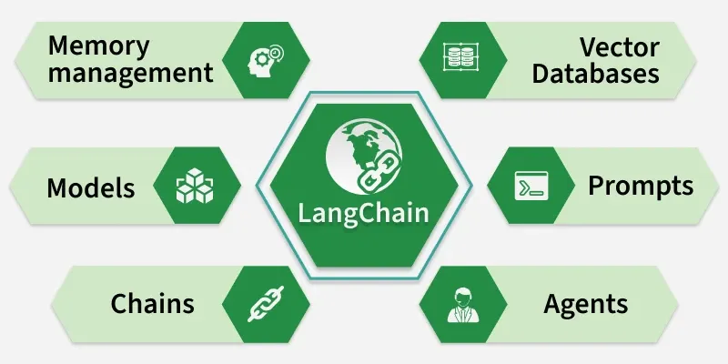
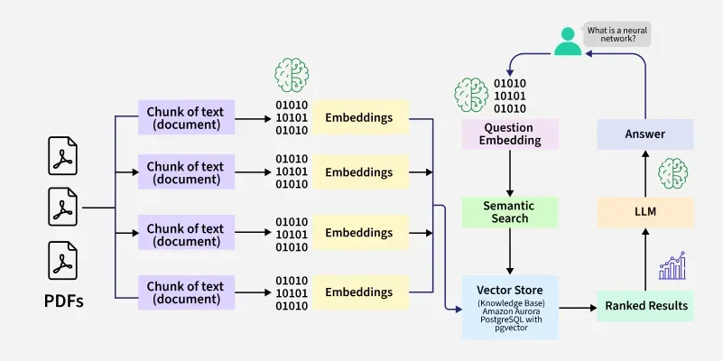

# Langchain

## Introduction to LangChain

## Introduction to LangChain

    - Simplifies chaining LLMs together for reusable and efficient workflows.
    - Offers tools for effective prompt engineering and memory handling.
    - Streamlines the process of building LLM-powered applications.

## Key Components

- **Chains:** Define a sequence of steps where each step can use an LLM, process data or call tools. Simple chains use one step, while multi step chains combine multiple actions.
- **Prompt Management:** Helps design and manage prompts using templates, making it easier to control input, output format and model behavior.
- **Agents:** Agents are [LLM](https://www.geeksforgeeks.org/artificial-intelligence/large-language-model-llm/) driven components that decide which actions to take, such as calling tools or APIs, based on input and predefined capabilities.
- **Vector Database:** Stores data as vectors to enable similarity search, helping retrieve relevant information for tasks like document search and RAG.
- **Models:** Supports multiple LLMs like [OpenAI](https://www.geeksforgeeks.org/machine-learning/open-ai-gpt-3/) , [Hugging Face](https://www.geeksforgeeks.org/artificial-intelligence/hugging-face-tutorial/) and others, allowing flexibility in choosing the best model.
- **Memory Management:** Maintains context from past interactions, enabling better responses in conversations and multi step tasks.

## How LangChain Works?

LangChain enables [Retrieval-Augmented Generation (RAG)](https://www.geeksforgeeks.org/nlp/what-is-retrieval-augmented-generation-rag/) by combining document processing, vector storage and LLMs to generate accurate, context aware responses. It connects embeddings, vector databases and models into a smooth workflow.

## Create a Prompt Template

We create a dynamic prompt where {year} can be replaced with input values.

template = "Give me 3 career skills that are in high demand in {year}."

prompt_template = PromptTemplate.from_template(template)

## Example of simple Chain

llm = OpenAI(

temperature=0.7,

openai_api_key=api_key,

api_key = os.getenv("OPENAI_API_KEY")

)

prompt = "Suggest me a skill that is in demand?"

**# We create a dynamic prompt where {year} can be replaced with input values.**

template = "Give me 3 career skills that are in high demand in {year}."

prompt_template = PromptTemplate.from_template(template)

**# LCEL (LangChain Expression Language): It’s a new way to compose LLM workflows using a simple, chainable syntax with the | (pipe) operator.**

chain = prompt_template | llm | StrOutputParser()

response = chain.invoke({"year": "2025"})

print("\n Career Skills in 2025:\n", response)

    - Enables chatbots and virtual assistants that remember past interactions, connect with APIs and provide context aware responses.
    - Allows users to query documents like PDFs, research papers or contracts and get precise answers quickly.
    - Supports knowledge management by organizing and retrieving data from multiple sources.
    - Automates multi step workflows such as customer support, report generation and CRM updates.
    - Converts natural language queries into insights, SQL queries and business reports for data analysis.

Sources:

[https://www.geeksforgeeks.org/artificial-intelligence/introduction-to-langchain/](https://www.geeksforgeeks.org/artificial-intelligence/introduction-to-langchain/)

LangChain is an open-source framework that simplifies building applications using large language models. It helps developers connect LLMs with external data, tools and workflows and is available in both Python and JavaScript.

## Key Components

## How LangChain Works?

## Create a Prompt Template

## Example of simple Chain

## Applications
