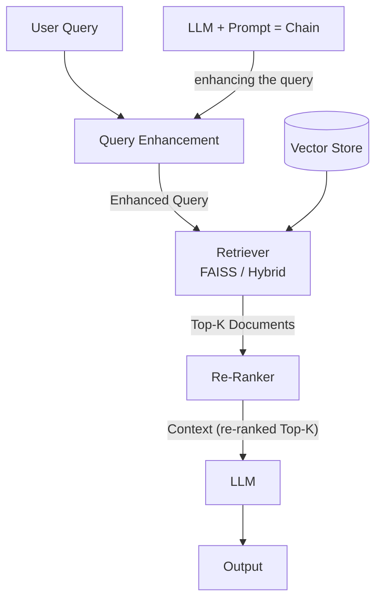
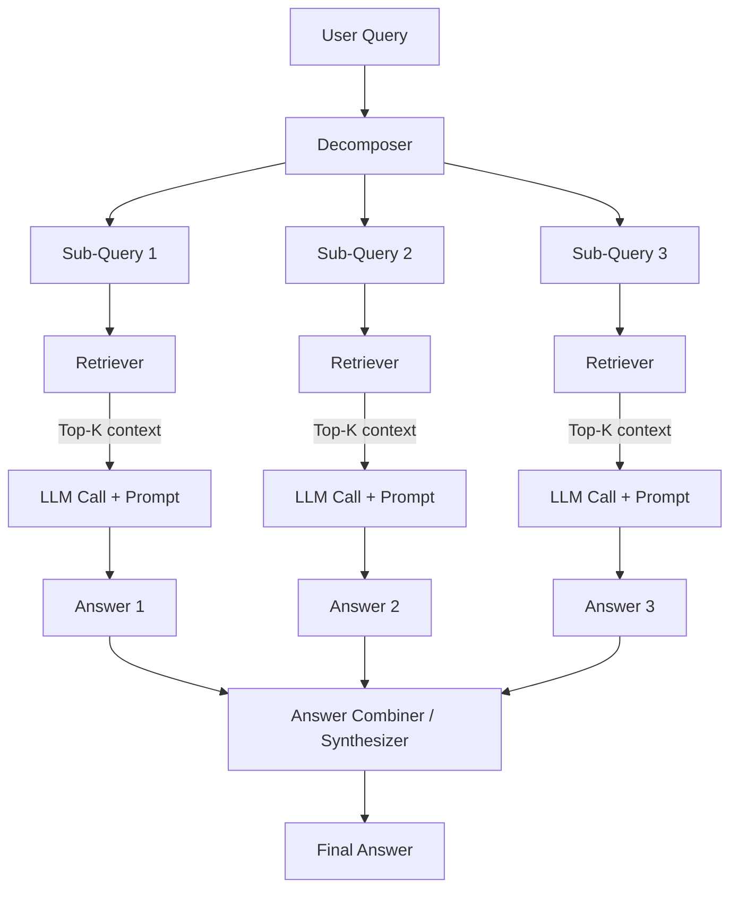
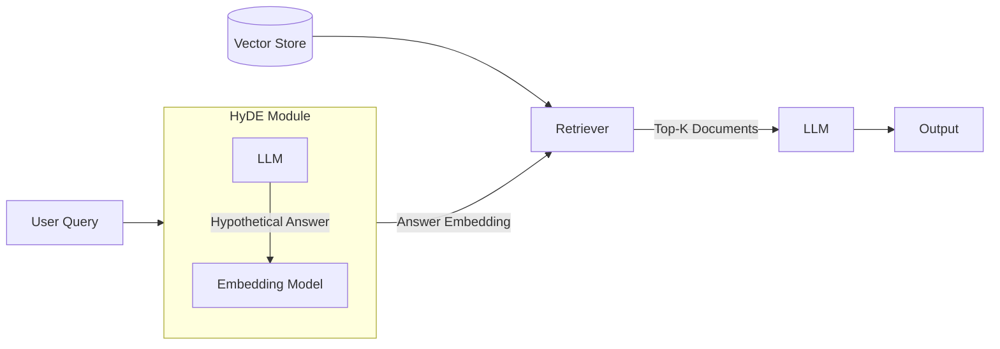

# Query Enhancement

> **Core idea:** In a RAG pipeline, the quality of the query sent to the retriever determines the quality of the retrieved context, and that context determines how accurate the LLM's final answer is.
>
> **Better queries → better retrieved chunks → better grounded LLM answers ✅**

Query enhancement is a family of techniques. This module covers them one at a time:

1. [Query Expansion](#technique-1-query-expansion): make a short or vague query richer
2. [Query Decomposition](#technique-2-query-decomposition): split a complex query into simpler sub-queries
3. [HyDE (Hypothetical Document Embeddings)](#technique-3-hyde-hypothetical-document-embeddings): search with an embedding of an LLM-generated answer instead of the query

---

## What Is Query Enhancement?

**Definition:** Techniques that **improve or reformulate the user's query** so the retriever pulls **better, more relevant documents** from the knowledge base (the **vector store / vector database**).

- It's not a heavy operation. You're only **rewriting the query** before retrieval.
- Example: the user types `LangChain memory`. It gets reformulated to something like *"Explain LangChain memory. What are the different types of memory in LangChain?"*

### When to use it
1. The original query is **short, ambiguous, or under-specified**.
2. You want to **broaden the scope** to catch:
   - **Synonyms**
   - **Related phrases**
   - **Spelling variants**

---

## Technique #1: Query Expansion

### Why it matters in RAG

| Problem (Original Query) | Solution (Enhanced Query) |
|---|---|
| "LangChain memory" | "LangChain memory modules, conversation memory" |
| "tools in LLM" | "LangChain tools, APIs, calculator, agent tools" |
| "retrieval" | "vector retrieval, dense search, BM25, MMR" |

The expanded query includes related terms, so it matches more of the relevant chunks in the vector store.

### Standard RAG pipeline (without enhancement)
1. **Query** → sent to the **Retriever** (FAISS, or **Hybrid** = dense + sparse)
2. Retriever searches the **Vector Store** → returns the **Top-K documents**
3. **Re-Ranker** re-orders them → **re-ranked Top-K documents**
4. These become the **context** passed to the **LLM**
5. LLM produces the **output**

### With Query Expansion
Add **one extra step** between the query and the retriever: the **Query Enhancement module**.



### Inside the Query Enhancement module
- Built as a **chain**: **LLM + Prompt**
- The prompt tells the LLM something like:
  > *"Reformulate this query. Enhance it with synonyms and related terms, and add more meaning to it."*
- **Output:** an **enhanced query**
- The retriever uses this enhanced query to search the vector store, so the **Top-K documents are more relevant**.

---

## Technique #2: Query Decomposition

### Definition
**Query decomposition** takes a **complex, multi-part question** and **breaks it into simpler, atomic sub-questions**. Each sub-question is **retrieved and answered individually**.

```
            Complex Query (Q)
           /        |        \
        SQ1        SQ2        SQ3
         |          |          |
      Context    Context    Context
```

### Why use it?
- **Complex queries often involve multiple concepts.** One query mixes several topics.
- **LLMs or retrievers may miss parts of the original question.** A single retrieval over a complex query may not capture every part of it.
- **It enables multi-hop reasoning.** The question gets answered in steps.
- **It allows parallelism.** Sub-queries can run independently, which is especially useful in **multi-agent frameworks**.

### Example
> **Q:** *"What memory modules does LangChain support, and how are they different from CrewAI?"*

This one query covers LangChain, memory modules, CrewAI and a comparison. The decomposer splits it into:

| Sub-query | Question |
|---|---|
| **SQ1** | What memory modules does LangChain support? |
| **SQ2** | What are CrewAI agents? |
| **SQ3** | How does LangChain memory compare to CrewAI agents? |

### How it works

**Standard RAG:** User Query → Retriever → LLM → Output

**With decomposition:** add a **Decomposer** step. Each sub-query then gets its own retrieval and LLM call, and a **Synthesizer** combines the answers at the end.



**Steps:**
1. **Decompose:** split the complex query into sub-queries.
2. **Retrieve per sub-query:** each sub-query goes to the retriever and gets its own **Top-K documents** (context).
3. **Answer per sub-query:** each context + sub-query goes to an **LLM call** (using the same prompt each time), which gives one output per sub-query (O1, O2, O3).
4. **Synthesize:** the **Answer Combiner / Synthesizer** merges all the partial answers into the **final answer**.

### How the Decomposer splits the query

| Method | How | Trade-off |
|---|---|---|
| **① LLM + Prompt** | Prompt such as *"Decompose the following complex question into 2–4 smaller sub-questions for better document retrieval."* | Smarter, more context-aware splits, but costs an extra LLM call |
| **② Regex / rule-based** | Split on punctuation: `.` `,` `!` `?` | No extra LLM call, but the splits are cruder |

### ⚠️ Major disadvantage
- **Many LLM calls and retrieval calls.** Every sub-query needs its own retrieval call and its own LLM call, plus the decomposition call and the synthesis step, so cost and latency go up.

### When to use it
- Use it when **accuracy and handling complex queries matter most**, and the extra calls are an acceptable price.
- To cut cost, use **regex-based decomposition** to avoid the extra decomposer LLM call.

---

## Technique #3: HyDE (Hypothetical Document Embeddings)

### Definition
**HyDE** is a retrieval technique where, **instead of embedding the user's query directly**, you:
1. **Generate a hypothetical answer (document)** to the query using an **LLM**.
2. **Embed that hypothetical document**.
3. Use that embedding to **search the vector store**.

> **Intuition:** A question and its answer are usually phrased differently. The documents in the vector store look like *answers*, so embedding an answer-like text lands closer to them in embedding space than the raw question does.

The generated answer **doesn't need to be factually correct**. It only needs to *look like* a relevant document so it retrieves the real one.

### When to use it
HyDE bridges the gap between **user intent** and **relevant content**, especially when:
1. **Queries are short**
2. There's a **language mismatch between the query and the documents**
3. You want to retrieve based on **answer content, not question words**

### How it works

**Standard RAG:** Query → Retriever → Top-K → LLM → Output

**With HyDE:** add a **HyDE module** between the query and the retriever.



**Steps:**
1. The **query** goes to an **LLM** with a prompt such as *"You are an expert writing a detailed explanation on this topic. Create a hypothetical answer for it."*
2. The LLM returns a **hypothetical answer**.
3. The hypothetical answer is converted into an **embedding**.
4. The **retriever** runs a similarity search with that embedding and returns the **Top-K documents**.
5. The Top-K documents become the context for the **final LLM**, which produces the output.

> **Example:** The query *"Why was Steve Jobs fired from Apple?"* becomes a generated paragraph about the 1985 boardroom conflict with John Sculley. That paragraph's embedding then retrieves the real Wikipedia chunks about the event.

### Two ways to build it (concept only)
| Approach | Idea |
|---|---|
| **Manual** | Separate steps: an LLM + prompt generates the hypothetical doc, then you embed it and pass it to the retriever yourself. |
| **LangChain `HypotheticalDocumentEmbedder`** | Wraps **LLM + base embeddings** into a single **embedding function**, so the whole HyDE process becomes the vector store's embedder. Uses either a predefined `prompt_key` (e.g. `web_search` for a precise, concise answer; others include `sci_fact`) or a **custom prompt**. |

### Why use HyDE?

| Problem | How HyDE helps |
|---|---|
| User query and documents use different words | Embeds **answer-style content** instead of the question |
| Query is too vague | The LLM-generated answer gives **richer semantics** |
| Better grounding needed | Embeds **what the answer might look like** |
| Zero-shot retrieval | **Works well even without prior training** |

### Benefits of HyDE

| Feature | Why it helps |
|---|---|
| **Semantic intent modeling** | Better than literal keyword matching |
| **LLM-aware retrieval** | The query is expanded into more context |
| **Generalization** | Works well even if document phrasing differs from the question |
| **Plug-and-play** | No retraining needed; works with OpenAI, Cohere, Hugging Face |

### ⚠️ Trade-offs
- **One extra LLM call per query**, which adds latency and cost.
- If the LLM **hallucinates in the wrong direction** (e.g. on niche or private-domain topics it knows nothing about), the hypothetical answer can pull in irrelevant documents.

---

## Key Takeaways

| | Query Expansion | Query Decomposition | HyDE |
|---|---|---|---|
| **Problem** | Query is short, vague, under-specified | Query is complex, multi-part, multi-concept | Query wording doesn't match document wording |
| **What it does** | Enriches **one** query with synonyms or related terms | Splits **one** query into **several** sub-queries | Replaces the query with an **LLM-generated hypothetical answer**, then embeds it |
| **What gets embedded** | The enhanced query | Each sub-query | The hypothetical answer |
| **Retrieval calls** | 1 | 1 per sub-query | 1 |
| **LLM calls** | 1 (enhancement) + 1 (answer) | 1 (decompose, optional) + 1 per sub-query + synthesis | 1 (hypothetical doc) + 1 (answer) |
| **Extra component** | Query Enhancement chain (LLM + Prompt) | Decomposer + Answer Synthesizer | HyDE module (LLM + Embedder) |
| **Main cost** | One extra LLM call | Many LLM and retrieval calls | One extra LLM call; risk of misleading hallucinated answers |

- Retrieval quality depends on the query, so improving the query improves the whole pipeline.
- All three techniques run **before the retriever** and fit into existing pipelines (FAISS / Chroma / hybrid retrievers, re-rankers).
