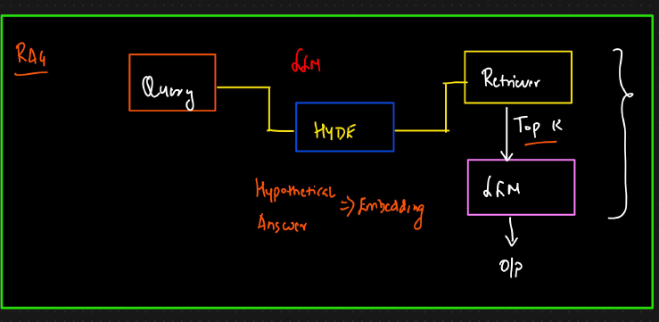

# Query Preprocessing

## Query Enhancement

In a RAG pipeline, the quality of the query sent to the retriever determines how good the retrieved  
context is - and therefore, how accurate the LLM's final answer will be. That's where Query Expansion / Enhancement comes in.

### What is Query Enhancement?

Query enhancement refers to techniques used to improve or reformulate the user query to retrieve  
better, more relevant documents from the knowledge base (vector store/database).

It is especially useful when:  
1. The original query is short, ambiguous, or under-specified  
2. You want to broaden the scope to catch synonyms, related phrases, or spelling variants

### Why Query Expansion Matters in RAG

Query expansion strengthens the retrieval step by increasing recall and semantic coverage, leading to more accurate, grounded, and useful LLM outputs.

Better queries --> Better retrieved chunks --> Better grounded LLM answers

## Query Decomposition

Query decomposition is the process of taking a complex, multi-part question and breaking it into simpler, atomic sub-questions that can each be retrieved and answered individually.

### Why Use Query Decomposition?

· Complex queries often involve multiple concepts  
. LLMs or retrievers may miss parts of the original question  
. It enables multi-hop reasoning (answering in steps)  
. Allows parallelism (especially in multi-agent frameworks)

Disadvantage: A lot of LLM and retrieval calls

## Hypothetical Document Embeddings (HyDE)

### What is HyDe?

HyDE (Hypothetical Document Embeddings) is a retrieval technique where, instead of embedding the user's query directly, you first generate a hypothetical answer (document) to the query using an LLM - and then embed that hypothetical document to search your vector store.

HyDE bridges the gap between user intent and relevant content, especially when:  
1. Queries are short  
2. Language mismatch between query and documents  
3.You want to retrieve based on answer content, not question words
